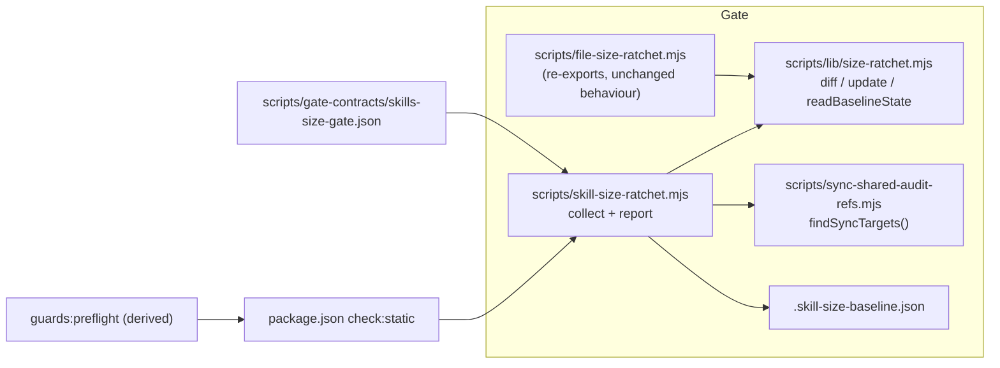

# Plan: Skill markdown size ratchet + fleet coordination.md split
- **Date**: 2026-10-14
- **Status**: Approved
- **Author**: Claude + Louis Strydom
- **Scope**: backend (tooling + skill docs), stack `js-ts`
- **Proposal**: p-20261014065320-db8d (theme skill-context-budget)
- **Depends on**: claude/coordinator-ride-along-1014 (local branch, base of this work: it edits coordination.md rules 14 and 16; merge `origin/main` in once it lands)
- **Target domain(s)**: `scripts`, `shared-lib`, `skills-content`, `tests`
- ⚠ **Cross-domain work**: a gate (scripts + shared-lib + tests) plus a doc restructure (skills-content). The two halves meet only at the baseline file, which is intentional.

## 1. Context Summary

**Problem.** AGENTS.md has a hard character cap (`npm run context:check`,
`ctx/oversized-agents-md`, 92,000 chars). Skills cap only the `description`
(1024 chars) and the reference-index summaries (120 chars,
`scripts/lib/skill-refs-parser.mjs`). The "SKILL.md ≤3K tokens" target in
`docs/reference/skill-reference-format.md` is prose that nothing enforces, so
skill markdown grows by accretion. `skills/fleet/references/coordination.md`
grew twice on 2026-10-14 alone.

**Census**: measured 2026-10-14 at 8561d31f with `wc -c` (bytes = chars here; all files are LF and almost all ASCII).

| Population | Files | Over 12,000 chars (≈3K tokens) | Largest |
|---|---|---|---|
| `skills/*/SKILL.md` | 17 | 13 | `ship` 69,993 · `persona-test` 59,449 · `audit-code` 57,024 · `cycle` 47,804 · `click-test` 45,355 · `plan` 38,602 · `audit-plan` 28,494 · `brainstorm` 23,910 · `ux-lock` 19,723 · `explain` 16,922 · `nav-audit` 16,513 · `fleet` 15,020 · `investigate` 13,631 |
| `skills/*/references/*.md` | 72 (incl. 31 generated shared-ref copies) | 5 authored + 3 shared (copies) | `coordination.md` 27,911 · `dom-scanner.md` 24,975 · `pre-ship-gate-queries.md` 24,046 · `debt-capture.md` 12,634 · `verify-mode-generation.md` 12,289 |
| `docs/audit/shared-references/*.md` (canonical) | 7 | 3 | `verification-discipline.md` 27,739 · `browser-tool-detection.md` 20,195 · `gemini-gate.md` 18,444 |
| `skills/*/examples/*.md` | 8 | 0 | `report-and-debrief.md` 6,661 |

`coordination.md` sections: "Rules for a coordinator" ≈11.9K, "Ending a session"
≈5.8K, "Moving to another Claude Code account (`fleet handover`)" ≈5.4K.

**What the census decides.**
- **No absolute cap is possible.** 13 of 17 SKILL.md files are over the stated target. A hard cap fails on the first push and teaches `--no-verify` (the argument in `scripts/file-size-ratchet.mjs`'s header). The gate must be drift-only with a committed baseline, exactly like `size:ratchet:gate`.
- **The hard ceiling is the limit itself, for files under it.** The 4 SKILL.md files under 12K (`visual-audit` 11,827, `ai-context-management` 10,473, `security-strategy` 9,329, `skills` 6,561) and every reference or example under 12K may not cross 12K. A file over 12K is baselined and may not grow. This is the precedent's own `NEW>LIMIT` rule, and it is the honest version of "optionally a hard ceiling".
- **Shared refs are generated copies.** `skills/*/references/{verification-discipline,gemini-gate,ledger-format,prerequisite-ladder,auth-bootstrap,browser-tool-detection,input-acquisition}.md` are rendered from `docs/audit/shared-references/` by `scripts/sync-shared-audit-refs.mjs`, and their bytes differ slightly from the canonical (link rewriting in `renderForTarget`). Governing the copies would fail one growth ten times over and judge a generated artifact. The gate governs the canonical and skips the copies, identifying them with `findSyncTargets()`, the sync's own oracle, never a second hand-kept list.

**Code Trace** (pinned at 8561d31f):
- `scripts/file-size-ratchet.mjs:58 (8561d31f)` `collectSizes` → `:108` `diffAgainstBaseline` (grew/newOver/shrank/dropped) → `:93` `updatedBaseline` (ratchet-down only) → `:144` `readBaselineState` (absent/invalid/ok) → `main` prints and exits 0/1/2. It writes with `process.stdout.write` and then calls `process.exit`. That is a site `stdout:flush:gate` already holds in its baseline, so a NEW script must use `await finishAndExit(code)` (`scripts/lib/cli-io.mjs`).
- `package.json` `check` → `check:static` → `… && npm run size:ratchet:gate && …`. `scripts/lib/guards-preflight.mjs` `planPreflight` DERIVES its static gates from that chain (`staticGatesFromCheck(expandedCheckScript(...))`), so a gate added to `check:static` joins `npm run guards:preflight` with no edit there. Its test half is the declared `GUARD_TESTS` list.
- `scripts/lib/prepush-archive-lane.mjs` `ARCHIVE_LANE_CHECK_CLASSIFICATION` must hold an entry for every `check` step: `validateClassification` fails on a missing one.
- `scripts/check-gate-contracts.mjs` → `loadCliGateContracts(scripts/gate-contracts/)`. `scripts/gate-contracts/_exemptions.json` says every gate added after 2026-07-31 needs a poison pill (`forbiddenNewExemptions()`), which `scripts/check-gate-poison-pills.mjs` runs in a tmpdir copy of the tracked tree, matching `expectStderr` against stderr+stdout.
- The gate-contract candidate-coverage check (`scripts/lib/gate-honesty/verb-pattern.mjs`) is DIFF-SCOPED to changed `skills/<s>/SKILL.md` lines. Any rewritten fleet SKILL.md line carrying an enforcement verb (`never`, `must`, `refuses`, `block`, …) needs a covering `ignoredCandidates` entry in `skills/fleet/gate-contract.json`. Reference files are not scanned.
- `scripts/sync-shared-audit-refs.mjs:95 (8561d31f)` `findSyncTargets(rootDir)` returns `{canonical, target}` pairs, both on-disk and expected.
- Fleet doc consumers: `tests/skill-command-portability.test.mjs:88 (8561d31f)` allows `scripts/prepush-check.mjs` to be named only in `skills/fleet/references/coordination.md` (rule 8). `tests/fleet-storyline-feedback.test.mjs:179` requires `three-dot` in `skills/fleet/SKILL.md`. `docs/runbooks/consumer-adoption.md:975` cites coordination.md for "directives instead of messages", which stays there. Other repos' coordinators and `skills/fleet/references/participant-rules.md` cite rules by NUMBER.

**Neighbourhood considered** (arch-memory, 2026-10-14): `scripts/file-size-ratchet.mjs` `main` (precedent, above-floor-standout), plus `collectSizes`, `diffAgainstBaseline` and `readBaseline` (review). The other matches were `scripts/lib/claudemd/rules.mjs` `checkSize` (bytes, an advisory `/ai-context-management` lint of a consumer's files at a fixed 3,072 bytes, not a ratchet), `scripts/check-context-drift.mjs` `checkAgentsSize` and `scripts/lib/skill-description-lint.mjs` `checkDescriptionBudget` (all review). **Decision: reuse the precedent's pure decision core, and extract it rather than copy it** (§2). `checkSize` stays as it is: a different consumer (advisory, consumer repos, absolute cap) with a different unit. Its fixed 3,072-byte default would fail 15 of this repo's 17 SKILL.md files, which is the absolute-cap cliff the census rules out.

**Past incidents**: INC-001 (symlink bypass of a lexical classifier). It applies to the walker only as a measurement-honesty point: any symlink in a governed tree is a FAILURE ("cannot measure"), never a silent skip. Nothing leaves the machine.

## 2. Proposed Architecture

**Decisions** (engineering principles from `skills/plan/references/engineering-principles.md`):

1. **Extract, don't copy, the decision core (#1 DRY, #5 single source of truth).** Move `diffAgainstBaseline`, `updatedBaseline` and `readBaselineState` from `scripts/file-size-ratchet.mjs` into `scripts/lib/size-ratchet.mjs`, with unit-neutral wording ("numeric sizes", not "line counts"). `file-size-ratchet.mjs` imports them and re-exports them so `tests/file-size-ratchet.test.mjs` and its behaviour stay byte-for-byte. Two consumers make the extraction a true function of the problem. A copy would let one ratchet's next fix (it has had four: the invalid-vs-absent split, ratchet-down-only updates, …) miss the other.
2. **New CLI `scripts/skill-size-ratchet.mjs`, npm `skills:size:gate`.** The walk differs from the precedent (governed roots, shared-copy exclusion, char unit) and so does the report. Folding both into one script with a mode flag would couple two baselines with different units, which is the over-built variant.
3. **Unit: characters of the LF-canonical decoded text.** `canonicalizeEol(buf).toString('utf8').length`: the same unit as `agentsMdCharCount` (`scripts/lib/claudemd/context-size.mjs`), with the CRLF fold AGENTS.md prescribes for a committed artifact compared across OSes (`.gitattributes` pins `eol=lf`, so the fold is defence, not a fix). The report also prints `≈tokens = ceil(chars/4)`.
4. **Governed population (#4 no hardcoding: roots are constants, copies come from the oracle):**
   - **every `*.md` at any depth under `skills/<skill>/`**: `SKILL.md`, `references/**` and `examples/**`, nested subdirectories included (R1-M1). Flat globs would leave a nested `references/<group>/<topic>.md` as an unmeasured place to move oversized content. None exists today (`find skills -mindepth 4 -name '*.md'` → empty, 2026-10-14), and the recursive walk keeps it that way. Examples are included because they are the same on-demand class; all 8 sit under the limit today, so they cost no baseline entries.
   - `docs/audit/shared-references/**/*.md`, the canonical of the shared refs.
   - EXCLUDED: every `target` path `findSyncTargets()` returns (the generated copies), and `.claude/skills/**`, which is never walked.
5. **Constants.** `LIMIT_CHARS = 12000` (the documented ≤3K-token target at 4 chars/token, one limit for every governed file). `TOLERANCE_CHARS = 200` (about two lines of prose; under it, growth or shrink is noise). They are in the same shape as `LIMIT_LINES`/`TOLERANCE_LINES` and recorded in the baseline file.
6. **Outcomes and exits are identical to the precedent** (#11 testability, #15 error handling): `GREW`/`NEW>LIMIT` fail, `SHRANK`/`DROPPED` fail asking for `--update-baseline`. **`--update-baseline` has exactly three cases, keyed on `readBaselineState`** (R2-H1; this is the precedent's `updatedBaseline(current, prior)` contract, unchanged):
   - **absent** (ENOENT) → **bootstrap**: every currently over-limit file becomes the baseline (`updatedBaseline(current, null)` returns `{...current}`). This is how Phase 2 writes the initial debt ledger, once, from the pre-split tree. It is the only path that admits files.
   - **ok** → ratchet-down only: each entry becomes `min(old, current)`, a file now under the limit leaves, and a new or grown file is NOT admitted (it is printed as "NOT absorbed").
   - **invalid** → refuse, exit 2, file untouched.

   In gate mode (no flag): an absent baseline → exit 2, "run --update-baseline to create it"; an invalid one → exit 2. `--report` exits 0. An unreadable governed root, an unreadable nested directory (other than a nested ENOENT race), or **any symbolic link met by the walk** → throw, exit 1 with the reason: fail closed (#16). That covers a symlinked governed root (`lstat` on each root before reading it), a symlinked skill directory, a symlinked `references/`, `examples/` or nested directory, and a symlinked `.md` (R1-M2). The walk uses `withFileTypes` Dirents and checks `isSymbolicLink()` BEFORE `isDirectory()`/`isFile()`, so a link is never silently skipped (a Dirent link is neither a directory nor a file) and never followed out of the tree. A link is the one entry the gate can neither measure honestly nor ignore. No skill content uses one today, and `scripts/lib/skill-packaging.mjs` allowlists only plain files in a skill directory. Exits go through `finishAndExit`. Flags are checked with `assertKnownFlags`, and the script carries the `--selfcheck-relocation` handler at the head of `main()` and an `isInvokedAsScript` entry guard.
7. **The failure message names the remedy for skill text, not code:** "move detail into `references/<topic>.md` (progressive disclosure, `docs/reference/skill-reference-format.md`), or justify and hand-edit the baseline entry in a reviewed commit."
8. **Wiring.** Add `npm run skills:size:gate` to `check:static` right after `size:ratchet:gate`, which puts it in `guards:preflight` automatically, and add `tests/skill-size-ratchet.test.mjs` to `GUARD_TESTS`. Add a classification entry `'skills:size:gate': S('drift-only ratchet')` and a `.cli-catalog.json` entry. Add a CLI gate contract with a poison pill. Add one AGENTS.md sentence (the contract's `statedIn`) and a `docs/reference/ratchet-gates.md` row and section.

**The coordination.md split (#3 modularity: progressive disclosure, the pattern `skill-reference-format.md` already prescribes).**

| New file | Holds | Approx. |
|---|---|---|
| `skills/fleet/references/coordination.md` (kept; same name, since outside docs cite it) | intro, `fleet next`, directives, unregistered work, addressing a session, **Rules for a coordinator as a terse numbered list 1–16** (one to three lines each, the action and its command, ending "Why and detail: `references/coordination-rationale.md` §N"), the title-hook paragraph condensed, permission prompts | ≈9.5K |
| `skills/fleet/references/coordination-rationale.md` | per rule `## Rule N — <name>`: the mechanics that do not fit a terse line (rule 8's test-tier merge command and source-repo note, rule 10's proposal outcome flags, rule 14's lease file, takeover and `FLEET_MACHINE_DIR`, rule 16's per-route steps and the Claude Code tools), the measurements, the incidents and the title-hook detail | ≈9–10K |
| `skills/fleet/references/ending-a-session.md` | release, archive-check, prune (and its surfaced count), archive, "stop the clutter at the source", and `archiveIgnore` | ≈5.8K |
| `skills/fleet/references/handover.md` | moving to another Claude Code account: prepare, the BEFORE YOU RELAUNCH step, receive, its exit codes, scheduled tasks, claims waiting on the switch | ≈5.4K |

**Split invariants:**
- **Rule numbers 1–16 are stable.** Each terse rule keeps its number and its bold name. The rationale file uses the same numbers, so "rule 14" resolves in both files.
- **Nothing is lost.** Every sentence of the old file lands in exactly one new file, verbatim apart from condensation in the terse list. Every number, date, PR number and command survives in the rationale file. The implementer checks this with a sentence-level diff of old against the union of new before committing (§9).
- **A terse rule may drop rationale, never an action.** If the action needs a command or flag to be done correctly (rule 8's `--match-head-commit`, rule 14's `lease acquire`, rule 10's `fleet propose`), the command stays in the terse line.
- Each new reference gets `summary:` frontmatter that byte-matches its row in `skills/fleet/SKILL.md`'s reference index (≤120 chars), enforced by `npm run skills:check`. coordination.md's own summary changes to drop "release, prune, archive, handover".

**Fleet SKILL.md trim (15,020 → target ≤ 11,500, under the 12K limit, so it is not baselined).** The worktree-preflight block (≈1.6K) is a gated marker and stays.
- Move "Config — optional `.fleet.json`" (≈2.4K) into a new `skills/fleet/references/config.md`, with a one-line pointer and an index row.
- Fold the four landing bullets (pr-mode approve refusals, `ready (stale)`, interrupted `land`, `--serial`/`restack`; ≈1.2K) into one bullet pointing at `references/landing.md`, which already holds that detail (verified: §"Required checks must have RUN", §"`land --approve <train> --serial`"). Anything landing.md lacks moves there verbatim.
- Shorten the removal bullet to the decision rule (the user decides; check the session list; the hooks-path refusal), with the detail in `ending-a-session.md`.
- Point the coordinator bullet and the `archiveIgnore` pointer at the new files.
- Keep `three-dot` (pinned by `tests/fleet-storyline-feedback.test.mjs`).
- **Gate-contract follow-through:** for each rewritten SKILL.md line with an enforcement verb, add an `ignoredCandidates` entry, or carry over the moved line's reason. Drop entries whose line left SKILL.md. `node scripts/check-gate-contracts.mjs` adjudicates.

## 6. Sustainability Notes

- **Assumption: 4 chars/token and one 12K limit.** Both are constants, recorded in the baseline. Changing either is one reviewed edit plus a re-baseline. A per-population limit (references larger than SKILL.md) is the obvious next step if a real need appears. It is not built now because no current requirement distinguishes them (YAGNI).
- **Assumption: the shared-ref copies remain derived.** If `findSyncTargets` gains a new canonical, the gate follows automatically. If a shared ref stops being derived, it becomes a governed `skills/` file and, if over 12K, reads `NEW>LIMIT`. That is loud, so it is acceptable.
- **The baseline is a debt ledger.** after this PR, 12 SKILL.md, 4 references and 3 canonicals stay baselined (19 entries; coordination.md and fleet SKILL.md leave it in Phase 4). Each later trim ratchets down via `--update-baseline`.

### Right-sizing

- **Band-aid:** add a sentence to `skill-reference-format.md` saying "really, ≤3K tokens", and hand-trim coordination.md. That is the state that already failed: prose nobody enforces.
- **Over-engineered:** a token-accurate ratchet (a real tokenizer), per-skill budgets in a config file, per-section caps inside coordination.md, a generic "ratchet framework" with pluggable collectors.
- **Chosen:** one char-unit drift-only ratchet sharing the existing size ratchet's extracted decision core, plus a doc split by section. It serves the current requirement: growth in skill markdown is unenforced, and the one file growing fastest is split.
- **Manual vs scripted:** the split is judgment-heavy prose surgery in 4 files, so it is done by hand. Completeness is verified mechanically by the sentence diff (§9).

## 7. File-Level Plan

| File | Intent | Purpose |
|---|---|---|
| `scripts/lib/size-ratchet.mjs` | create | `diffAgainstBaseline(current, baseline, tolerance)`, `updatedBaseline(current, baseline)`, `readBaselineState(path)`: unit-neutral (#1, #5) |
| `scripts/file-size-ratchet.mjs` | modify | import and re-export the three from the lib; behaviour and output unchanged |
| `scripts/skill-size-ratchet.mjs` | create | CLI: `collectSkillSizes(repoRoot)` (governed roots, shared-copy exclusion via `findSyncTargets`, LF-canonical char count, fail-closed walk), `LIMIT_CHARS`, `TOLERANCE_CHARS`, `DEFAULT_BASELINE`, `main()` with `--report`, `--update-baseline`, `--baseline 
` and `--help`, exits via `finishAndExit` |
| `.skill-size-baseline.json` | create | `{_description, limitChars, toleranceChars, files}`, written by `--update-baseline` after the split |
| `tests/skill-size-ratchet.test.mjs` | create | pure-core reuse, collector (governed roots, copy exclusion, `.claude/skills` never walked, CRLF fold, symlink fails closed, under-limit not baselined), CLI process tests in a tmp repo (grow → 1 with `GREW`, new over limit → 1, shrink → 1, clean → 0, absent → 2, `--report` → 0, `--update-baseline` refuses invalid and never absorbs growth); temp dirs removed with the four-property `fs.rmSync` |
| `tests/file-size-ratchet.test.mjs` | modify (only if needed) | still imports from `scripts/file-size-ratchet.mjs`; no change expected |
| `package.json` | modify | `"skills:size:gate": "node scripts/skill-size-ratchet.mjs"`, added to `check:static` after `size:ratchet:gate` |
| `scripts/.cli-catalog.json` | modify | entry for `skills:size:gate` (category `diagnostic`) |
| `scripts/lib/prepush-archive-lane.mjs` | modify | `'skills:size:gate': S('drift-only ratchet')` |
| `scripts/lib/guards-preflight.mjs` | modify | add `tests/skill-size-ratchet.test.mjs` to `GUARD_TESTS` |
| `scripts/gate-contracts/skills-size-gate.json` | create | executable gate, `statedIn: AGENTS.md`, poison pill that overlays `skills/fleet/references/telemetry.md` (3,418 chars, under the limit, not in the debt ledger) with an oversized fixture; `expectExit: 1`, `expectStderr: "skill markdown may not grow"` (R1-M3) |
| `tests/fixtures/poison/skill-markdown-oversized.md` | create | ≈13,000 chars of filler prose. Overlaid on an under-limit file it reads `NEW>LIMIT`; if that file is ever baselined, it reads `GREW`. Either way the gate prints its shared growth line "skill markdown may not grow". So the pill does NOT depend on any file staying in the debt ledger, which an understated-baseline fixture would: trimming `ship` below 12K would turn its `GREW` into `DROPPED`. |
| `AGENTS.md` | modify | one-sentence rule beside "Oversized files may not grow" (the contract's `stated`) |
| `docs/reference/ratchet-gates.md` | modify | table row + "Skill markdown may not grow" section with the census |
| `docs/reference/skill-reference-format.md` | modify | "target ≤3K tokens" → enforced by `skills:size:gate` (12,000 chars) |
| `skills/fleet/references/coordination.md` | modify | terse rules + retained sections |
| `skills/fleet/references/coordination-rationale.md` | create | per-rule why, measurements, incidents and mechanics |
| `skills/fleet/references/ending-a-session.md` | create | the moved "Ending a session" section |
| `skills/fleet/references/handover.md` | create | the moved handover section |
| `skills/fleet/references/config.md` | create | the moved `.fleet.json` config section |
| `skills/fleet/SKILL.md` | modify | trim, pointers, 4 new index rows (coordination-rationale, ending-a-session, handover, config), updated coordination row |
| `skills/fleet/gate-contract.json` | modify | `ignoredCandidates` for rewritten verb lines |
| `tests/skill-command-portability.test.mjs` | modify | `scripts/prepush-check.mjs` allowlist follows rule 8's command to `skills/fleet/references/coordination-rationale.md` (only if the command moves out of coordination.md) |

### 7b. Implementation Phases

**Phase 1 — Extract the ratchet core**: move the three pure functions into the lib and re-export them. Files: `scripts/lib/size-ratchet.mjs` (create), `scripts/file-size-ratchet.mjs` (modify).

**Phase 2 — The skill-size gate**: CLI, tests, wiring, contract and poison pill, docs, and the initial baseline written from the PRE-split tree. Files: `scripts/skill-size-ratchet.mjs` (create), `tests/skill-size-ratchet.test.mjs` (create), `.skill-size-baseline.json` (create), `package.json` (modify), `scripts/.cli-catalog.json` (modify), `scripts/lib/prepush-archive-lane.mjs` (modify), `scripts/lib/guards-preflight.mjs` (modify), `scripts/gate-contracts/skills-size-gate.json` (create), `tests/fixtures/poison/skill-markdown-oversized.md` (create), `AGENTS.md` (modify), `docs/reference/ratchet-gates.md` (modify), `docs/reference/skill-reference-format.md` (modify).

**Phase 3 — Split coordination.md**: terse rules, plus rationale, ending-a-session and handover. Files: `skills/fleet/references/coordination.md` (modify), `skills/fleet/references/coordination-rationale.md` (create), `skills/fleet/references/ending-a-session.md` (create), `skills/fleet/references/handover.md` (create), `tests/skill-command-portability.test.mjs` (modify).

**Phase 4 — Trim fleet SKILL.md and re-baseline**: config.md, the landing fold, pointers, the index, the gate contract, then `skills:size:gate --update-baseline`. The gate reads `DROPPED` for coordination.md and fleet SKILL.md first: green evidence of the ratchet-down path. Files: `skills/fleet/SKILL.md` (modify), `skills/fleet/references/config.md` (create), `skills/fleet/references/landing.md` (modify, only if a folded bullet's detail is missing there), `skills/fleet/gate-contract.json` (modify), `.skill-size-baseline.json` (modify).

**Close-out (not a phase)**: `npm run skills:regenerate` (regenerates `.claude/skills/fleet/**` and `skills.manifest.json`); `npm run plans:index`; `npm run skills:check`; `npm run docs:synced-links:gate`; `npm run skills:consumer-refs:gate`; `node scripts/check-gate-contracts.mjs`; `npm run gates:poison`; `npm run guards:preflight`; and the red/green demonstration (§9).

## 8. Risk & Trade-off Register

- **Chars ≠ tokens.** ±20% depending on prose and code density. Accepted: the ratchet is about drift, and the unit only has to be stable and cheap. A tokenizer dependency is the over-built cliff.
- **200-char tolerance lets a file creep 199 chars per commit.** The ratchet-down update and the shrink-fails rule bound it the same way `size:ratchet` bounds lines. Measured friction is the precedent's (no `--no-verify` reports in its life).
- **A 19-entry baseline looks like amnesty.** It is a measured debt ledger. Every entry can only go down, and the census is in the plan and `ratchet-gates.md`. Trimming those 12 SKILL.md files is out of scope (one proposal each via `fleet propose`; the theme is `skill-context-budget`).
- **Split loses or misplaces a sentence.** Mitigated by the mechanical sentence diff (§9) and by keeping the rule numbers.
- **Consumers see the split on the next sync.** Their copies of coordination.md and SKILL.md shrink and four new references arrive (coordination-rationale, ending-a-session, handover, config). A consumer holding a diverged local copy is refused by the sync's three-way check (declared divergence), never silently reverted.
- **Ride-along dependency.** This branch is based on `claude/coordinator-ride-along-1014`, so no push happens until the coordinator reports it merged. Then `origin/main` is merged in (not rebased), and any rule 14/16 wording change from that merge is re-applied to both the terse line and the rationale.
- **Deferred:** trimming the other 12 oversized SKILL.md files (proposals); a per-population limit (no requirement yet).

## 9. Testing Strategy

- **Unit (Tier 1, deterministic):** `scripts/lib/size-ratchet.mjs` is still covered by the unchanged `tests/file-size-ratchet.test.mjs` (that is the regression proof of the extraction) plus char-unit cases in the new test.
- **Collector:** a tmp repo containing `skills/a/SKILL.md` (13K), `skills/a/references/r.md` (5K), `skills/a/examples/e.md`, a `docs/audit/shared-references/x.md` with its generated copy at `skills/a/references/x.md`, a `.claude/skills/a/SKILL.md` (20K), a nested `skills/a/references/group/deep.md` (13K) and a CRLF file. Assert: the copy and `.claude/skills` are absent; the nested file IS measured; the CRLF and LF variants measure equal; files under the limit are not in the result. A symlinked `.md`, a symlinked `references/` directory and a symlinked governed root each throw (skipped with a stated reason where the OS refuses to create a link, never silently passed).
- **CLI process (the direction it must NOT fire as well):** clean → 0; growth within tolerance → 0; growth over → 1 with `GREW`; new over limit → 1 `NEW>LIMIT`; shrink → 1 `SHRANK`; drop below limit → 1 `DROPPED`; no baseline → 2; invalid baseline → 2 and `--update-baseline` refuses with the file untouched; `--update-baseline` with NO baseline bootstraps every over-limit file (and only those); with a valid baseline it never raises a mark or admits a new file; `--report` → 0; unknown flag → 2; `--selfcheck-relocation` → `OK`.
- **Poison pill:** `npm run gates:poison` must show the new pill's control run passing (exit 0 on the pristine copy) and its poison run failing with "skill markdown may not grow". The gate prints that phrase for both `GREW` and `NEW>LIMIT`, and a unit test pins that.
- **Red/green on the real tree (evidence for the PR):** append 300 chars to `skills/fleet/references/participant-rules.md` (under the limit, so no effect) and then 6,000 chars (crosses 12K): `skills:size:gate` exits 1 `NEW>LIMIT`. Append 300 chars to `skills/ship/SKILL.md`: exit 1 `GREW`. Revert both: exit 0. Record the outputs in the PR.
- **Split completeness:** a throwaway script (Category A, scratchpad only) that splits old coordination.md and the union of the 4 new files into normalised sentences and lists every old sentence with no exact or condensed counterpart. Every listed sentence is either present (condensed in a terse rule) or deliberately merged, and is named in the PR body.
- **Skill gates:** `npm run skills:check` (summary byte-match, index ↔ files), `docs:synced-links:gate`, `skills:consumer-refs:gate`, `check-gate-contracts.mjs` and `tests/skill-command-portability.test.mjs`, `tests/fleet-storyline-feedback.test.mjs`.
- **Preflight:** `npm run guards:preflight` lists `skills:size:gate` among its static gates and `tests/skill-size-ratchet.test.mjs` among its guard tests.

## 11. Execution Clustering

- **Cluster A** — Phases 1–2 — fix-gate: yes
  - Coupling: the extracted core and the new CLI that consumes it, plus the wiring that makes it a gate. The cross-cutting seam is `scripts/file-size-ratchet.mjs` re-exports ↔ `scripts/lib/size-ratchet.mjs` ↔ `scripts/skill-size-ratchet.mjs`.
  - author-tier: standard
- **Cluster B** — Phases 3–4 — fix-gate: final
  - Coupling: the coordination.md split and the SKILL.md trim share the fleet reference index and its summary byte-match contract, and Phase 4's re-baseline measures Phase 3's output.
  - author-tier: standard
- **Final gate**: consolidated Gemini review over the union diff (A + B).

## Audit trail

- `/audit-plan` 2026-10-14, SID `audit-plan-1791961820365-99512`, GPT auditor, `--mode plan`:
  - R1 NEEDS_REVISION H:0 M:3 L:1, all 4 accepted and fixed (nested markdown walk, fail closed on any symlink, a poison pill independent of the debt ledger, reference counts);
  - R2 H:1, accepted and fixed (the `--update-baseline` bootstrap case);
  - R3 READY_TO_IMPLEMENT H:0 M:0 L:0. Stopped: converged, acceptance 100% every round.
- Gemini final gate, round 1/2: **APPROVE**, gate `approve` (0 blocking, 0 debt).
