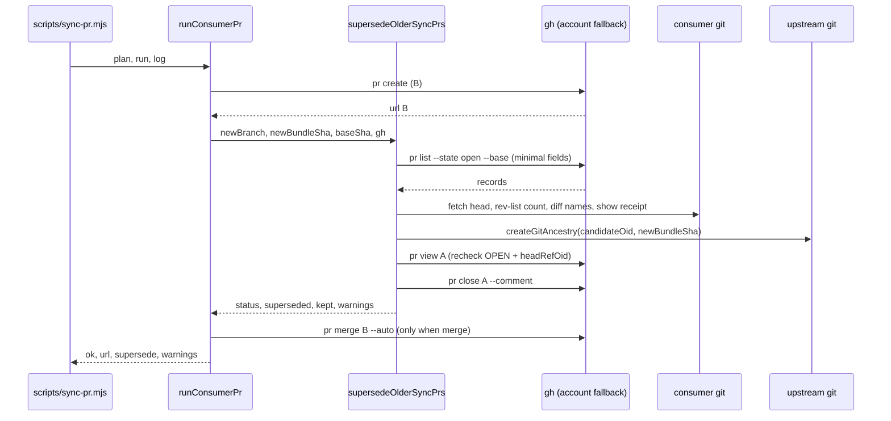

# Plan: sync-pr supersedes an older open sync PR
- **Date**: 2026-10-13
- **Status**: Complete — shipped in #230, #238, #242 (status reconciled against merged PRs 2026-10-25)
- **Author**: Claude + Louis
- **Scope**: backend (js-ts) — one library module + its two test files
- **Target domain(s)**: `shared-lib`, `tests`
- **Upstream report**: `2f933809-3508-4a8f-86af-3a959f84956f` (wine-cellar-app) — "Concurrent sync PRs always conflict on .sync-receipt.json and cannot be hand-merged safely"

## 1. Context Summary

**The defect.** Every sync prepends one entry to `.sync-receipt.json`'s
`recentSyncs`. Two `chore/sync-*` PRs open at once for one consumer both edit
the head of that list, so whichever merges second is DIRTY, and a hand
resolution either drops an event or hand-computes the rotation on the file whose
whole job is to be the trustworthy record.

**What already landed.**
- #230 (`8b16c58b`): the sync branch forks from a freshly fetched
  `origin/<default>`; a stale base whose upstream touched a synced path is
  refused by name (`SKIP_REASON.STALE_BASE_COLLISION`).
- #231 (`fa14585f`): post-merge verification accepts a correct union merge of
  the receipt (`verifyReceiptStructure`).

**Still uncovered.** PR A is opened (sync of bundle `aaaa…`), the consumer's
default branch does not move (wine never auto-merges; its coordinator merges
by hand), a second sync runs and `sync:pr` opens PR B from the same fresh
origin. Both are clean against origin; the second to merge conflicts.

**Code Trace** (pinned to `be057735`):
- CLI loop `scripts/sync-pr.mjs:122` (`be057735`) → `gatherConsumerFacts`
  `scripts/lib/sync-pr.mjs:244` (`be057735`) → `planConsumerPr`
  `scripts/lib/sync-pr.mjs:174` (`be057735`) → `runConsumerPr`
  `scripts/lib/sync-pr.mjs:439` (`be057735`).
- Inside `runConsumerPr`: `switch -c` → `add` → `commit` → `push` →
  `gh pr create` (`scripts/lib/sync-pr.mjs:500`, `be057735`) → optional
  `gh pr merge --auto --squash --delete-branch` → `switchBack`; `finally`
  restores the gh account. Every `gh` call goes through the `gh` closure that
  retries under another signed-in account on a repo-not-visible error
  (`isRepoNotResolvable`, `parseGhAccounts`).
- The CLI prints `result.warnings` and every line passed to `log` — so the new
  behaviour is reportable WITHOUT editing `scripts/sync-pr.mjs` (claimed by
  another session's entry-guard migration; this plan must not touch it).
- Branch prefix is the shared constant `SYNC_BRANCH_PREFIX`
  (`scripts/lib/sync-divergence.mjs:328`, `be057735`), already imported by
  `scripts/lib/sync-pr.mjs`; `branchNameFor(sha)` = prefix + first 8 chars of
  the bundle sha. Commit title is `buildPrText`'s
  `chore(sync): bundle sync from <repo> <short8>`.
- Ownership: `scripts/.sync-owned.json` (`OWNED_SIDECAR_RELATIVE_PATH`,
  `isUsableSidecar`, `isUpstreamOwned` in `scripts/lib/sync-owned-sidecar.mjs`)
  is the committed allowlist of sync-written paths. Measured 2026-10-13 against
  wine-cellar-app's committed sidecar (931 paths): it does NOT list
  `.sync-receipt.json`, `scripts/.sync-owned.json` or `.sync-overrides.json` —
  so the receipt and the sidecar are added explicitly; overrides are not
  (a sync never writes them).

**Neighbourhood considered**: all candidates `review` (below the repo's noise
floor) — `scripts/sync-refresh.mjs` `main`, `scripts/sync-to-repos.mjs` `main`.
Nothing existing closes or lists PRs for a consumer. No past incidents apply
(INC-001 is the sensitive-path symlink class).

## 2. Proposed Architecture

### Options compared (design right-sizing)

| Option | Verdict | Why |
|---|---|---|
| 1. Git merge driver for `.sync-receipt.json` reusing `verifyReceiptStructure` | **Rejected** | GitHub's server-side merge (the merge button, auto-merge) **never runs custom merge drivers** — a driver is configured in `.git/config`, which is not committed and not on GitHub's servers. The PR would still read DIRTY on GitHub; only a local `git merge` would benefit. It also needs per-clone installation in every consumer. Fixes the wrong surface. |
| 3. Regenerate the receipt when the PR's base moves | **Rejected** | Needs a trigger (a watcher or CI job) that does not exist, and rebuilding the receipt outside the sync is the "second implementation of the sync" `scripts/lib/sync-pr.mjs`'s header rule 3 already refuses. |
| 2. **Supersede**: when `sync:pr` opens a PR, close older open `chore/sync-*` PRs for that consumer with a comment naming the successor | **Chosen** | One existing seam (`runConsumerPr`, already holding the gh-with-account-fallback closure); no new artifact, no consumer-side install, no trigger. |

- **Band-aid extreme**: tell the coordinator to close the older PR by hand
  (today's state — #852 sat DIRTY for a day).
- **Over-engineered extreme**: a merge driver + a receipt-rebuilding GitHub
  Action, or a stored producer-provenance record per PR.
- **Chosen**: supersede, guarded so it closes only a PR whose replacement it
  can PROVE from git evidence. Serves the current requirement: two sync PRs
  open at once for one consumer must not leave the later merge DIRTY.

### When the newer PR replaces the older — evidence, not text

Both PRs are built from origin + a full sync of a bundle. The newer one
replaces the older iff every guard below holds. Evidence is read from **git**,
never from PR text (a headline is not provenance). A PR failing any guard is
KEPT (left open) with a warning naming the reason (#13, #16 — fail closed,
never close a PR on a guess).

**Discovery (gh, minimal fields).**
`gh pr list --state open --base <baseBranch> --limit 1000 --json number,url,headRefName,baseRefName,isCrossRepository,headRefOid`.
- Each record is validated locally: `number` a positive safe integer;
  `headRefName` a string matching `^chore/sync-[0-9a-f]{8}$` (the
  `branchNameFor` shape; other heads are ignored, not reported); `baseRefName`
  a string; `isCrossRepository` a boolean; `headRefOid` 40 hex. A sync-shaped
  record failing validation is kept as `invalid-record`.
- The new PR's own branch is excluded.
- Unparseable output → `discovery: 'failed'` (never `[]`: an unread list is
  not an empty one). Exactly 1000 records returned → `discovery: 'incomplete'`
  and a warning — what WAS found is still decided normally (each candidate's
  verdict does not depend on the others).

**Per-candidate evidence (git, in the consumer checkout).**
1. **Head binding** — `git fetch --no-tags origin +refs/heads/<branch>:refs/remotes/origin/<branch>`,
   then the fetched sha must equal `headRefOid`. Mismatch (pushed to since
   listing) or fetch failure → `evidence-unavailable`.
2. **One commit** — `git rev-list --count <baseSha>..<head>` must be `1`, where
   `baseSha` is the freshly fetched base B was built on; a PR whose single
   commit no longer sits on an ancestor of `baseSha` still counts its own
   commits correctly because `rev-list A..B` excludes everything reachable
   from `baseSha`. >1 → `hand-edited`.
3. **Only sync-owned files** — `git diff --name-only --no-renames -z <baseSha>...<head>`
   (three-dot: changes since the merge-base). Every path must be in the
   sync-owned set AS OF THAT PR: `isUpstreamOwned(sidecar, p)` over the
   candidate's OWN sidecar at its head (`git show <head>:scripts/.sync-owned.json`),
   plus `.sync-receipt.json` and `scripts/.sync-owned.json` themselves
   (compared by `comparisonKey`). Its own sidecar, not the new sync's: a file
   the older bundle wrote and the newer one retired is absent from the new
   sidecar, so judging against it would call every such PR `hand-edited`
   during ordinary bundle evolution (final-gate G1). Any other path →
   `hand-edited` (human work outside the synced surface is never closed). The
   set is the UNION of the sidecar at `<head>` and the sidecar at the PR's
   merge-base (`git merge-base <baseSha> <head>`): a file the PR's own sync
   retired is in the diff but no longer in the head sidecar, and the
   merge-base sidecar is what authorised it (final-gate R2 G1). An absent or
   unusable sidecar at the head (`!isUsableSidecar`) → `ownership-unknown`;
   an absent one at the merge-base only narrows the union (a first-ever sync).
   *Within* sync-owned paths the newer sync is authoritative: a synced copy is
   upstream-owned (AGENTS.md: never patch the synced copy), so an edit there is
   exactly what the next sync would overwrite anyway.
4. **Attested bundle provenance** — the candidate's OWN receipt at its fetched
   head: `git show <head>:.sync-receipt.json` → `readSyncReceipt` →
   `latestReceiptEntry` (`scripts/lib/sync-receipt.mjs`). Its
   `source.commitSha` must be a full 40-hex OID that starts with the branch's
   8-char suffix, and its `source.repo` must equal the producing repo
   (`manifest.repo`). Missing, unreadable, or inconsistent → `provenance-mismatch`.
   This is the sync's own record of which bundle the commit carries — the
   branch name is only cross-checked against it, never trusted alone — and it
   means no abbreviation is ever resolved (a ref cannot shadow a full OID).
5. **Strictly older bundle** — through the existing three-valued oracle
   `createGitAncestry(upstreamDir)` (`scripts/lib/sync-rollback-guard.mjs`),
   asked `(candidateOid, newBundleSha)` in the UPSTREAM repo (`upstreamDir` =
   the directory of `scripts/lib/sync-pr.mjs`; git discovers the enclosing
   repo). Equal OIDs → `not-older`. `yes` → older; `no` → `not-older` (warning
   says THIS new PR may be the stale one — a sync from a stale worktree);
   `unknown` (either sha absent here, or git failed) → `bundle-order-unknown`.
   Without this guard, `sync:pr` after a stale-worktree sync would close the
   NEWER PR. Injected as `ancestry` so the fake-runner tests stub it.

`sync:pr` runs only from the upstream repo; anywhere else the shas do not
resolve and guard 5 fails closed.

**Pre-close recheck.** Candidates are handled one at a time (discover once,
then per candidate: evidence → decide → recheck → close). Immediately before
`gh pr close`, `gh pr view <n> --json state,headRefOid` must still read `OPEN`
and the evidenced `headRefOid`; otherwise → `changed-before-close`, kept.
GitHub offers no version-conditional close, so this NARROWS the window between
evidence and mutation to one round trip; it does not eliminate it. The bound
on the residual case is the reversibility above: a reopenable closed PR with
its branch intact.

The decision is a PURE function of the validated record + its evidence object
(`decideSupersession`), so every keep-reason is unit-testable without git.

### Ordering and failure semantics (Phase 1.5)

Dependency chain: **create B → supersede (discover → evidence → close each) →
arm auto-merge on B**.

- Supersession runs only AFTER `gh pr create` succeeded, so a consumer is never
  left with zero open sync PRs. It runs BEFORE arming B's auto-merge so the
  window in which A could still land is as short as possible.
- Discovery is one snapshot; each candidate is then evidenced, decided,
  rechecked and closed before the next (keeps evidence→close short).
- Supersession never fails the run: a discovery failure, an evidence failure,
  or a failed `gh pr close` becomes a warning (B is open and correct). Its
  status is reported separately from creation: `supersede.status` ∈
  `none` (no older sync PR open) · `complete` · `partial` (a close failed, or a
  candidate was kept) · `incomplete-discovery` · `failed` (discovery failed).
  Each failed close's warning prints the exact `gh pr close <n> --comment …`
  command to run by hand.
- **Nothing is merged and no auto-merge is armed on A.** Closing a PR disables
  any auto-merge armed on it. `--no-merge` is still respected —
  wine-cellar-app's "coordinator merges" policy is untouched. **B's auto-merge
  is WITHHELD** (`merged: 'not-armed'` plus a named warning) unless
  supersession is `none` or `complete` (code audit R1 H5): arming it while
  another sync PR may still be open recreates the receipt conflict, and when
  that PR is NEWER it lands a stale sync over it.
- **The successor is confirmed OPEN** (`gh pr view <B url>`) before the first
  close (code audit R1 H2), and the pre-close re-read of each candidate
  re-applies `decideSupersession` to its fresh base, head and fork flag
  (code audit R1 H3).
- **A's remote branch is LEFT in place** (`gh pr close` without
  `--delete-branch`). Reasons: (a) a closed PR whose branch still exists can be
  reopened, so the action is reversible; (b) deleting a branch is a
  destructive act each consumer's own policy owns; (c) the leftover ref is
  inert — `findUnabsorbedSyncBase` matches a sync ref's tip only against the
  CURRENT manifest base, which is B's bytes, and `branchExists` only blocks a
  re-sync of A's exact sha.
- Close comment (body on stdin via `--comment` arg is short, fixed text with no
  user content): `Superseded by <B url> — a newer bundle sync built from the
  current <base>. Closed by npm run sync:pr; the branch is kept, so this PR can
  be reopened.`
- Residual race (named, not fixed): if A merges between B's base fetch and the
  close, B is DIRTY. That is the #230 window, seconds wide, and on wine A's
  merge is a human act.

### Design decisions → principles

- Pure `parseOpenSyncPrs` (validation) + pure `decideSupersession`; impure
  evidence collection isolated in `collectSupersedeEvidence`; the whole step
  exported as `supersedeOlderSyncPrs` so a retry path can call it without
  re-creating B (#2 SRP, #11 testability, #18 extensibility).
- All gh calls reuse the existing `gh` closure — the work-account fallback
  comes for free, never a second implementation (#1 DRY, #5 SSoT).
- Prefix from `SYNC_BRANCH_PREFIX`, branch shape from `branchNameFor`,
  ownership from `sync-owned-sidecar.mjs`'s `isUpstreamOwned` /
  `comparisonKey` — no re-spelled rules (#4, #5).
- Every kept candidate is reported with a reason enum (#19 observability);
  every failure degrades to a warning (#16).

## 6. Sustainability Notes

- Assumes one sync PR per bundle sha (`branchNameFor`) and one commit per sync
  PR. If either changes, guards 2/3 keep PRs open (fail-closed) rather than
  closing wrongly — the safe direction.
- `--dry-run` does not preview supersession, and a re-run that skips with
  `BRANCH_EXISTS` does not retry a failed supersession: both paths live in
  `scripts/sync-pr.mjs`, which this change may not touch. See Out of Scope.

## 7. File-Level Plan

- `scripts/lib/sync-pr.mjs` (modify)
  - `SUPERSEDE_KEEP_REASON` — frozen enum: `invalid-record`, `not-ours`,
    `evidence-unavailable`, `hand-edited`, `ownership-unknown`,
    `provenance-mismatch`, `not-older`, `bundle-order-unknown`,
    `changed-before-close`, `close-failed`.
  - `parseOpenSyncPrs(text, {excludeBranch})` — PURE. → `{records, invalid, full}`
    or `null` on unparseable output.
  - `decideSupersession(record, evidence)` — PURE. → `{supersede: true}` or
    `{supersede: false, reason}`.
  - `collectSupersedeEvidence(run, {repoRoot, record, baseSha, repo, ancestry, newBundleSha})`
    — impure, every git call through `run` (ancestry through the injected
    oracle); returns the evidence object, never throws.
  - `supersedeOlderSyncPrs({gh, run, ancestry, repoRoot, repo, baseBranch, baseSha, newBranch, newBundleSha, newUrl, log})`
    — orchestrates discover → evidence → decide → close; returns
    `{status, superseded:[{number,url,branch}], kept:[{number,url,branch,reason,detail}], warnings}`.
  - `runConsumerPr` — calls it after `gh pr create`, before `gh pr merge`; adds
    `supersede` to the ok result and appends its warnings. New optional input
    `ancestry` (default `createGitAncestry(<this module's directory>)`).
  - `planConsumerPr` — adds `bundleSha` (the manifest `commitSha`) and `repo`
    to the `pr` plan so `runConsumerPr` needs no new CLI input.
  - Header: add rule 4 (supersede, its guards, why options 1 and 3 lost).
- `tests/sync-pr.test.mjs` (modify) — pure parser/decision table and the
  fake-runner sequence (see §9).
- `tests/sync-pr-git.test.mjs` (modify) — real git with a scripted gh (see §9).

`scripts/sync-pr.mjs` is NOT modified (claimed by another session).

## 8. Risk & Trade-off Register

- **Closing a PR is outward-facing.** Mitigated by git-evidenced guards and by
  leaving the branch: the worst case is a reopenable closed PR.
- **Network cost**: one list call + one fetch per sync-shaped candidate;
  consumers have a handful.
- **Residual race** (above) — named, not fixed.

## 9. Testing Strategy

Red-then-green in the same commit (AGENTS.md Tier 3(b), consumer sync
contract): write the tests first, observe them fail against `be057735`'s
`runConsumerPr`, then implement. Single test files only
(`node --test tests/sync-pr.test.mjs tests/sync-pr-git.test.mjs`); fixture
cleanup via `rmrfBestEffort` (rmsync-retry guard).

- Pure: `parseOpenSyncPrs` — non-JSON → null; non-array → null; a record with a
  string `number`, a bad `headRefOid`, a non-boolean `isCrossRepository` →
  `invalid`; non-sync heads ignored; own branch excluded; `full` at the limit.
  `decideSupersession` — one row per keep reason + the supersede row.
- Fake runner: the sequence `pr create → pr list → pr close → pr merge`; close
  never carries `--delete-branch`; no `gh pr merge` ever names A; list failure
  → warning, still `ok`, `status:'failed'`; close failure → `partial` +
  the manual command in the warning; `--no-merge` still opens + supersedes and
  never merges.
- Real git (bare origin, consumer clone, an upstream fixture repo with two
  bundle commits, scripted gh): an open older sync PR whose branch holds one
  sync-owned commit is closed with a comment naming B; none open → nothing
  closed, `status:'none'`; a NEWER open sync PR is kept `not-older`; a PR with a
  hand-edited non-owned file is kept `hand-edited`; a PR with two commits is
  kept `hand-edited`; an old-named branch whose receipt names a different
  bundle is kept `provenance-mismatch`. A head that moved between evidence and
  close (`changed-before-close`) is a gh-side race, pinned in the fake-runner
  tests rather than on real git.

## Audit trail

- R1 (GPT): H1 M3 — 4/4 accepted (git-evidenced guards, discovery
  completeness, exported supersession step, validated records + tri-state
  ancestry).
- R2 (GPT): H1 M2 — 3/3 accepted (receipt-attested provenance, no
  abbreviation resolution, per-candidate pre-close recheck with the residual
  window named). **Stopped after R2**: acceptance stayed high, but R2's
  findings are adversarial-actor edge cases (an amended branch carrying a
  different bundle; a ref named like a short sha; a push in the seconds before
  close) — the rigor-pressure character, and each is now closed or bounded by
  the reopenable-close property. Remaining verification belongs to the code
  audit against real code.

## Out of Scope (Future)

- **Retry wiring for a failed supersession** (audit R1 M2): a same-bundle
  re-run skips at `BRANCH_EXISTS` in `scripts/sync-pr.mjs` before
  `runConsumerPr`, so retrying needs a CLI change; that file is held by
  another session's entry-guard migration. Independence: supersession's
  correctness does not depend on it — a failure leaves exactly today's state
  plus a warning with the exact close command, and the next newer sync
  re-supersedes every older open sync PR. `supersedeOlderSyncPrs` is exported
  so the wiring is a call, not a rewrite.
  **Done (follow-up branch `claude/sync-pr-supersede-retry`):** whenever a
  run opens no PR while the current bundle's sync branch exists
  (`supersessionRetryTarget`: the `BRANCH_EXISTS` re-run after a fresh sync,
  and the bare `sync:pr` re-run that skips at `CLEAN` because the first run
  committed the synced files; code audit R1 M2), the CLI calls
  `retrySupersession`, which resolves the
  branch's existing PR (`gh pr view <branch>`, through the same account
  fallback, now one `createGhWithAccountFallback` shared with
  `runConsumerPr`) and, only when it is OPEN on this base, runs
  `supersedeOlderSyncPrs` against the freshly fetched origin sha. It creates
  no commit, branch or PR and never arms auto-merge; `--dry-run` asks gh
  nothing. Limit: it does not close the residual race above — if the older
  PR merged before the close, there is nothing open to supersede and the
  existing PR stays DIRTY on the receipt (fleet proposal
  p-20261013191133-2c93).
  Retry audit (`--scope diff`): R1 H0 M5. Fixed: M2 (a bare re-run on a
  clean tree never retried; now `supersessionRetryTarget`). Dismissed in
  deliberation (GPT overruled its own findings): M1/M3 stdout routing (no
  machine stdout contract in this CLI), M4 exit code (the plan's
  "supersession never fails the run" contract, shared with the creating
  path), M5 adjacency bound. R2 PASS. R3 (all passes, full feature diff) H1:
  the retry trusted a remote PR as successor; fixed by proving its fetched
  head and its own receipt attest this bundle (`successor-unverified`).
  R4 and R5 PASS, H0 M0 L0, file coverage complete. **Converged.** Final
  gate R1 (Gemini): **APPROVE**, 0 blocking, 0 debt. Each fix's test was
  watched red with the fix reverted.
- **Dry-run preview** of what would be superseded — same file, same reason.
- Final gate R1 (Gemini): G1 HIGH accepted — guard 3 judged the older PR
  against the NEW sidecar, which would keep every PR whose bundle a newer one
  retired a file from; it now reads the candidate's own sidecar at its head.
- Final gate R2 (Gemini): G1 HIGH accepted — a file the PR's own sync retired
  is in its diff but not in its head sidecar; the ownership set is now the
  union of the head and merge-base sidecars. **Gemini cap reached (2/2).** The
  round-2 finding was a concrete design defect, fixed here as the reviewer
  recommended; no third round exists, so it is escalated to the user in the
  final report and verified by the code audit against real code.
- Code audit R1 (GPT): H5 M3. Fixed: the merge-base sidecar authorises
  deletions only (H1, compromised to MEDIUM), the successor is confirmed open
  (H2), the pre-close re-read re-applies the decision (H3), auto-merge is
  withheld while supersession is unsettled (H5), and the close comment is
  policy-based (M1, LOW). Dismissed in deliberation: byte-reproducing the
  older sync (H4). Deferred as blocked-by: the retry path (M2, see Out of
  Scope). M3 is an adjacency-wave coverage bound.
- Code audit R2 (backend + sustainability over the R1 fix diff): PASS, H0 M0
  L0. R3 (all passes and waves over the full feature diff, file coverage
  complete): PASS, H0 M0 L0. **Converged: 2 stable clean rounds.** Census:
  structure, wiring, backend, sustainability, quickfix, duplication,
  adjacency, orphan-introduced and event-wiring-symmetry completed; frontend
  ineligible (0 frontend files).
- Code final gate R1 (Gemini): **APPROVE**, gate approve, 0 blocking, 0 debt.
