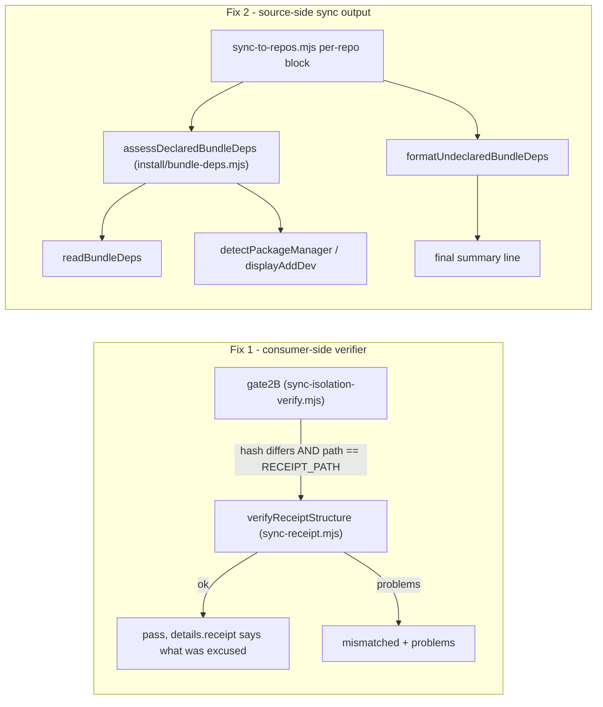

# Plan: Sync contract — structural receipt check (gate 2B) + undeclared required-dep warning
- **Date**: 2026-10-13
- **Status**: In Progress
- **Author**: Claude + Louis
- **Scope**: backend
- **Target domain(s)**: `install`, `shared-lib`
- ⚠ **Cross-domain work** — touches `install` (bundle-deps reader) and `shared-lib` (receipt + verifier); the two fixes are independent and never call each other.

Two defects in the consumer sync contract (AGENTS.md testing doctrine **Tier 3**:
a break ships silently to repos we cannot observe), shipped together because both
are "the sync's own record/report says the wrong thing to the consumer".

## 1. Context Summary

Detected stack: `js-ts`, ESM. Scope: backend (CLI + library; no UI).

### Fix 1 — gate 2B hash-pins an append-only ledger (upstream `fc843d6b-4f1a-49f5-ad11-4b9db5725086`, filed by wine-cellar-app)

`.sync-receipt.json` is, by its own design, an append-only, newest-first,
bounded LIST (`scripts/lib/sync-receipt.mjs` header, v2, upstream `1fb43574`):
a second session's sync PREPENDS rather than overwrites, and the file is
committed by a human at an unbounded later time. Two concurrent sync PRs
therefore both modify it, and the correct conflict resolution is a **union
merge** of both sides' `recentSyncs` — which produces bytes that no single sync
ever wrote.

Gate 2B, meanwhile, verifies every manifest entry by sha256, and the sync
records the receipt's own hash into the manifest after writing it
(`patchManifestWithExtraHashes(..., { rel: RECEIPT_PATH, ... })`,
`scripts/sync-to-repos.mjs:2466` (83fc038a)). So any legitimate union merge
fails 2B. Measured by the reporter: sync-pr wrote `a91db4db` in wine commit
`5e7a8c2a4`; wine-cellar-app#893's union merge is `5cc59832` (both sides'
`recentSyncs`, newest first, capped at 10, `olderSyncsDropped` counted); gate 2B
failed on exactly that one entry while every other gate passed.

Re-pinning the hash to the merged file is wrong: the manifest is gitignored and
per-checkout, and the next merge would break it again. The receipt has a
**structure** that is the actual contract; verify that.

### Fix 2 — a newly REQUIRED bundle dependency lands silently

`scripts/lib/bundle-deps.json` (Category B, generated) declares `picomatch` as
`required: true` (importer `lib/glob.mjs`, since #186). Nothing at sync time
told storyline, two of its chips crashed on `Cannot find package 'picomatch'`,
and the package was hand-installed into storyline's main checkout.

Why both existing probes stayed green:
- `ensureAuditDeps` (`scripts/lib/install/deps.mjs:358` (83fc038a)), run after
  every sync, asks `findMissingDeps` whether `node_modules/<dep>/package.json`
  exists — **presence**, not declaration. A transitively hoisted or
  hand-installed copy satisfies it, so nothing is installed and nothing is
  declared.
- check-setup's `checkBundleDependencies` (`scripts/lib/install/bundle-deps.mjs:90`
  (83fc038a)) asks `createRequire().resolve()` — **resolvability**, same blind spot.

Neither asks the durable question: *does the consumer's committed
`package.json` declare it?* Under pnpm (storyline: `packageManager:
pnpm@11.21.0`) an undeclared root `node_modules/<pkg>` is pruned on the next
`pnpm install`, so a hand-install fixes the crash only until then.

**Measured 2026-10-13** (read-only, `package.json` of each consumer against
`scripts/lib/bundle-deps.json` required set):

| Consumer | Required packages NOT declared |
|---|---|
| storyline | `picomatch` (present today only as a hand-installed symlink, `node_modules/picomatch -> .pnpm/picomatch@4.0.7/...`, created 2026-10-12 16:12) |
| wine-cellar-app | `picomatch` |
| ai-organiser | `@babel/parser`, `minimatch`, `picomatch`, `yaml` |

All three work today by resolution, so all three are one dependency upgrade (or
one `pnpm install`) from the storyline crash.

### Code Trace (pinned to 83fc038a)

- Receipt write: `scripts/sync-to-repos.mjs:2420` (`buildReceiptEntry`) →
  `:2450` (`receiptShouldWrite`) → `:2451` (`appendReceiptEntry`) → `:2452` atomic
  write → `:2466` manifest gets the receipt's hash.
- Receipt shape: `scripts/lib/sync-receipt.mjs` — `RECEIPT_VERSION = 2`,
  `RECEIPT_HISTORY_LIMIT = 10`, `looksLikeEntry`, `readSyncReceipt`,
  `appendReceiptEntry` (writes `{version, _note, olderSyncsDropped, recentSyncs}`).
- Entry 0's source sha and the manifest's `commitSha` come from the SAME
  `sourceGitMeta` (`scripts/sync-to-repos.mjs:1349`, used at `:2255` for the
  manifest and `:2429` for the receipt) — so "entry 0 is this sync" is a
  comparison of two values the sync derived from one source.
- Gate 2B: `scripts/lib/sync-isolation-verify.mjs:327-410` — iterates
  `manifest.files`, skips the manifest self-entry, `hashFile` vs expected,
  override → `held`, else `mismatched`. Text output `formatText` (`:961`) prints
  `held` on a pass.
- Dep flow: `scripts/sync-to-repos.mjs:2505` `ensureAuditDeps(repo.path)` →
  `:2516` spawns `check-setup.mjs --repo-path` → `checkBundleDependencies` →
  `readBundleDeps(scriptsDir)` (`scripts/lib/install/bundle-deps.mjs:41`).
- Every consumer gets every bundle (`bundleForRepo()` takes no per-repo
  argument, `scripts/sync-to-repos.mjs:849`), so the required set is the same
  for every target — no per-consumer filtering is needed.

### Neighbourhood considered

- `readSyncReceipt` (`scripts/lib/sync-receipt.mjs`, `precedent`,
  above-floor-cluster) — the new verifier sits **beside** it and reuses its
  `looksLikeEntry` predicate. It does not extend `readSyncReceipt`: that reader
  is deliberately *lenient* (filters malformed entries, normalises v1) because
  the writer must never clobber history; a verifier must be *strict*. Two
  intents, two functions, one shared entry predicate.
- `checkBundleDependencies` (`scripts/lib/install/bundle-deps.mjs`, `review`) —
  the new assessor lives in the same module and reuses `readBundleDeps` and
  `detectPackageManager`/`displayAddDev`; no second bundle-deps reader.
- Security incident neighbourhood: INC-001 (symlink sensitive-path bypass) —
  not applicable; nothing here reads a path outside the consumer root or sends
  bytes to an LLM.

## 2. Proposed Architecture



### Fix 1 design

New PURE export in `scripts/lib/sync-receipt.mjs`:

```js
verifyReceiptStructure(raw, expectedCommitSha, { limit = RECEIPT_HISTORY_LIMIT } = {})
  → { ok: boolean, problems: string[], entries: number }
```

Rules (every violated rule is listed, not just the first — #15):
1. `raw` is a plain object with `version === RECEIPT_VERSION`. A FUTURE version
   is reported as such (this bundle cannot judge it), never as corruption.
2. `recentSyncs` is a non-empty array of length `<= limit`.
3. `olderSyncsDropped` is a non-negative integer.
4. Every entry passes `looksLikeEntry` AND has a parseable `syncedAt` AND a
   `source.commitSha` that is a string or null.
5. **Entry 0's `source.commitSha === expectedCommitSha`** — the newest record is
   the sync that produced this checkout's tooling.
6. Newest-first: `Date.parse(syncedAt)` is non-increasing.
7. De-duplicated: no two entries share the key `syncedAt + '\0' + commitSha`
   (a union merge that kept the common ancestor's entries twice).

"Subset of the union of both histories" is not checkable without git history,
and is not attempted: the structural rules are what a correct merge guarantees
and what an incorrect one (dropped head, duplicated ancestor, unsorted,
over-cap, hand-mangled) violates.

Gate 2B change, inside the existing loop, AFTER `if (actual === expected) continue;`
— the fast path is untouched, so a receipt the sync wrote and nobody merged
verifies exactly as before:

- If `destRel === RECEIPT_PATH` **and** `manifest.commitSha` is a non-empty
  string: parse the file (parse failure is a problem, not a throw) and run
  `verifyReceiptStructure`. `ok` → record `details.receipt = { verified:
  'structural', entries, entry0: <sha8> }` and continue. Not ok → the
  structural check is an ADDITIONAL acceptance path, not a replacement: the
  path falls through to the existing held-vs-mismatched override decision
  unchanged, and if it lands in `mismatched` the entry carries the structural
  `problems` so the failure says why the receipt was rejected (audit-plan R1 M2).
- `manifest.commitSha === null` → no way to attest entry 0, so the old hash
  verdict stands (an unknown is not a yes; this preserves today's strictness in
  the one case the structural check cannot decide).
- `formatText` prints `details.receipt` on a pass (one line) so the default
  text output says what it excused, matching the `held` precedent at
  `scripts/lib/sync-isolation-verify.mjs:967` (83fc038a).

**Does NOT re-pin the hash** and does not touch the writer — the manifest still
records the sync's own bytes, which remains the fast path.

### Fix 2 design

New exports in `scripts/lib/install/bundle-deps.mjs` (the module that already
owns `readBundleDeps` — single bundle-deps reader, #5):

```js
assessDeclaredBundleDeps(repoRoot, scriptsDir, { readCommitted } = {})
  → { measured: true, required: number,
      undeclared:   [{name, importer}],   // in no durable section, working tree or HEAD
      optionalOnly: [{name, importer}],   // only in optionalDependencies
      uncommitted:  [{name, importer}],   // declared in the working tree, not in HEAD:package.json
      committedKnown: boolean,            // false = HEAD unreadable (no git / no commit) — said, never assumed
      command: string|null, pmNote: string|null }
  | { measured: false, reason: string }

formatUndeclaredBundleDeps(result, { Y, D, X }) → { lines: string[], summary: string|null }
```

- **Declared** = key present in `dependencies` or `devDependencies` of the
  consumer's root `package.json`. Two weaker states are reported DISTINCTLY,
  never as clean:
  - **optional-only** (audit-plan R1 M4): `optionalDependencies` tolerates
    omission and install failure, which contradicts `required: true`. Named with
    "declared only as optional — move it to devDependencies".
  - **uncommitted** (audit-plan R1 M1): the durable question is the COMMITTED
    manifest. `ensureAuditDeps` may `--save-dev` a package during this very
    sync, which lands in the working tree only. The assessor also reads
    `HEAD:package.json` (`git show`, injected as `readCommitted` for tests); a
    package declared in the working tree but not in HEAD is "pending — commit
    package.json and the lockfile". When HEAD cannot be read (not a repo, no
    commit yet) `committedKnown:false` is printed as such; the working-tree
    verdict still stands, but the line never claims the declaration is durable.
  `peerDependencies` does not count: a peer entry states a requirement on a HOST
  package, not that this repo installs it, and whether a manager auto-installs
  peers is a per-manager, per-version setting — not something to rely on.
- **Exhaustive state table** (audit-plan R2 M1). The WORKING-TREE manifest
  decides the install obligation (it is what the next install reads); HEAD is
  only durability evidence. Per required package, first matching row wins:

  | Working tree | HEAD | Bucket |
  |---|---|---|
  | in deps/devDeps | in deps/devDeps | clean |
  | in deps/devDeps | absent, optional-only, or unreadable-HEAD | `uncommitted` (HEAD unreadable → `committedKnown:false`, still not "durable") |
  | optional-only | any | `optionalOnly` |
  | absent | any (incl. declared in HEAD — a pending removal) | `undeclared` |

  So a package declared in HEAD but removed in the working tree is NOT clean,
  and the working tree's optional-only state outranks a HEAD declaration.
- **The committed read targets the consumer, never the ambient repo** (audit-plan
  R2 M2). The sync runs inside this repo's pre-push hook, where git exports
  `GIT_DIR`/`GIT_WORK_TREE` that override `cwd`. The sync already strips them at
  its process boundary (`scrubAmbientGitEnv`, `scripts/sync-to-repos.mjs:1258`
  (83fc038a)), but this helper ships to consumers and may be called elsewhere,
  so the production `readCommitted` runs `git show HEAD:./package.json` (the `./` makes git resolve the path relative to `cwd`, not the repository top level — a consumer that is a sub-package of a larger repo must read ITS manifest; Gemini plan-gate G1) with
  `cwd: repoRoot` AND `env: sanitizeGitEnv(repoRoot)` from
  `scripts/lib/git-env-sanitize.mjs` (the existing shared sanitiser — no new
  one). Any failure → `committedKnown:false`; it never falls back to another
  repo's data. Tested with a real two-repo fixture: `GIT_DIR` pointed at repo A
  while reading repo B must return repo B's HEAD manifest.
- **Unmeasurable states say so** (consumer shape 7; never a silent zero):
  no `package.json`, unparseable `package.json`, `bundle-deps.json` unreadable →
  `measured:false` with a reason, printed as a yellow "could not check" line and
  carried into the summary.
- **Remedy command**: `displayAddDev(pm.name, names, repoRoot)` from the
  package-manager oracle. When the manager is `ambiguous` or its declaration is
  `invalidDeclaration`, NO command is printed (never guessed) — the line names
  the candidates and says to declare them with the repo's own manager.
- Measured-and-clean prints one dim confirmation line (positive control in the
  output; quiet enough not to add noise).
- Called from the per-repo block in `scripts/sync-to-repos.mjs` **after**
  `ensureAuditDeps` (an install it performs may itself `--save-dev` declare a
  package, so the check reports the post-sync state), in dry-run as well (it is
  read-only). Each non-clean repo contributes one line to a final summary block
  printed after `Targets: … reached` — the per-repo output is long and the sync
  usually runs inside a pre-push hook log, so the summary is where it is seen.

### Warn, not refuse — decision and why

**Loud warning; exit code unchanged.**
1. **Measured blast radius.** All three registered consumers currently lack a
   required declaration and all three work today. A refusal would block the
   next sync to every consumer — including fixes — over a condition that is a
   latent risk, not a current break. A gate that fires on every healthy
   consumer is the cried-wolf shape that gets bypassed.
2. **The remedy is consumer-owned.** Declaring a dependency edits the
   consumer's `package.json` and lockfile with the consumer's own manager. The
   sync must not make that edit (and this change does not add an install); a
   refusal would not make the edit happen, only withhold delivery.
3. **Timing.** The check can only be meaningful after the files are written
   (that is when the new importer lands). A refusal at that point cannot
   un-deliver; a refusal before copying would leave the consumer on the OLD
   bundle — the stale state the rollback guard exists to prevent.
4. **This repo's own pre-push hook runs the sync.** A non-zero exit would turn a
   consumer's `package.json` into a push blocker for this repo.

The warning is made hard to miss instead: named packages, the importer that
needs each, the exact command for the consumer's manager, and a final-summary
line per affected consumer.

### Principles cited

#1 DRY (one bundle-deps reader, one entry predicate), #5 Single Source of Truth
(required set from `bundle-deps.json`; manager from `package-manager.mjs`),
#11 Testability (both deciders pure, I/O at the edge), #15 Error Handling (all
problems listed; parse failure is a finding, not a throw), #16 Graceful
Degradation (`measured:false` instead of a fake zero; null `commitSha` keeps the
hash verdict), #18 Backward Compatibility (hash-match fast path unchanged; exit
code unchanged), #19 Observability (pass says what it excused; summary line).

## 6. Sustainability Notes

- If `RECEIPT_VERSION` bumps, `verifyReceiptStructure` keys on the same
  constants and reports a newer version as "cannot judge", never as corrupt.
- If a future bundle becomes per-consumer, `assessDeclaredBundleDeps` is the one
  place to filter by delivered importers (`importers` are already in the data).
- Out of scope, named: `ensureAuditDeps` still installs by presence; making it
  declare present-but-undeclared packages would edit three consumers'
  `package.json` on the next sync and is a separate decision. check-setup /
  doctor could also surface the declaration gap consumer-side via the same
  assessor — a one-line follow-up, deliberately not bundled here.

## 7. File-Level Plan

- `scripts/lib/sync-receipt.mjs` (modify) — add `verifyReceiptStructure`. Pure; no new imports.
- `scripts/lib/sync-isolation-verify.mjs` (modify) — gate 2B receipt branch + `formatText` line; import `RECEIPT_PATH`, `verifyReceiptStructure`. **Size-ratcheted (baseline 1032, tolerance 10)**: net growth ≤ 10.
- `scripts/lib/install/bundle-deps.mjs` (modify) — add `assessDeclaredBundleDeps`, `formatUndeclaredBundleDeps`, and `reportDeclaredBundleDeps(repoRoot, scriptsDir, colors)` (assess + format, the one entry point the sync calls). All decision and wording logic lives here.
- `scripts/sync-to-repos.mjs` (modify) — call sites only: one import, one `reportDeclaredBundleDeps` call after `ensureAuditDeps` printing its lines, one summary accumulator, one summary print. **Size-ratcheted (baseline 2709, now 2714, tolerance 10)**: ≤ 5 lines of growth, met by keeping every responsibility in the helper module — no comment condensing, no upward re-baseline (audit-plan R1 M5).
- Gate 2B similarly takes only the receipt branch + one `formatText` line; the rules live in `verifyReceiptStructure`.
- `tests/sync-isolation-receipt-structural.test.mjs` (create) — gate 2B against fixture consumer dirs.
- `tests/bundle-deps-undeclared.test.mjs` (create) — assessor + formatter units against fixture consumer dirs.
- `tests/sync-consumer-divergence-e2e.test.mjs` (modify) — one assertion on the real sync's output for its existing fixture (deps seeded in `node_modules`, none declared — exactly storyline's shape).

`sync-receipt.mjs` and `install/bundle-deps.mjs` already ship to consumers (both
present under storyline's `scripts/.claude-skills/lib/`), and neither gains an
npm import, so `scripts/lib/bundle-deps.json` does not change.

### 7b. Implementation Phases

**Phase 1 — Structural receipt verification**: pure verifier + gate 2B branch + tests. Files: `scripts/lib/sync-receipt.mjs` (modify), `scripts/lib/sync-isolation-verify.mjs` (modify), `tests/sync-isolation-receipt-structural.test.mjs` (create)

**Phase 2 — Undeclared required-dep warning**: assessor/formatter + sync wiring + tests. Files: `scripts/lib/install/bundle-deps.mjs` (modify), `scripts/sync-to-repos.mjs` (modify), `tests/bundle-deps-undeclared.test.mjs` (create), `tests/sync-consumer-divergence-e2e.test.mjs` (modify)

**Close-out (not a phase)**: `npm run size:ratchet:gate`; `node scripts/generate-bundle-deps.mjs --check`; `npm run skills:check`.

## 8. Risk & Trade-off Register

- **Entry-0 strictness**: a receipt whose newest entry is a sync this checkout
  never received (another branch synced later, merged in) fails 2B. Intended:
  the on-disk tooling is then older than the newest recorded sync, and the
  remedy (re-sync) is the right one. The failure message says so.
- **Same-commit older entry at head** (two syncs from one commit, merge dropped
  the newer) passes — the bytes are identical for one source commit, so nothing
  real is hidden.
- **Warning fatigue**: the warning will fire on all three consumers on the next
  sync until each declares the packages. That is the point; the summary names
  the exact command.
- **Not attempted**: resolving the textual merge conflict on
  `.sync-receipt.json` itself (linked report `2f933809`). This fix makes the
  *post-merge verification* accept a correct union merge; it does not stop two
  concurrent sync PRs from conflicting. A merge driver / `.gitattributes`
  strategy is a separate change.

## 9. Testing Strategy

Red then green, one defect at a time (verification discipline §3):

Fix 1 (`tests/sync-isolation-receipt-structural.test.mjs`, fixture consumer dir
with a manifest object whose receipt hash is the ORIGINAL sync's bytes):
- receipt union-merged from two syncs (built with the real `buildReceiptEntry` /
  `appendReceiptEntry`, merged newest-first, de-duplicated, capped, entry 0 =
  manifest sha) → **2B passes** and `details.receipt` says it was verified
  structurally (RED today: hash-mismatched).
- receipt whose entry 0 is NOT this sync → **2B fails**, problem names both shas.
- direction-must-still-fire controls: duplicated ancestor entry, out-of-order
  entries, over-cap list, unparseable JSON, future version → each fails with its
  own problem; a non-receipt path with a hash mismatch still fails (the
  relaxation is scoped to one path); `manifest.commitSha: null` keeps the hash
  verdict.
- unchanged receipt (hash matches) → passes with no `details.receipt`.

Fix 2 (`tests/bundle-deps-undeclared.test.mjs`, fixture consumer dirs + a
fixture bundle-deps.json):
- required package not declared → named, with importer and the manager's command
  (npm fixture → `npm install --save-dev`, pnpm fixture → `pnpm add -D`).
- declared in deps or devDeps → not named; optionalDependencies-only → named
  as optional-only (no clean line); peer-only → named; optional bundle package
  undeclared → not named.
- declared in the working tree but not in the injected HEAD manifest → named as
  uncommitted (pending); HEAD unreadable → `committedKnown:false` said in the
  output; a consumer nested one directory below its repo top level reads ITS
  committed manifest, not the top-level one (real-git fixture).
- gate 2B: a structurally invalid receipt that IS declared in
  `.sync-overrides.json` is `held` (override decision preserved); undeclared,
  it is `mismatched` carrying its `problems`.
- no package.json / bad JSON / missing bundle-deps.json → `measured:false`,
  formatter prints a "could not check" line and a summary (never silent).
- ambiguous lockfiles → no command printed.
- e2e: the real sync against the existing divergence fixture prints the warning
  naming `picomatch` (RED today: nothing printed).

## 11. Execution Clustering

- **Cluster A** — Phases 1–1 — fix-gate: yes
  - Coupling: the verifier's rule set and the gate branch that consumes it are one contract (the `problems` vocabulary is asserted through the gate).
- **Cluster B** — Phases 2–2 — fix-gate: final
  - Coupling: the assessor's result shape is consumed only by its formatter and the sync's per-repo/summary wiring; the e2e assertion reads that output.
- **Final gate**: consolidated Gemini review over the union diff of both clusters.

## Out of Scope (Future)

- **Version-ranged install specs** (audit-plan R1 M3, GPT compromise → LOW): the
  remedy command uses bare package names via `displayAddDev`, the same policy
  `ensureAuditDeps` and check-setup's `checkBundleDependencies` already use. A
  bare name can select an incompatible major. The fix belongs to the shared
  install policy (derive `name@range` from one authoritative source, likely a
  `bundle-deps.json` generator extension) and must move all three sites
  together. Independence: this plan's detection and naming of undeclared
  packages does not depend on which version a consumer later installs.
- **`ensureAuditDeps` declaring present-but-undeclared packages** — would edit
  three consumers' `package.json` on the next sync; a separate decision.
- **Receipt merge conflicts themselves** (linked report `2f933809`) — this plan
  fixes post-merge verification only.

## Audit trail

- Consolidated Gemini gate over the union diff (886f7c88..3b0ee788): APPROVE, 0
  blocking, 0 debt (reviewer noted changed-line coverage PARTIAL for 5 files).
- Cluster B code audit: R1 H:9 M:5. H9/M3/M4 were one real defect (npm's
  `optionalDependencies` overrides a same-name `dependencies` entry), fixed with
  two regression tests that fail on the old predicate. M1 was load-bearing (the new
  summary prints just before `process.exit`, so a piped run could truncate it):
  the normal exit now uses `finishAndExit`, and the stdout-flush baseline went from
  212 to 211. H1–H8 and M2 cite pre-existing `scripts/sync-to-repos.mjs` code
  that the new call neither invokes nor depends on. They are dismissed as out of
  scope and are unverified claims for a separate session. R2: H:0 M:0 L:0.
- Cluster A code audit: R1 M:3. M2 (receipt read outside the hash's error
  boundary) and M3 (weak "every rule" assertion) were fixed, and a mutation turns
  the tightened tests red. M1 was Cluster B's not-yet-written test, deferred to
  Cluster B and settled there. R2: in-cluster H:0 M:0.
- Red → green: gate 2B rejected the union-merged receipt before the fix (2 of 3
  merge tests red) and accepts it after (15/15). The e2e sync printed nothing
  about undeclared packages before the fix (red) and names every required
  package after it (green).

- Gemini plan gate R2: APPROVE (blocking 0, debt 0). Plan audit closed after 3 GPT + 2 Gemini rounds.
- Gemini plan gate R1: CONCERNS, 1 blocking (G1: `HEAD:package.json` resolves from the repo top level, wrong for a sub-package consumer) — fixed with `HEAD:./package.json` + a nested-package fixture test.
- audit-plan R3 (GPT): READY_TO_IMPLEMENT, H:0 M:0 L:0.
- audit-plan R2 (GPT): M:2 (state-table gap, git env isolation) — both accepted and folded in. Acceptance 100%.
- audit-plan R1 (GPT): M:5 → M1 M2 M4 M5 accepted and folded in; M3 rebutted,
  GPT compromise → LOW, deferred above. Acceptance 100%.
