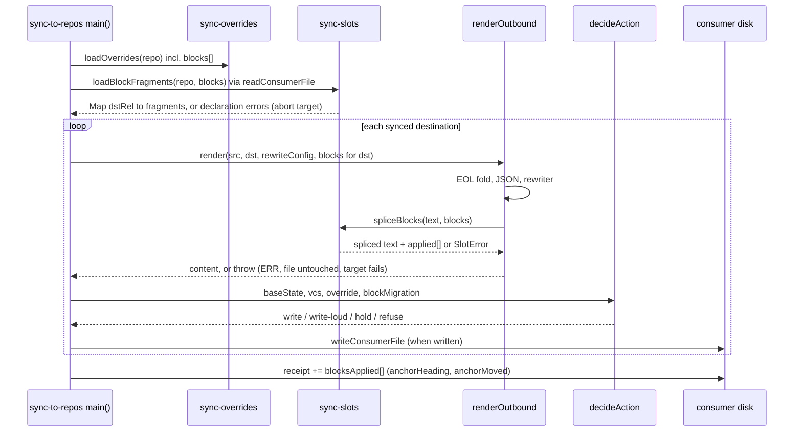

# Plan: Block holds: a consumer block inside a synced SKILL.md
- **Date**: 2026-11-28
- **Status**: Complete
- **Author**: Claude + Louis
- **Scope**: backend (sync tooling, consumer-sync contract). Stack `js-ts`, ESM.
- **Target domain(s)**: `install`, `scripts`, `shared-lib`
- ⚠ **Cross-domain work**: the change touches the sync CLI (`install`), its libs (`shared-lib`) and one skills check (`scripts`). That crossing is intended: the sync's own write loop is the only place a destination's bytes are decided.

## 1. Context Summary

### The problem, measured

A consumer that needs ONE repo-specific block inside a synced SKILL.md must
hold the WHOLE file through `.sync-overrides.json`. storyline does this for
its `<!-- repo-electron-target -->` adapter block (a packaged Electron app
with no HTTP surface, so upstream's `--verify <url>` instructions do not
apply). It holds four files: `click-test`, `nav-audit`, `persona-test` and
`visual-audit`. STO measured on 2026-11-28 (storyline PR #634, from CES
`0e1a66be`) how far those held files have drifted from upstream: 359, 128,
692 and 51 lines. A whole-file hold stops every upstream fix to that skill,
so the drift only grows. `upstreamMoved` reports it on every run, but the
only thing a consumer can do about it is a hand re-merge.

What the four blocks have in common (measured in storyline's working tree
on 2026-11-28, `grep -n repo-electron-target`):

| skill | block lines | where it sits |
|---|---|---|
| click-test | 157–180 | between upstream's `---` rule and `## Phase 1 — Detect Browser Tool` |
| nav-audit | 40–60 | after the Usage fence, before the `# /nav-audit` H1 |
| persona-test | 199–244 | between `---` and `## Phase 1 — Detect Browser Tool` |
| visual-audit | 68–98 | before `## Flow` |

Every block is an **insertion**. None of them replaces upstream text. That
is what makes a narrow mechanism enough: we need a named place to insert
a consumer's bytes, not a general merge.

### Code Trace (pinned to `7721a7bd`)

- `scripts/sync-to-repos.mjs:935 (7721a7bd)`: `loadOverrides(repo.path)`, once per target, before the write loop.
- `scripts/sync-to-repos.mjs:1221 (7721a7bd)` → `renderOutbound(...)` at `scripts/lib/sync-outbound.mjs:49 (7721a7bd)`. This is the ONE renderer: EOL fold → JSON stage → `rewriteCommandSurface` (`:67`) → `injectUpstreamBanner` (`:70`, which applies only to the tooling dir, never to `.claude/skills/**`).
- `scripts/sync-to-repos.mjs:1235 (7721a7bd)`: `srcHash` is the hash of the rendered bytes, which become the manifest base after a write (`:1403`, `writtenHash.set`).
- `scripts/sync-to-repos.mjs:1285 (7721a7bd)`: `matchOverride(dstRel, overridesDoc.overrides)` (`scripts/lib/sync-overrides.mjs:314`).
- `scripts/sync-to-repos.mjs:1318–1338 (7721a7bd)`: `classifyAgainstBase` → `readDivergenceVcs` → `decideAction` (`scripts/lib/sync-divergence.mjs:303 (7721a7bd)`). The precedence is override → HOLD, not-diverged → WRITE, prior-upstream → WRITE_LOUD, flag → WRITE_LOUD, untracked → WRITE_LOUD, else REFUSE.
- `scripts/sync-to-repos.mjs:1340–1356 (7721a7bd)`: a HOLD records `overridesHeld[]` with `upstreamMoved` (`classifyHeldStaleness`, `sync-divergence.mjs:261`).
- `scripts/sync-to-repos.mjs:911 (7721a7bd)` `priorRenderer` and `:1111` `decideUnmanifested` both re-render through `renderOutbound`. Prior-upstream matching and the ownership scan compare rendered bytes with rendered bytes, so any new rendering stage must feed all three callers.
- `scripts/sync-to-repos.mjs:1422 (7721a7bd)`: GC's `isDeclaredDivergence` predicate, which decides whether a retired skill file is held or deleted.
- `scripts/sync-to-repos.mjs:964–966 (7721a7bd)`: `priorReceiptHeld` comes from `latestReceiptEntry(priorReceipt).overridesHeld`, the committed record of which paths were declared held last run.
- `scripts/lib/sync-isolation-verify.mjs:345–372 (7721a7bd)`: gate 2B exempts override-held paths from the manifest-vs-disk check. A path that is written normally needs no exemption.
- `scripts/lib/sync-consumer-io.mjs:57 (7721a7bd)`: `readConsumerFile` is the contained, link-refusing consumer read.
- `scripts/skill-size-ratchet.mjs` governs `skills/**/*.md` in characters. Three of the four target SKILL.md files are over the 12,000 cap and baselined (`click-test` 30911, `nav-audit` 13460, `persona-test` 43426), so they may not grow. `visual-audit` is under the cap (10,817 bytes).
- `.file-size-baseline.json:23 (7721a7bd)`: `scripts/sync-to-repos.mjs` is baselined at 1916, so **its line count may not grow**.

### Patterns reused vs new

- **Reused**: declarations live in `.sync-overrides.json` (committed, `reason` required, a malformed file aborts the target). The single renderer carries the new stage. The manifest-hash three-way base is unchanged. Containment reuses `readConsumerFile`. The receipt gets one new array, the same shape `overridesHeld` already has.
- **New**: one pure module, `scripts/lib/sync-slots.mjs`, owning marker grammar and splicing. One impure loader. One new `decideAction` rule for the one-time migration. One skills-check lint.

### Neighbourhood considered

`get-neighbourhood` (coverage `verified`, 2522 eligible) gave every candidate the band `review`. The nearest was `renderOutbound` (`below-noise-floor`), which is the function being extended, not a duplicate of the new one. `renderGitignoreExtras` (`sync-overrides.mjs:337`) is the closest precedent in shape: consumer-declared content placed inside a sync-owned fence. The design follows that precedent: the fence stays sync-owned, and its content has two declared sources.

### Security incident neighbourhood

INC-001 (`manual-verification-required`, symlink escape through a lexical
path check) applies, because the sync will now READ a consumer-named path.
See §Security Considerations.

## 2. Proposed Architecture

### Right-sizing gate

- **Band-aid**: keep whole-file holds and have the consumer re-merge upstream into its held files by hand after each sync, or run a post-sync script that re-inserts the block into the synced copy. The first is today's status quo, and the drift measured above is the result. The second is a local patch to an upstream-owned surface, invisible to the sync's base, so every sync reads the file as consumer content and refuses.
- **Over-engineered**: a general three-way text merge (diff3) of arbitrary consumer edits into every synced file, or a templating layer (includes, conditionals, per-consumer variables) over skill markdown. No current consumer edits upstream text in place: all four known blocks are pure insertions. A merge engine also turns an unattended sync into a conflict-resolution step.
- **Chosen**: **upstream-declared named slots, filled by consumer-declared fragment files.** Upstream puts a one-line marker where a repo adapter belongs. The consumer declares `{path, slot, from, reason}`, and the sync splices the fragment's bytes in after every other rendering stage. **Current requirement served**: storyline's four blocks, so that those four files go back to receiving upstream updates.

### Alternatives rejected, with the reason

| Alternative | Why not |
|---|---|
| **Runtime include**: upstream SKILL.md says "if `<consumer file>` exists, read it first". No sync code at all. | The block has to override upstream instructions at the point of use ("`--verify <url>` does not apply here"). An include puts that in context only if the model follows a conditional read, on every host (Copilot included). And if upstream deletes the include line, the consumer's adapter silently stops being read. A splice is deterministic, and its failure is loud. Kept as decision D1. |
| **Consumer-declared anchors**: insert after the heading text `"## Phase 1 — Detect Browser Tool"`. No upstream change. | The anchor is a heading upstream does not know anyone depends on. Any heading edit breaks it, and upstream cannot see the dependency to keep it. A slot is a promise upstream makes visibly, in its own source. |
| **Fragment inline in `.sync-overrides.json`** | Thirty lines of markdown as an escaped JSON string cannot be reviewed, and a consumer's own guard (storyline's `verify-skill-electron-sections.mjs`) cannot grep it. |

### The five questions, settled

**Q1. Where the block lives, and how it is declared.**

- The fragment is a committed consumer file, by convention `.sync-blocks/<skill>.<slot>.md` at the consumer root. The sync never ships, manifests, GCs or overwrites anything under `.sync-blocks/`. The convention is not load-bearing: the path is whatever `from` says, within the validation rules below.
- The declaration is a new `blocks` array in `.sync-overrides.json`, alongside `overrides`, `gitignoreExtra` and `syncOptIn` (#5, #10: one declaration file, one validator):

  ```json
  "blocks": [
    { "path": ".claude/skills/nav-audit/SKILL.md", "slot": "target-adapter",
      "from": ".sync-blocks/nav-audit.target-adapter.md",
      "reason": "packaged Electron app, no HTTP surface: redirects the lens to the repo's own driver" }
  ]
  ```

- `validateOverrides` errors (and, as today, the target aborts) when any of these hold (#12):
  - `path` is not `.claude/skills/<name>/SKILL.md`. v1 scope is the synced SKILL.md, the only surface with a current requirement and the one the upstream lint covers.
  - `slot` does not match `^[a-z][a-z0-9-]{0,39}$`.
  - `from`, after `normaliseOverridePath`, is not a safe relative path. It must match `^[A-Za-z0-9._/-]+$`, and must have no empty, `.` or `..` segment. This also keeps `-->` and newlines out of the rendered start line.
  - `from` is under the tooling dir, under `.claude/skills/`, or equal to a sync bookkeeping path.
  - (checked once the target's inventory is known, before any write; R1 H5) `from` equals, case-insensitively, any destination the target will write this run (`intendedWrites`) or any destination in the prior manifest. A managed file can never be a fragment source, whatever its alias or case.
  - `reason` is missing.
  - the same `(path, slot)` pair is declared twice.
  - a `path` is also claimed by a whole-file override. That is contradictory, and the error names both entries, because a hold would silently win.
- Fragments are loaded once per target, after `loadOverrides`, by the new `loadBlockFragments(repoRoot, blocks)`, which reads through `readConsumerFile`. It gives one of four outcomes:
  - `present`: the file is read and canonicalised to LF. Trailing blank lines are trimmed, then exactly one `\n` is added.
  - `absent`, `refused` or `unreadable`: a declaration error. The target aborts, the same severity as a malformed overrides file. A declared block whose bytes cannot be read must never render as "no block".
  - empty after the trim: an error. An empty fragment is a forgotten declaration, not an intent.
  - containing the text `sync-slot:`: an error, because a fragment may not open a slot of its own.

**Q2. How the sync splices: deterministic and byte-stable.**

- Upstream marker grammar: one line, column 0, exactly `<!-- sync-slot:<name> -->`. It sits outside YAML frontmatter and outside fenced code. A name appears at most once per file.
- A new stage in `renderOutbound`, **after** `rewriteCommandSurface` and before `injectUpstreamBanner`. The fragment's bytes therefore reach the consumer verbatim: upstream's command rewriter never touches a consumer's own command lines (storyline's `npm run ux:driver` would be a target).
- A filled slot renders as:

  ```
  <!-- sync-slot:target-adapter:start — from .sync-blocks/nav-audit.target-adapter.md (edit it there; a sync rewrites this span) -->
  <fragment bytes, LF, exactly one trailing \n>
  <!-- sync-slot:target-adapter:end -->
  ```

- An unfilled slot keeps its marker line unchanged (identity rendering). Consumers with no declaration get byte-identical files apart from the one inert comment.
- Pure function `spliceBlocks(content, blocks) → {content, applied: [{slot, anchorHeading}]}`. Its output depends only on the upstream text plus the fragment bytes: no clock, no sha, no path from the disk. **The contract is render-from-source determinism, not idempotence** (R1 M1). The renderer always starts from upstream source, so the same source and the same fragments give the same bytes on every run, and the manifest hash is stable. Input that already carries a `sync-slot:<name>:start` line is rejected (`already-spliced`): it can only mean a caller fed a rendered file back in.
- `renderOutbound` gains `blocks = []`. **All three callers** pass this destination's blocks: the write loop (`:1221`), `priorRenderer` (`:911`) and `decideUnmanifested` (`:1111`). "Is the disk an earlier upstream version, rendered for THIS consumer?" stays a rendered-to-rendered question (#5). The blocks for each destination are computed once per target, as a `Map<dstRel, block[]>`.
- **Current and historical rendering have different failure contracts** (R1 H3):
  - CURRENT outbound (the write loop): a `SlotError` throws and fails the file (Q3).
  - HISTORICAL (`priorRenderer` over earlier upstream blobs, which naturally predate a newly added marker): a `SlotError` makes that blob **incomparable**. It never matches, so it never grants prior-upstream overwrite permission, and it is counted in its own `stats.slotIncomparable`, not in `renderFailures`, so a renderer regression stays visible. `renderedInfo` (`scripts/lib/sync-divergence.mjs:656 (7721a7bd)`) already catches a throw and returns null. The change is to classify the throw.
  - DECIDED in the code audit (R1 H6): a RAW earlier upstream blob still counts as prior-upstream for a block-declared path. A raw upstream blob carries no consumer block, so a disk equal to one is a stale snapshot nobody typed into, and before its first block sync the path legitimately held raw upstream bytes. A pending hold → block adoption pre-empts the rule (1b/1c sit above it). Only `slot-missing` counts as incomparable; any other slot error in history counts as a render failure.
  - `decideUnmanifested` already treats a throwing render as "no expected bytes" (`sync-outbound.mjs:104–108`), so ownership falls to the banner, which skill files never carry. The result is `collision`, never `owned`: fail-closed, unchanged.
- Divergence needs no new state. The manifest records the spliced hash as the base. If the consumer edits the fragment, the next outbound changes while the disk still equals the base, so the state is PRISTINE and the file is written. If the consumer hand-edits the spliced span inside SKILL.md, the disk no longer equals the base, the state is DIVERGED, and tracked content is REFUSED (unchanged rules). For a path that has block declarations, the refusal prose adds: *"this file carries a block hold: edit `<from>`, not the synced copy."*
- `sync-isolation-verify` gate 2B needs no exemption. A block-held file is written, so the manifest and the disk agree. This is better than today, where four storyline paths are exempted from the gate.

**Q3. The anchor moves or vanishes: fail loudly, never drop the block.**

`spliceBlocks` **throws** a typed `SlotError` in each of these cases:

| code | condition |
|---|---|
| `slot-missing` | a declared slot has no marker in the rendered upstream text: upstream removed or renamed it |
| `slot-duplicate` | the marker appears more than once |
| `slot-in-frontmatter` | the marker sits inside the leading `---` block |
| `slot-in-fence` | the marker sits inside fenced code |
| `already-spliced` | the input already carries a rendered span (see Q2) |

**A declaration that never reaches the renderer is an error too** (R1 H2). After the write loop, every declared block `path` must have been rendered this run. It reconciles against `intendedWrites`, the per-target inventory after opt-in, legacy and retirement decisions.
- A declared path that is not in it is `block-dest-unknown`: a typo, or a destination this target does not receive. The prose names the declaration index.
- A declared path that GC finds retired upstream is **held** (`isDeclaredDivergence`, so the consumer's file and block are kept) **and** reported as `block-dest-retired`.

Both count as errors (non-zero exit), print in the summary, and leave the destination and its base untouched.

The throw takes the existing render-failure path (`:1222–1226`): `ERR` line, `failedWrites`, `repoErrors++`, so the target exits non-zero, and **the file is not written**. The consumer's current file, block included, stays on disk, and the manifest base carries forward. A dry run reports the same thing. The `ERR` prose names both remedies: report it upstream (`cross-skill.mjs upstream report --affected-path <path>`), or fall back to a whole-file override for that path until upstream restores the slot.

A **moved** slot is not an error: the slot is upstream's promise of where an adapter belongs, and following the marker is the point. It is reported, though. `applied[].anchorHeading` is the nearest preceding Markdown heading. When it differs from the newest receipt entry that recorded that `(path, slot)`, the sync prints a warning, *"upstream moved slot `target-adapter` in nav-audit from under '## Usage' to under '## Phase 1'; review that the block still reads right"*, and records `anchorMoved: true`. A run that refused or failed the file does not count: it recorded nothing. It warns but does not fail, because the content still lands correctly. **The contract is deliberately limited to heading changes** (R1 M2): a marker moved within the same section is not reported. The marker is upstream's declared position, and a finer location signal (line offsets) would fire on every unrelated edit above it.

**Receipt semantics** (R1 M2). `blocksApplied[]` records a `(path, slot)` only when the bytes on disk after the run carry that block: the file was written, or it was unchanged and already carried it. A refused, failed or held file records nothing, and a dry run writes no receipt (as today). `blockErrors[] {path, slot|null, code}` records every `SlotError`, `block-dest-unknown` and `block-dest-retired`, so a CI check can fail on them from the committed record.

**Q4. Migrating an existing whole-file hold to a block hold.**

The consumer's commit:

1. moves the block's bytes into the fragment file;
2. deletes the `overrides` entry;
3. adds the `blocks` entry.

On the next sync, the disk (the consumer's held file) differs from the base (the manifest's last write, from before the hold), so it is DIVERGED + tracked, and today that means REFUSE. `--overwrite-diverged` is far too broad an answer: it applies to every diverged file in the target.

**Adoption state is derived from the committed receipt, durably** (R2 H1). `adoptionState(path)` reads receipt entries newest-first and finds the first one that names the path in `overridesHeld` or `blocksApplied`. Entries that only refused or failed the path are skipped, so a failed attempt never erases the evidence.
- `overridesHeld` found first **and the path currently has at least one block declaration and no whole-file override** ⇒ **pending**: a whole-file hold awaiting adoption. Without a current block declaration the adoption rules never apply, and the existing precedence is unchanged (R3 H1). So a consumer that drops a hold without adopting blocks keeps today's behaviour.
- `blocksApplied` found first ⇒ **adopted**.
- neither ⇒ **none**.

This is the same newest-recording-entry rule `anchorMoved` uses. It needs no new state: the receipt is append-only and committed.

The fix is a new `decideAction` input, `blockAdoption: {pending, eligible, failed}`, which adds two rules placed right after HOLD and **above every other WRITE_LOUD rule**, prior-upstream and untracked included (R2 H2).

- **1b.** pending and eligible ⇒ `WRITE_LOUD`, reason `block-hold-migration`.
- **1c.** pending and NOT eligible ⇒ `REFUSE`, reason `block-hold-migration-blocked`, naming the failed condition. This **fails closed** before the generic untracked or prior-upstream overwrite can fire. A previously held file is consumer content until it is adopted, whatever git says about it.
- `--overwrite-diverged` (rule 3) stays the documented escape hatch and still wins over 1c, loudly. *"An escape hatch that still refuses is not one"* (`decideAction`'s own contract). The runbook says not to use it for a migration.

`eligible` holds only when ALL of these hold:

- (a) `adoptionState(path) === 'pending'`: the divergence was declared, which the committed record proves offline.
- (b) (folded into `pending` above, so 1b/1c never fire for a path without a current block declaration.)
- (c) every declared fragment's bytes occur verbatim (EOL-folded) in the disk file. This proves the consumer moved its block into the fragment, rather than declaring a new block and abandoning content.
- (d) the disk bytes equal the file at the consumer's HEAD (`vcs.matchesHead === true`, already computed by `readDivergenceVcs`). Every byte the overwrite replaces is recoverable from git. Uncommitted or untracked content is never migrated (R1 H1).
- (e) the block entry carries `"adoptHeldFile": "sha256:<first 16 hex of the disk bytes>"`, and that value equals the held file being adopted. **Consent is bound to the exact bytes of one held generation** (R3 M1). The operator takes the value from the 1c refusal, which prints it (*"to adopt this held file, set adoptHeldFile: \"sha256:…\""*), after reviewing the dry-run diff. A stale flag restored later, after the consumer went back to a hold and edited the file, names different bytes and refuses until it is re-authorised. A boolean flag could not tell those generations apart. **One function computes the token**: `adoptionToken(diskBytes)` = `sha256:` + the first 16 hex of the SHA-256 of the **LF-canonical** bytes (`canonicalizeEol`, the same fold condition (c) uses). A clean CRLF checkout of the same commit therefore yields the same token. The 1c printer and `assessBlockMigration` both call it, so the value printed is the value checked (final gate G2). On a path with several block entries, at least one must carry the flag, and every entry that carries it must carry the same value. Disagreeing values are a validation error.

**The flag's lifecycle.** `adoptHeldFile` must match `^sha256:[0-9a-f]{16}$`. It is valid on any block entry, and validation never rejects it for lacking a hold. It is consulted only while the state is `pending`:
- `pending`: the flag authorises 1b **if it names the current bytes**. A refused or failed attempt leaves the state `pending`, so a retry still has its evidence.
- `adopted`: the flag is **spent and inert**, and the sync prints one advisory, *"adoptHeldFile on <path> is spent; remove it"*, never an error.
- `none`: the flag is inert, with the same advisory.

The overwrite is loud: it prints per file and goes into `divergedOverwritten` with the reason. Running `--dry-run` first shows the full diff (the runbook says so). Upstream does not migrate storyline: STO does, after this lands.

**Q5. `skills:check` and the size gate.**

- **Upstream (CES)**: a new `scripts/check-skill-slots.mjs` is added to `skills:check`. It lints every `skills/**/SKILL.md` for the marker grammar: exact form, column 0, not in frontmatter, not inside a fence, at most once per name. **It fails closed on its input** (R3 M2): a missing or unreadable `skills/` root, a traversal or read error, or zero discovered SKILL.md files is exit 2 with the cause, never a pass. It also prints the count of files and markers it read, so a green run states what it measured. This is the CES half of Q3: a malformed marker fails at push, never at a consumer's sync. The frontmatter contract is untouched, because markers are body text by construction, and the splice refuses to land in frontmatter.
- **The size gate** governs CES's `skills/**` only, never a consumer's rendered copy. That is unchanged and correct: the spliced bytes are the consumer's own context cost. The marker adds about 34 characters. `visual-audit` is under the cap, so the marker fits. `click-test`, `nav-audit` and `persona-test` are baselined over the cap and **may not grow**. So in each, the same commit makes a trim of at least the marker's length in the same file, and then re-baselines DOWN. No cap or baseline is raised; that is Louis's call (decision D3 offers the other route).
- **Consumer side**: `sync-isolation-verify` gate 9 (frontmatter keys) keeps working, because the frontmatter is not touched. The sync prints the fragment's size on the `upd` line (`[block target-adapter +1,412 chars]`), so a consumer can see what it adds.

### Architecture diagram



### Execution model (Phase 1.5)

There is one dependency chain per target: load declarations → load fragments → (per file) render → decide → write → receipt. A fragment load failure aborts the target before any write, the same severity as a malformed overrides file. A splice failure fails **only that file**: it is not written, and the target exit code is non-zero, the existing per-file render-failure semantics. Files are independent of each other. There is no new concurrency: the sync is serial per target, as today.

### Security Considerations

- The fragment path is consumer-authored, so it is read only through `readConsumerFile`, which contains it to the consumer root and refuses a link (INC-001's class: a lexical check alone is not enough). A `refused` read is a declaration error, never a silent skip.
- `from` may not name the tooling dir or `.claude/skills/`. A consumer must not be able to make an upstream-owned file the SOURCE of a block, or create a loop where a fragment is itself a synced file.
- Nothing leaves the machine. Fragments go from the consumer's disk into the consumer's own file. This is not an egress path.

## 6. Sustainability Notes

- **Assumption**: consumer adapters are insertions. If a consumer later needs to *replace* an upstream paragraph, the right move is an upstream slot that wraps that paragraph as default content. The grammar leaves room for it (`start`/`end` markers in the source), but nothing builds it now (YAGNI).
- **Extension point**: adding a slot is a one-line upstream edit plus the lint. Opening the mechanism to other synced markdown (e.g. reference files) means widening one prefix check in `validateOverrides`.
- **Coupling**: the splice is a renderer stage, so every byte-comparing path (write, prior-upstream, ownership scan) gets it at once. A fourth renderer caller added later also gets it, as long as it passes `blocks`. This is called out in `renderOutbound`'s JSDoc.

## 7. File-Level Plan

| File | Intent | Key exports / change | Why |
|---|---|---|---|
| `scripts/lib/sync-slots.mjs` | create | `SLOT_NAME_RE`, `findSlotMarkers(text)`, `spliceBlocks(text, blocks)`, `SlotError` (codes in Q3), `lintSlotMarkers(text)` (used by the check) | One owner of the grammar (#5, #10). Pure, so unit-testable (#11) |
| `scripts/lib/sync-overrides.mjs` | modify | `validateOverrides` validates `blocks`; `blocksByDest(blocks)` gives `Map`; `loadBlockFragments(repoRoot, blocks)` (impure, via `readConsumerFile`) | Declarations stay in one file and one validator (#5) |
| `scripts/lib/sync-outbound.mjs` | modify | `renderOutbound({..., blocks})`: splice after the rewriter; returns `blocksApplied` | The single renderer (#5) |
| `scripts/lib/sync-divergence.mjs` | modify | `decideAction` rules 1b/1c (`blockAdoption`), above every other WRITE_LOUD rule; `describeReason('block-hold-migration' | 'block-hold-migration-blocked')`; pure `adoptionState(receipt, path)` and `adoptionToken(bytes)` (the one token function, used by both the checker and the refusal printer); a pure `assessBlockMigration({priorHeld, hasBlocks, hasOverride, diskText, fragments, matchesHead, adoptHeldFile})` returning `{eligible, failed: 'a'|'b'|'c'|'d'|'e'|null}`; `renderedInfo` classifies a `SlotError` as `slotIncomparable` (R1 H3) | The decision table stays pure (#11) |
| `scripts/lib/sync-receipt.mjs` | modify | `blocksApplied[] {path, slot, from, fragmentSha, anchorHeading, anchorMoved}`, `blockErrors[] {path, slot, code}`, and their counts | Committed evidence for Q3 (#19) |
| `scripts/sync-to-repos.mjs` | modify | Wiring only: load fragments, pass `blocks` to the three render callers, compute `blockMigration`, push `blocksApplied`, add the refusal hint, include blocks in `isDeclaredDivergence`, check `from` against the inventory before any write, and reconcile declarations against `intendedWrites` and GC after the loop (`block-dest-unknown`, `block-dest-retired`). To keep this file flat, the reconcile and the from-vs-inventory check live in `sync-overrides.mjs` as pure helpers, and the CLI only calls them. **Net line count ≤ 0** (it is baselined): offset by moving the EOL-only rationale comment (`:1245–1281`) into `sync-divergence.mjs`'s `eolInsensitiveEqual` header, which already holds that explanation | Size ratchet |
| `scripts/check-skill-slots.mjs` | create | Lints `skills/**/SKILL.md` markers; `isInvokedAsScript` guard; `--help` pure | Upstream half of Q3 |
| `package.json` | modify | Append `node scripts/check-skill-slots.mjs` to `skills:check` | Wire the lint |
| `skills/click-test/SKILL.md`, `skills/nav-audit/SKILL.md`, `skills/persona-test/SKILL.md`, `skills/visual-audit/SKILL.md` | modify | Add `<!-- sync-slot:target-adapter -->` at the point where each skill resolves its target (before "Phase 1 — Detect Browser Tool" / "Flow"; for nav-audit, right after its Usage block), and trim an equal-or-larger span in the three over-cap files | The slots storyline needs |
| `docs/reference/consumer-repo-layout.md` | modify | §Declared divergence: block holds, grammar, the failure table, the migration | Operator contract |
| `docs/runbooks/consumer-adoption.md` | modify | Migration recipe: whole-file hold → block hold, with a dry-run first | Operator recipe |
| `tests/sync-slots.test.mjs` | create | Grammar, splice byte-stability, every `SlotError`, the fence/frontmatter lint | Tier 3(b) |
| `tests/sync-overrides.test.mjs`, `tests/sync-outbound.test.mjs`, `tests/sync-divergence.test.mjs`, `tests/sync-receipt.test.mjs` | modify | Validation rows, renderer stage order (rewriter never sees fragment bytes), rule 1b and its three failure legs, receipt shape | Tier 3(b) |
| `tests/sync-block-holds-e2e.test.mjs` | create | A disposable consumer fixture driven through `sync-to-repos.mjs` (`tests/helpers/consumer-fixture.mjs`, as in `tests/sync-consumer-divergence-e2e.test.mjs`) (see §9) | Tier 3(b): the contract ships to repos we cannot observe |
| `tests/sync-inventory-parity.test.mjs` | modify | Assert `scripts/lib/sync-slots.mjs` is in `bundleForRepo().files` (R1 H4). The bundle is a walked import closure (`resolveBundle`, `scripts/lib/sync-inventory.mjs:383 (7721a7bd)`), and `sync-overrides.mjs` is in `SYNC_ISOLATION_ENTRY` (`scripts/lib/sync-entry-lists.mjs:421 (7721a7bd)`), so it ships by construction, but nothing yet pins that. | Consumer verifier must not die on `MODULE_NOT_FOUND` |

### 7b. Implementation Phases

**Phase 1 — Grammar and splice core**: the pure slot module and its tests. Files: `scripts/lib/sync-slots.mjs` (create), `tests/sync-slots.test.mjs` (create).

**Phase 2 — Declarations and renderer**: `blocks` validation, the fragment loader, the renderer stage. Files: `scripts/lib/sync-overrides.mjs` (modify), `scripts/lib/sync-outbound.mjs` (modify), `tests/sync-overrides.test.mjs` (modify), `tests/sync-outbound.test.mjs` (modify).

**Phase 3 — Decision, receipt, wiring**: migration rule, receipt fields, write-loop wiring, e2e. Files: `scripts/lib/sync-divergence.mjs` (modify), `scripts/lib/sync-receipt.mjs` (modify), `scripts/sync-to-repos.mjs` (modify), `tests/sync-divergence.test.mjs` (modify), `tests/sync-receipt.test.mjs` (modify), `tests/sync-block-holds-e2e.test.mjs` (create).

**Phase 4 — Upstream slots and lint**: markers in four skills, size offsets, the check, docs. Files: `scripts/check-skill-slots.mjs` (create), `package.json` (modify), `skills/click-test/SKILL.md` (modify), `skills/nav-audit/SKILL.md` (modify), `skills/persona-test/SKILL.md` (modify), `skills/visual-audit/SKILL.md` (modify), `docs/reference/consumer-repo-layout.md` (modify), `docs/runbooks/consumer-adoption.md` (modify).

**Close-out (not a phase)**: `npm run skills:regenerate`; `node scripts/skill-size-ratchet.mjs --update-baseline` (downward only, verify the diff); `npm run skills:check`; `npm run skills:size:gate`; `npm run size:ratchet:gate`; `npm run help:readonly:gate`; `npm run check:static`; the full suite in CI (`full-suite.yml`).

## 8. Risk & Trade-off Register

| Risk / trade-off | Handling |
|---|---|
| Upstream removes a slot a consumer uses: that consumer's file stops updating | By design: the file is not written and the target fails loudly, with two remedies named. CES cannot see consumer declarations offline. A CES-side "slots in use" registry would be a second source of truth, so it is deferred (D4). |
| A consumer hand-edits the spliced span | DIVERGED → REFUSE (tracked), with the "edit `<from>`" hint. No new state. |
| The migration overwrites consumer edits outside the block | Gated by (a)+(b)+(c), loud, recorded in `divergedOverwritten`, visible in the sync PR diff, recoverable from git. The runbook says to dry-run first. |
| A fourth `renderOutbound` caller forgets `blocks` | `blocks` is required by the JSDoc contract. The e2e asserts that prior-upstream matching and the ownership scan see spliced bytes (one test each). |
| `sync-to-repos.mjs` may not grow | The wiring is offset by moving a comment block (§7). If it still does not fit, the wiring helper moves into the new lib instead. The baseline is never raised. |
| Trimming text in three over-cap SKILL.md files | The trim must be redundant prose (duplicated elsewhere in the skill or its references), named in the PR. Alternative: D3. |
| Unfilled markers ship to every consumer | One HTML comment per file, inert to every markdown renderer and model. Accepted, because identity rendering keeps the renderer free of a strip stage. |

**Deferred (true scope boundaries)**: slots in non-SKILL markdown, replace-style slots, a CES-side slot registry, and storyline's own migration (STO's, after this lands).

## 9. Testing Strategy

**Unit** (pure): marker grammar accept/reject rows; render-from-source determinism (two renders of the same source and fragments give identical bytes), already-spliced input rejected, and stability (CRLF fragment ⇒ same bytes as LF); each `SlotError`; unfilled slot ⇒ byte identity; `validateOverrides` errors (one row per rule in Q1); `assessBlockMigration` truth table (a–e, each leg failing alone); historical render of a pre-marker blob ⇒ incomparable, counted in `slotIncomparable` and not `renderFailures`; `from` aliasing a managed destination (case variant, `./` prefix) rejected; `decideAction` precedence (HOLD still wins; order is HOLD → 1b → (pending and not eligible: `--overwrite-diverged` ⇒ WRITE_LOUD, else 1c REFUSE) → the existing rules; 1b/1c therefore pre-empt prior-upstream and untracked WRITE_LOUD; both apply only to a DIVERGED base state); `adoptionState` over receipt sequences (held → refused → held/written; written → none).

**E2E** (`tests/sync-block-holds-e2e.test.mjs`, temp source + temp consumer git repos, the same fixture style as `sync-outbound-eol-e2e.test.mjs`):

1. Declared block → the consumer file carries upstream + spliced fragment; the manifest hash equals the disk; `sync-isolation-verify` passes with no override exemption.
2. Upstream edits text outside the slot → the next sync writes it, and the block is preserved. (This is the requirement itself.)
3. The consumer edits the fragment → the next sync writes it; the state is PRISTINE, not a refusal.
4. Upstream deletes the marker → `ERR slot-missing`, non-zero exit, the consumer file is byte-unchanged, the base carries forward.
5. Whole-file hold → block migration: (a)–(e) ⇒ WRITE_LOUD `block-hold-migration`. Drop (c) ⇒ REFUSE `block-hold-migration-blocked` naming (c). An uncommitted edit (d) ⇒ REFUSE, bytes intact. An UNTRACKED held file ⇒ REFUSE, not the generic untracked WRITE_LOUD (R2 H2). A refused attempt followed by a fixed retry ⇒ the state is still pending and the retry migrates. The sync after a success ⇒ the flag is reported spent, exit 0. A wrong-bytes flag ⇒ 1c, printing the correct value. Adopt, then return to a hold and edit, then restore the stale block entry ⇒ 1c (R3 M1). Drop a hold with NO block declaration, then a later diverged sync ⇒ the existing rules decide, never 1c (R3 H1).
6. Upstream moves the marker under another heading → written, `anchorMoved: true`, warning printed.
7. The consumer's own command lines inside the fragment are untouched by the rewriter (a fragment containing `node scripts/<an owned tail>.mjs` keeps it verbatim).
8. A declaration naming a path the target never receives (a typo) ⇒ `block-dest-unknown`, exit ≠ 0, receipt `blockErrors`.
9. The DEPLOYED verifier inside the consumer (`scripts/.claude-skills/…`, the bundle the sync just wrote) runs green on the block-held file. This proves the shipped closure includes `sync-slots.mjs` (R1 H4).
10. Adoption where the consumer's file equals an earlier upstream version that predates the marker: the historical render is incomparable, so the result is never a prior-upstream WRITE_LOUD on that basis.

**Proof plan** (`skills/plan/references/proof-oracle.md`):

| Behaviour | Oracle | Pass condition | Evidence in report |
|---|---|---|---|
| Upstream updates flow into a block-held file | e2e 2, red first (assert fails against today's code, where only a whole-file hold exists) | written bytes = upstream v2 + fragment | test name + red-then-green run |
| Block never dropped | e2e 4 | consumer file sha before == after; exit ≠ 0 | test output |
| Byte stability | unit: double render | identical buffers | test name |
| Migration safe | e2e 5, both legs | WRITE_LOUD only with (c); REFUSE without it | test output |
| The lint fails closed | `check-skill-slots.mjs` on a fixture with a fenced marker, as a **negative control**, plus missing-root, empty-root and unreadable-file fixtures | exit 1 naming the file:line; exit 2 for each input failure; exit 0 on the real tree with file and marker counts > 0 | command + all exits |
| No size growth | `npm run skills:size:gate`, `npm run size:ratchet:gate` | green; the baseline diff only lowers numbers | gate output + baseline diff |

## Open decisions (Louis)

- **D1 — splice vs runtime include.** This plan recommends the splice (a deterministic in-context block, loud on failure). The include needs no sync code but depends on the model following a conditional read, and fails silently if the pointer is removed.
- **D2 — fragment location convention** `.sync-blocks/<skill>.<slot>.md`. Only the convention is open; the `from` field makes any contained path legal.
- **D3 — size offset route** for the three over-cap SKILL.md files: trim equal prose in each (recommended, no baseline raised), or exempt slot-marker lines from the ratchet's measurement (needs Louis, since it changes what the gate measures).
- **D4 — CES-side slot registry.** Deferred. Revisit if a second consumer adopts slots and an upstream slot removal ever ships to a consumer.

## Audit trail

- **/audit-plan 2026-11-28**, SID `audit-plan-1795849705622-63128`. GPT rounds R1 H5 M2, R2 H2, R3 H1 M2. Acceptance was 100% each round (12 of 12 fix-now, none deferred or dismissed), and the run stopped at the 3-round default cap. Findings shrank 7 → 2 → 3, each round's being narrower lifecycle corner cases of Q4.
- **Final gate**: Gemini (`latest-pro`), round 1, `CONCERNS`, disposition **`approve_with_debt`** (0 blocking, 2 debt). Both were fixed in the plan before close:
  - **G1** (MEDIUM): a scripted R3 edit had duplicated plan text inside Q4, because a `$` followed by a backtick in a JS replacement string is the "text before the match" pattern. Repaired. Every later scripted edit uses index slicing, never `String.replace` with a literal replacement string.
  - **G2** (MEDIUM): the `adoptHeldFile` token's byte representation, and the multi-block rule, are now specified (Q4, §7).
- Scope change: Louis approved implementation in this session on 2026-11-28 (`/cycle --autonomous`, D1–D4 at the recommended picks).
