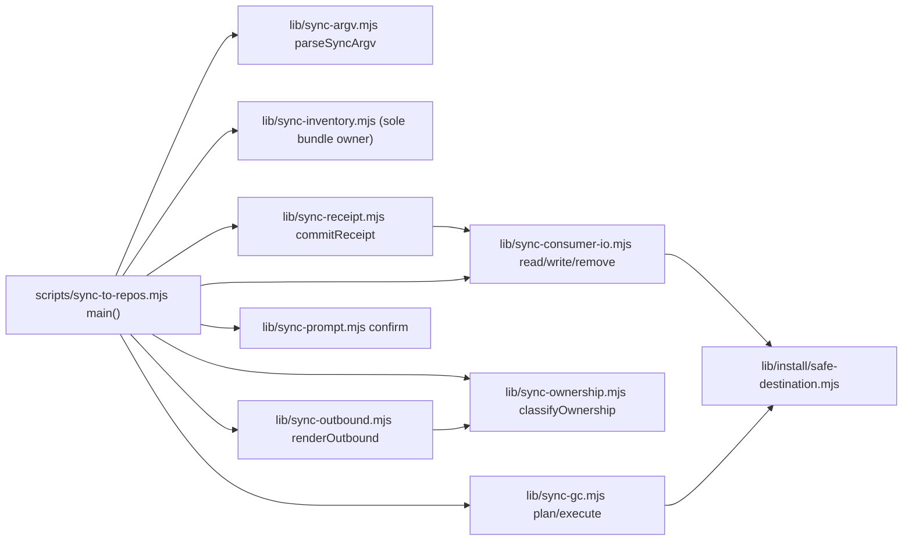

# Plan: sync-to-repos debt cluster (16 still-present defects)
- **Date**: 2026-11-17
- **Status**: Draft
- **Author**: Claude + Louis
- **Scope**: backend (Node ESM CLI + `scripts/lib/**`; stack `js-ts`)
- **Target domain(s)**: `install`, `shared-lib`
- ⚠ **Cross-domain work** — touches >1 domain; the crossing (CLI → its own `sync-*` libs) is the existing, intended direction.
- **Tier-3 seam**: the consumer sync / relocation contract (AGENTS.md §Testing doctrine). Every defect lands with its test in the SAME commit.

**Neighbourhood considered**: `get-neighbourhood` returned only `review` band records, all inside
`scripts/sync-to-repos.mjs` itself (`main`, `readSource`, `bundleForRepo`, `realMissingDeps`, …): nothing
outside the file occupies this space. Reuse decisions below are made on the code, not the band.
Incident neighbourhood: INC-002 only (DB DSN), unrelated to these paths.

## 1. Context Summary

The census (`.claude/tmp/census/sync-verdicts.json`, read at `8ce88fc2`) lists 16 STILL-PRESENT topics.
Each was re-read against the code at `8ce88fc2` for this plan. Verdict after re-verification:

| # | topicId | Sev | Re-verified verdict |
|---|---|---|---|
| D1 | 7798d3cef2ea | HIGH | **Real, and worse than stated.** `--target` with no value, `--target ""`, and `--target=wine` all resolve `targetFilter` to a falsy value, so the run syncs EVERY consumer. `--target=x` passes `assertKnownFlags` (it checks the name half) and then `indexOf('--target')` misses it. |
| D2 | 3b96a5ef7971 | HIGH | **Real.** 9 consumer write/unlink sites skip `assertContainedDestination`. |
| D3 | 489588c47264 | HIGH | **Half real.** The *override* half is not real; the *divergence* half is. Details in §8. |
| D4 | 8fca02c6915a | HIGH | **Real, destructive.** A `.gitignore`/`.gitattributes` read that fails (EACCES/EBUSY) becomes `null`. `updateManagedBlock(null, …)` then builds a fresh file holding only the managed block, and the write REPLACES the consumer's whole file. |
| D5 | d6003d6472e6 (+dup e6d20a3a2532) | HIGH | **Real.** The receipt is read before the copy loop and rewritten from that snapshot. Also found: an *unreadable or malformed* receipt reads as "no prior", so the late write replaces the append-only history with one entry. |
| D6 | ae70a5d51c16 | HIGH | **Real.** `dst === src` is taken as proof of ownership. `.claude/skills/` is a shared Claude Code discovery root, so a consumer's own same-named skill there gets overwritten. |
| D7 | 4e0763d54f00 | HIGH | **Real.** The manifest base is re-read from disk after the loop, so a concurrent edit in that window gets recorded as our base. |
| D8 | 8e5974a92c98 (+umbrella d13d16b568ce) | MED | **Half real.** `readSource` catch→null is real: an unreadable entry file drops its whole import subtree from the bundle, and GC then deletes that subtree from consumers. The `realMissingDeps` regex is **not a defect** (§8). Of the umbrella's other parts, the lease-spawn part is already fixed (`lib/fleet/lease-spawn.mjs:30` c729 note, `stopTree` returns `{ok:false}`). The relocation-scan part is outside this claim and is recorded as a Finding. |
| D9 | 3627c83a | MED | **Real.** `sync-to-repos.mjs` and `sync-inventory.mjs` each define `CORE_ASSETS`, `EDITOR_FILES`, `CLAUDE_CODE_FILES`, `CORE_NON_IMPORTABLE`, `buildFileUniverse`, `readSource`, `resolveBundle`, `bundleForRepo` and `syncMigrations`, with "keep in lock-step" comments. |
| D10 | 07a3dbdd565b | MED | **Real.** Every `.json` destination is `deepMerge`d. For an upstream-exclusive file (`scripts/.claude-skills/lib/oss-call-policy.json`, `bundle-deps.json`, `.audit-loop/expected-schema.json`), a key that upstream deletes is never deleted downstream. |
| D11 | 77c917615461 | MED | **Real.** The ownership comparand runs EOL→rewrite→banner, but the writer also runs JSON parse→merge→stringify. A byte-identical JSON orphan therefore reads as a collision. |
| D12 | f4d57e36c0e2 | MED | **Real, and worse than stated.** On Ctrl-D or a closed stdin the promise never settles. With no handles left, node exits **0** mid-run. |
| D13 | cc838c26f9e4 | MED | **Real.** The EOL-only rewrite runs before `matchOverride`, so it rewrites a path the consumer declared held. |
| D14 | ad2fd650d8bd | MED | **Real.** A receipt write failure only logs, yet `detectSourceRollback` reads the latest receipt entry. |
| D15 | 2e26f79ebd92 | MED | **Real.** The boolean flags use `process.argv.includes`, which ignores `--`. `assertKnownFlags` stops at `--`. |
| D16 | f307dfbf6320 | MED | **Real.** The parity test asserts that `scripts/<rel>` appears as TEXT in the sync source, so a mention in a comment satisfies it. |

### Code Trace (all at `8ce88fc2`)

- argv: `scripts/sync-to-repos.mjs:193-243` (8ce88fc2) module-scope constants →
  `KNOWN_FLAGS` `:858` → `assertKnownFlags` `:913` (`scripts/lib/cli-io.mjs:383-399`, stops at `--`, accepts `=`) →
  target gate `:935-965` (`targetFilter ? filter : REPOS`).
- bundle: `readSource` `:386-389` → `collectImportClosure` `scripts/lib/module-graph.mjs:240`
  (`content == null → continue`) → `bundleForRepo` `:495` → `repo.files` → GC `planGarbageCollection`
  `scripts/lib/sync-gc.mjs:81-93`. Duplicate pipeline in `scripts/lib/sync-inventory.mjs:39-236`.
- receipt: read `:1212-1221` → `detectSourceRollback` `:1229` → … → `appendReceiptEntry` + write `:2084-2096`
  (`scripts/lib/sync-receipt.mjs:199,384,410`).
- preflight: `.gitignore` read `:1279-1282` → `updateManagedBlock` → write `:1981`; `.gitattributes` `:1326-1329` → write `:1971`.
- ownership: `ownedByInventoryNonRelocating` `:1391-1394`; comparand `:1413-1420` (no JSON stage) vs writer `:1534-1594`.
- writes: journal `:1492`, payload `:1654,:1755` (contained), manifest `:1894`, sidecar `:1906`, watermark `:1918`,
  gitattributes `:1971`, gitignore `:1981`, journal unlink `:2027`, receipt `:2086`; plus
  `patchManifestWithExtraHashes` (`scripts/lib/sync-manifest.mjs`) and `scripts/lib/sync-legacy-copilot-block.mjs`
  write/unlink. The containment oracle is `assertContainedDestination` (`scripts/lib/install/safe-destination.mjs:169`).
- EOL vs override: `eolOnlyDiff` write `:1645-1663` precedes `matchOverride` `:1679`.
- manifest base: `consumerFileMap` loop `:1862-1875` re-hashes `fs.readFileSync(abs)`.
- prompt: `maybePromptSharedCloudUpdate` `:2253-2261`.
- parity test: `tests/cli-smoke-set-sync-parity.test.mjs:29-35,81`.

**Measured** (2026-11-17, reading each consumer's `scripts/.claude-skills/.sync-manifest.json` with node): wine-cellar-app,
ai-organiser and storyline are all `layout: isolated`, with 1142 entries each, 167 of them `.claude/skills/**`.
So tightening D6 only affects destinations that are absent from a consumer's manifest. Today that is no
`.claude/skills/` path, so the tightening cannot mass-abort a consumer.

**Size gate (measured)**: `scripts/sync-to-repos.mjs` is 2298 lines against a baseline of 2300. **Rule: every
COMMIT leaves it at or below its parent commit's line count** (an oversized file may not grow, AGENTS.md), and
that is checked per commit with `git show <parent>:scripts/sync-to-repos.mjs | wc -l` alongside
`size:ratchet:gate`. A commit that shrinks it re-records the baseline downward in the SAME commit. Phase 1
meets the rule by replacing the 25-line constant block `:193-243` with the parser import plus about 10
reads. The D9 unification (Cluster B) deletes about 200 duplicated lines and runs early to buy
headroom. A shrink fails `size:ratchet:gate` until the baseline is re-recorded DOWNWARD in
`.file-size-baseline.json`. Lowering the baseline is not raising a cap.

Patterns reused: `assertContainedDestination` (containment), `ArgvError` + exit 2 (`:2290`),
`createPriorUpstreamResolver().matches` (`scripts/lib/sync-divergence.mjs`) for prior-upstream provenance,
`classifyOwnership` (`scripts/lib/sync-ownership.mjs`), `mayStillExist` (`scripts/lib/sync-gc.mjs`, the tri-state
precedent), and `appendReceiptEntry` (append-only merge).

## 2. Proposed Architecture

### Key design decisions

**A. One argv parser (D1, D15): `scripts/lib/sync-argv.mjs`** (#5 SSOT, #12 validation, #15 error handling)
- `parseSyncArgv(argv) → { flags:{dryRun,noPrompt,adoptOrphans,overwriteDiverged,allowRollback,allowStaleBase,quietLegacyCheck}, target, targetPath, errors:string[] }`.
  It is pure and never throws. **Input contract**: the CALLER passes `process.argv.slice(2)` (the same region `assertKnownFlags` reads with `from = 2`), never the full `process.argv`; a test pins that the node and script paths are never reported as positionals. The complete grammar, every case rejected before target resolution:
  - **Region**: only tokens before the first `--` are read. Tokens after it are ignored, matching
    `assertKnownFlags`. A bare positional before `--` (anything not a flag and not a value flag's
    value) is an error, because this CLI takes no positionals.
  - **Value flags** (`--target`, `--target-path`) accept `--flag value` and `--flag=value`. These are
    errors, never "absent": a missing value, an empty value (`--target ""`, `--target=`), and a value
    that starts with `--`. Repeating a value flag is an error, because which occurrence wins is
    ambiguous on a command that writes into other repos.
  - **Boolean flags** are presence-only. `--dry-run=<anything>` is an ERROR. Measured at `8ce88fc2`:
    `assertKnownFlags` accepts `--dry-run=true` by its name half, `includes('--dry-run')` is then false,
    and the run is a REAL sync. A repeated boolean is harmless and accepted.
  - **Selectors**: `--target` together with `--target-path` is an error, decided in the parser rather
    than in `main()`. Today's check at `:935-941` moves here.
- `selectTargets(parsed, repos) → {repos}|{error}` is exported beside the parser as the one pure
  "which consumers" decision. It is what D1's proof exercises.
- The module-scope constants become reads of one `const ARGV = parseSyncArgv(process.argv.slice(2))`. It still evaluates
  at import, but it cannot throw, so the test that imports this module still works. `main()` throws
  `ArgvError(ARGV.errors.join('; '))` straight after `assertKnownFlags`, before any target is resolved. The
  existing catch turns that into exit 2.
- Not reused as is: `requiredFlagValue` (`scripts/lib/cli-io.mjs:224`) misses the `=` form, `--` and the empty
  value; `argOption` falls back silently. Changing either would alter their other callers, and `cli-io.mjs` is
  outside this claim. A Finding proposes folding the shared shape into `cli-io` later.

**B. The bundle has one owner (D8, D9, D16)** (#1 DRY, #5 SSOT)
- `sync-to-repos.mjs` imports `bundleForRepo`/`getSyncClosure`, `readSource` and `realMissingDeps` from
  `scripts/lib/sync-inventory.mjs` and deletes its own copies. Lists that only one side has (e.g.
  `NON_CODE_FILES`) move into the library first. The entry lists stay in `scripts/lib/sync-entry-lists.mjs`.
- **Behaviour-preservation oracle**: at the base commit, a scratch script captures `bundleForRepo()` from
  BOTH modules (the CLI's copy via `_internals`, which already exports the entry arrays; the private function
  is exposed for the capture only). After the change, the single bundle must be byte-identical to the CLI's
  former list. Any difference is a pre-existing drift: report it, and decide per entry with evidence.
- `readSource` THROWS `SourceReadError` (path + code) on every error, ENOENT included. The closure walker
  only visits files that are members of `FILE_UNIVERSE`, which is enumerated from disk at start
  (`module-graph.mjs:236-240` dequeues only resolved repo files and entry points). A read failure inside the
  closure is therefore a race or a fault, never a retirement: a retired file is simply not in the universe
  and is never visited. A declared ENTRY point outside the universe is `MissingEntryPointError`. Both are
  thrown during bundle resolution, before any consumer is touched, and abort the run (exit 1). Otherwise
  that file's import subtree would vanish from every consumer and be GC-deleted (AGENTS.md: a read-path catch
  must not render a failure as an empty result).
- Unresolved specifiers keep today's deliberate policy (a loud warning, non-fatal). See Out of Scope.
- `realMissingDeps` moves unchanged (§8 explains why its regex stays).
- The parity test (D16) asserts on the COMPUTED closure: `CLI_SMOKE_SET ⊆ getSyncClosure().files` (mapped to
  `scripts/<rel>`), and the source-only CLIs `∉ files`. `tests/sync-inventory-parity.test.mjs` becomes a pin
  that `sync-to-repos.mjs` declares no inventory array of its own. It parses `export`/`const` declarations
  rather than matching text; one AST-free regex over `^const (CORE_ASSETS|EDITOR_FILES|…) =` is enough
  because the pin's subject is a declaration.

**C. One consumer-IO seam (D2, D4): `scripts/lib/sync-consumer-io.mjs`** (#5, #15, #16)
- `readConsumerFile(root, rel) → {state:'absent'} | {state:'present', content} | {state:'unreadable', code, message} | {state:'refused', reason}`.
  It contains the path FIRST (`assertContainedDestination`, which rejects a leaf or ancestor symlink or
  reparse point, dangling or not). A refusal is its own state, `refused`, never `absent` and never
  `unreadable`, and every caller treats it as fatal for that target before any mutation. `absent` means
  ENOENT/ENOTDIR on a path that passed containment.
- `writeConsumerFile(root, rel, content)` = contain → `mkdirSync(dirname)` → `atomicWriteFileSync`.
  `removeConsumerFile(root, rel) → {removed}|{absent}|{failed, reason}` = contain → unlink. It is the ONLY
  consumer remove primitive. `executeGarbageCollection` calls it (its `contain`/`unlink` seams collapse into
  one injected `remove`), as do the journal unlink and the legacy-copilot-block unlink.
- **The mutation census is closed by a test**: a static scan of `scripts/sync-to-repos.mjs` and the
  `scripts/lib/sync-*.mjs` modules it calls fails on any `atomicWriteFileSync`/`writeFileSync`/`unlinkSync`/`rmSync`
  call outside `sync-consumer-io.mjs`, apart from a named allowlist of SOURCE-side writes (the source
  `.sync-manifest.json` regenerate), each with its reason.
- Every consumer write/unlink in the CLI goes through these: journal, manifest, sidecar, watermark,
  gitattributes, gitignore, journal unlink, receipt. So does `patchManifestWithExtraHashes`, whose signature
  takes `(root, rel)` instead of an absolute path, and so do the legacy-copilot-block write and unlink.
  Payload writes keep calling `assertContainedDestination` directly, through `writeConsumerFile`, so there is
  ONE write primitive.
- `.gitignore`/`.gitattributes`: `unreadable` or `refused` → `ABORT <file> preflight: could not read
  (<code|reason>)` with `totalErrors++` and the target skipped, the same shape as the existing preflight
  aborts. Nothing is written.

**D. One sync per consumer at a time, plus receipt integrity (D5, D14)** (#14 transaction safety, #15)
- **Per-consumer exclusion.** The sync is invoked from `.githooks/pre-push` (`:870` (8ce88fc2), the `scrubAmbientGitEnv` header) in every
  worktree, so two pushes from two sessions run concurrent syncs into the same consumer. They race on every
  payload file, the manifest and the receipt, not only on the receipt. The whole per-target body, from
  before the receipt/rollback read through the receipt commit, runs inside `withFileLock(lockPath, …)` from
  `scripts/lib/file-lock.mjs`, which already exists. It has five consumers, an O_EXCL `wx` acquire carrying
  pid plus a token, stale recovery that needs a dead pid AND an old mtime, and a token-checked release.
  - `lockPath` = `<consumer>/scripts/.claude-skills/.sync.lock`, which `LAYOUT_CONSTANTS` declares in
    `scripts/lib/sync-path-map.mjs` and the containment check validates before acquiring. It is gitignored
    by the existing tooling-dir block.
  - The acquire is bounded (`maxWaitMs: 30000`). On contention or `LockTimeoutError` the result is `SKIP <consumer>:
    another sync is writing into it (pid N since T)`, counted as a target error. The run never waits
    indefinitely, and it never proceeds without the lock.
  - Staleness and the documented check-then-unlink limitation are the primitive's own (`file-lock.mjs`
    header). They are not re-solved here. A non-cooperating writer (an editor, a `git checkout`) is not
    excluded by any lock: the receipt CAS below is the defence for that case.
  - **`--dry-run` takes no lock and writes nothing**, the lock file included, so a read-only consumer can be
    dry-run. Its documented limitation: a dry-run that runs during a real sync into the same consumer may
    observe a half-written state. It is advisory output and never a base for any later decision. Test: a
    dry-run leaves the consumer tree byte-identical (hash every file before and after), including no lock
    file.
  - Mechanics: the for-loop body is wrapped as an async callback, and its `continue`s become `return`s
    (about 20 sites; reviewed with `git diff -w`). No logic moves.
- The prior receipt is read through `readConsumerFile`. If it is `unreadable`/`refused`, OR present but
  unparseable, the target ABORTS before any write: `.sync-receipt.json is unreadable/malformed (<why>) —
  resolve it first; a merge conflict in this TRACKED file is the usual cause (git checkout or resolve the
  conflict). Do not delete it: it is the rollback guard's history.` The rollback guard cannot answer, and the
  late write would destroy the history. This is fail-closed for a safety guard's input, the same shape as the
  existing `unsupported` refusal.
- **Concurrency contract.** Every writer of `.sync-receipt.json` is this CLI, and every run writes it only
  inside the per-consumer lock. Cooperating writers are therefore fully serialised, and the rollback decision,
  made ONCE before any mutation and under that lock, cannot be invalidated by another sync. The only other
  thing that can change the file is an UNSUPPORTED external modification: a `git checkout`/`merge`/`pull` of
  this tracked file in the consumer while a sync runs. That is detected and disclosed, never claimed
  prevented.
- The write becomes `commitReceipt({root, startSnapshot, entry})`. It re-reads the receipt.
  - Bytes unchanged since the start snapshot → append and write.
  - Changed, and EVERY start-snapshot entry is still present in the fresh record → `merged`. Entry identity
    is `generatedAt` + `source.commitSha`; that pair is unique per sync run. The new `entry` is appended onto
    the fresh record and a TARGET ERROR is reported: `.sync-receipt.json changed outside this sync during the
    run (a git operation on the consumer?) — merged; re-run sync to re-validate`. The re-run re-validates
    rollback before any mutation.
  - Changed, and ANY start-snapshot entry is missing from the fresh record (e.g. a checkout restored an older
    valid history) → `declined`. Nothing is written, so neither history is overwritten, and a TARGET ERROR
    names the missing entries. No heuristic reconciliation: an append-only record that lost entries is a
    state for a human. The manifest stamp below keeps the rollback guard informed in the meantime.
  - Fresh read unreadable or malformed → `declined`, nothing written.
  - The residual window between the re-read and the rename is documented in the function header as part of
    the unsupported case. It is NOT closed and not claimed closed: Node has no compare-and-rename, the same
    limit `file-lock.mjs` documents. There is no post-mutation rollback recheck, because it could only report
    a rollback already performed.
  - Returns `{written|merged|declined|failed, reason}`.
- `failed` or `declined` (other than "no change worth writing") counts as a TARGET ERROR (`repoErrors++`,
  `totalErrors++`), so the exit code carries it.
- **A missed receipt cannot blind the next run.** `detectSourceRollback` is evaluated against EACH durable
  stamp independently: the receipt's latest entry, and the consumer manifest's source `commitSha`. Both are
  compared by commit ANCESTRY, which the guard already uses via `createGitAncestry`; wall-clock order is never
  consulted. A rollback is reported if EITHER stamp shows the current source is behind it. A stamp whose
  commit the source cannot resolve gets the guard's existing fail-closed treatment for an unresolvable
  commit. The manifest is written before the receipt (`:1894` vs `:2086`), so a failed receipt write still
  leaves the manifest stamp. If the manifest write ALSO failed, the target already ended in error with its
  journal kept, and the next run sees the older receipt stamp: today's behaviour, and the residual of a run
  that recorded nothing. The combining function is `rollbackAgainstStamps(stamps, current, ancestry)` in
  `sync-rollback-guard.mjs`. With no stamps at all, the answer is today's "no prior knowledge".

**E. Outbound is rendered once (D10, D11): `scripts/lib/sync-outbound.mjs`** (#1, #5)
- `renderOutbound({srcRel, dstRel, srcContent, existingContent, rewriteConfig}) → {content, rewrite:{changed,hits}, pinsHeld, isJson}`
  runs, in this order, the EOL fold, then the JSON stage, then the pin guard with its post-condition, then
  the rewriter, then the banner. The writer loop calls it, and so does the ownership comparand. "What we
  would write" therefore has exactly one definition.
- The JSON merge policy is DERIVED from the layout, not hand-listed: `deepMerge` only when
  `sourceRelToDestRel(srcRel) === srcRel` (non-relocated, consumer-namespace files:
  `.claude/settings.json`, `.vscode/mcp.json`, `.windowed-views.json`). A RELOCATED destination is
  upstream-exclusive and is REPLACED, still through the canonical `JSON.stringify(v,null,2)+'\n'`. The
  predicate is exported as `isCoOwnedJsonDest(srcRel)` next to `sourceRelToDestRel` in
  `scripts/lib/sync-path-map.mjs`, the layout's single source of truth.
- A consumer edit to a relocated JSON file now reaches the divergence gate. Before this change, `deepMerge`
  masked it. Such files are gitignored, so they take the `diverged-untracked` route → WRITE_LOUD, recorded in
  the receipt. That is the existing policy for every other tooling file.
- The ownership comparand always calls `renderOutbound` with `existingContent: null`, i.e. the bytes we would
  write into an EMPTY slot. Ownership is proven only by our banner or by byte-identity with a non-empty
  source payload. `classifyOwnership`'s contract (`scripts/lib/sync-ownership.mjs`) is unchanged; it is
  never asked to bless a merge built from the destination's own bytes.

**F. Ownership requires evidence; a shared surface is a merge, not an ownership claim (D6)** (#15 fail closed)
- An unmanifested, unjournalled destination with `dst === src` gets exactly one of three dispositions:
  1. **owned**: (a) `classifyOwnership` with the unified comparand says provable, or (b)
     `priorUpstream.matches(srcRel, sha256(dest)) === true` (byte-identical to an earlier upstream version;
     the resolver exists and is budgeted).
  2. **shared-merge**: `isCoOwnedJsonDest(srcRel)` is true (`.claude/settings.json`, `.vscode/mcp.json`,
     `.windowed-views.json`). This is NOT ownership. It is the documented contract for a shared config
     surface: the consumer's keys are preserved by `deepMerge`, and the pin guard plus its post-condition
     still run. Reported as `merge  <path> (shared config surface; consumer keys preserved)`. The manifest
     records the merged bytes as our base from then on, which is what the existing code does today for
     these files. A destination that does not PARSE as JSON is not merged: it is a collision (`JSON merge
     failed` today is an ERR after preflight; it moves into preflight).
  3. **collision**: anything else, including `priorUpstream` answering `null` (unknown). `--adopt-orphans`
     still overrides.
- The note that replaces the `inventoryOwned` line names each path's disposition and evidence.

**G. EOL repair respects declarations (D13)**
- `override = matchOverride(...)` is computed BEFORE `eolOnlyDiff`. With an active override, the EOL repair
  is skipped and the path falls through to `decideAction`, which returns HOLD and records it in
  `overridesHeld`. That is three moved lines, no growth.

**H. The manifest records what we wrote (D7)**
- Definition: `srcHash` is `manifestHashOf(outContent)` (see §I), computed AFTER every rendering stage (EOL fold, JSON stage, pin
  guard, rewriter, banner), i.e. the exact bytes the write call is handed. The loop records
  `writtenHash.set(dstRel, srcHash)` only on these three paths:
  - unchanged: `srcHash === dstHash`, so the disk bytes ARE those bytes;
  - EOL-repaired: after `writeConsumerFile` returns, which writes `outContent`;
  - written: after `writeConsumerFile` returns.
  Nothing else enters `writtenHash`. The manifest build takes `writtenHash` for those paths. Every other
  intended path keeps today's rules, unchanged and stated so they are not re-derived:
  - held, refused, failed or skipped: carry the prior entry while the file is still there, else omit;
  - a failed write with no prior base keeps the journal;
  - a new unmanifested path that was held: omitted (we never wrote it).
  The post-loop `readFileSync` is gone. `sync-isolation-verify` gate 2B (manifest vs disk) is then a real
  transfer check instead of a tautology.

**I. GC asks the divergence question (D3)**
- **One hash form at the boundary.** Manifest values are `sha256:<64 lowercase hex>`. One helper,
  `manifestHashOf(buf)`, produces that form, and both `writtenHash` (§H) and the GC probe use it, so GC
  compares strings of one form. `isManifestHash(v)` validates stored values. A malformed stored base
  classifies the candidate as `unknown-base`, which is HELD (never deleted) and reported.
- `planGarbageCollection` gains a `probe(rel) → {state:'present', hash} | {state:'absent'} | {state:'refused', reason} | {state:'failed', code}`
  (built on `readConsumerFile`), and returns `deletions` (present with hash === base),
  `divergedHeld` (present with hash ≠ a valid base), `unknownBaseHeld` (stored base fails `isManifestHash`),
  `alreadyAbsent`, and `probeFailed` (refused or failed).
- `unknownBaseHeld` is NEVER deleted, not even with `--overwrite-diverged`. Invalid provenance is not a
  divergence the flag authorises. It is reported as `held  <path> (its ownership record is malformed; delete
  it by hand if it is ours)`, and its entry is carried forward unchanged.
- Deletion is `removeConsumerFile(root, rel, {expectHash})`: it re-reads and compares IMMEDIATELY before the
  unlink and returns `{held: 'changed-since-probe'}` on a mismatch. That shrinks the probe-to-unlink window
  from the whole GC loop to one read-compare-unlink. The residual (an editor writing between that read and
  the unlink) is documented as unsupported concurrent modification, the same contract as the receipt. A
  quarantine/restore protocol was considered and rejected as over-built for a gitignored, upstream-owned
  tooling file.
- `alreadyAbsent` → the goal state. Its stale manifest entry is dropped (not carried), with no error. This
  is today's `absent` outcome of `executeGarbageCollection`, reached earlier.
- `probeFailed` non-empty → the target's GC is skipped entirely (nothing deleted). It is reported with the
  paths and counted as a target error, and the prior entries are carried forward so the next run retries.
- `divergedHeld` → NOT deleted by default. Each is printed as `held  <path> (upstream retired it, but this
  copy was edited locally; re-run with --overwrite-diverged to delete)`, its prior entry is carried forward,
  and it is recorded in the receipt as `retiredHeld`. With `--overwrite-diverged` (the existing per-run
  destructive authorization, `:202-206`) it is deleted and recorded in `divergedOverwritten` with reason
  `diverged-retired-upstream`. This mirrors the write path, where a diverged file is never overwritten
  silently. It needs no recovery artifact: the bytes stay on disk unless the operator opts in.
- The receipt schema gains the optional `retiredHeld` list (`scripts/lib/sync-receipt.mjs`). Old readers
  ignore an unknown key, and `readSyncReceipt` already normalises versions.

**J. The prompt always settles (D12): `scripts/lib/sync-prompt.mjs`**
- `createConfirmPrompt({input, output}) → (q) => Promise<boolean>`. On `close` with no answer it resolves to
  `false` (decline) and writes a newline plus `no input — declined`. The settle-once guard is a local flag.

## 6. Sustainability Notes
- Four new small modules each own one seam: argv, consumer IO, outbound render, prompt. The CLI shrinks.
  A future value flag is one entry in `sync-argv.mjs`'s table.
- The JSON co-ownership rule follows the layout map. A newly relocated JSON asset is upstream-exclusive by
  default, with no list to forget.
- The assumption that could change: "relocated ⇒ upstream-exclusive". An asset that must ever be co-owned
  AND relocated would need an explicit exception in `sync-path-map.mjs`. That is acceptable: none exists
  today, and the failure is loud (WRITE_LOUD), not silent.

**Right-sizing gate**
- *Band-aid*: guard `targetFilter === undefined`; wrap each write in its own `assertContainedDestination`;
  re-read the receipt only.
- *Over-engineered*: a general argv framework for all CLIs; a new lock substrate (flock addon, lock server); a
  pluggable JSON-merge-policy config file; recovery artifacts for GC.
- *Chosen*: one parser for this CLI's flags; one IO seam; one render function; per-consumer exclusion using
  the EXISTING `withFileLock`, which is not a new lock design; receipt CAS for non-cooperating writers. Each
  serves a defect present today. The cross-CLI parser is deferred as a Finding.

**Manual vs scripted**: manual. There are about 12 write-site edits, each with different context.

## 7. File-Level Plan

| File | Intent | Purpose |
|---|---|---|
| `scripts/lib/sync-argv.mjs` | create | `parseSyncArgv` (D1, D15) |
| `scripts/lib/sync-consumer-io.mjs` | create | `readConsumerFile`/`writeConsumerFile`/`removeConsumerFile` (D2, D4) |
| `scripts/lib/sync-outbound.mjs` | create | `renderOutbound` (D10, D11) |
| `scripts/lib/sync-prompt.mjs` | create | `createConfirmPrompt` (D12) |
| `scripts/lib/sync-path-map.mjs` | modify | export `isCoOwnedJsonDest` (D10); `LAYOUT_CONSTANTS.SYNC_LOCK` (D5) |
| `scripts/lib/sync-inventory.mjs` | modify | sole bundle owner; fail-closed `readSource`; `realMissingDeps` (D8, D9) |
| `scripts/lib/sync-receipt.mjs` | modify | `commitReceipt` CAS + rollback recheck; optional `retiredHeld` (D5, D14, D3) |
| `scripts/lib/sync-rollback-guard.mjs` | modify | `rollbackAgainstStamps(stamps, current, ancestry)` (D14) |
| `scripts/lib/file-lock.mjs` | reuse (no change) | `withFileLock` for per-consumer exclusion (D5) |
| `scripts/lib/sync-gc.mjs` | modify | `divergedHeld`/`probeFailed`; deletes via `removeConsumerFile` (D3, D2) |
| `scripts/lib/sync-manifest.mjs` | modify | `patchManifestWithExtraHashes(root, …)` contained (D2) |
| `scripts/lib/sync-legacy-copilot-block.mjs` | modify | writes and unlinks via the IO seam (D2) |
| `scripts/sync-to-repos.mjs` | modify | consume the above; net shrink |
| `.file-size-baseline.json` | modify | re-record `scripts/sync-to-repos.mjs` DOWNWARD only |
| `tests/sync-argv.test.mjs` | create | D1/D15 |
| `tests/sync-consumer-io.test.mjs` | create | D2/D4 units |
| `tests/sync-outbound.test.mjs` | create | D10/D11 |
| `tests/sync-prompt.test.mjs` | create | D12 |
| `tests/sync-debt-cluster-e2e.test.mjs` | create | the e2e red→green set (temp source + temp consumer, real CLI spawn) |
| `tests/sync-receipt.test.mjs` | modify | `commitReceipt` cases |
| `tests/sync-rollback-guard.test.mjs` | modify | `rollbackAgainstStamps` |
| `tests/sync-consumer-io-census.test.mjs` | create | the mutation-site census (D2) |
| `tests/sync-gc.test.mjs` | modify | diverged deletions |
| `tests/sync-inventory-parity.test.mjs` | modify | pin: the CLI declares no inventory arrays |
| `tests/cli-smoke-set-sync-parity.test.mjs` | modify | assert on the computed closure (D16) |
| `docs/plans/sync-to-repos-debt-cluster.md` | create | this plan |

The e2e harness reuses the existing spawn harness of `tests/sync-target-path.test.mjs` and
`tests/sync-consumer-divergence-e2e.test.mjs`: `--target-path <tmp consumer>`, with a temp `HOME` and a
scrubbed env. It does not add a new one.

### 7b. Implementation Phases

**Phase 1 — Argv**: parser plus wiring; the first commit. Files: `scripts/lib/sync-argv.mjs` (create), `scripts/sync-to-repos.mjs` (modify), `tests/sync-argv.test.mjs` (create).
**Phase 2 — Inventory owner**: unify the bundle, fail-closed `readSource`, parity on the computed closure. Files: `scripts/lib/sync-inventory.mjs` (modify), `scripts/sync-to-repos.mjs` (modify), `tests/sync-inventory-parity.test.mjs` (modify), `tests/cli-smoke-set-sync-parity.test.mjs` (modify), `.file-size-baseline.json` (modify).
**Phase 3 — Consumer IO seam**: contained writes everywhere, tri-state preflight reads. Files: `scripts/lib/sync-consumer-io.mjs` (create), `tests/sync-consumer-io-census.test.mjs` (create), `scripts/lib/sync-gc.mjs` (modify), `scripts/lib/sync-manifest.mjs` (modify), `scripts/lib/sync-legacy-copilot-block.mjs` (modify), `scripts/sync-to-repos.mjs` (modify), `tests/sync-consumer-io.test.mjs` (create), `tests/sync-debt-cluster-e2e.test.mjs` (create).
**Phase 4 — Exclusion, receipt + prompt**: per-consumer lock, CAS commit with rollback recheck, fail-closed prior read, write failure is an error, manifest stamp fallback, prompt settles. Files: `scripts/lib/sync-receipt.mjs` (modify), `scripts/lib/sync-rollback-guard.mjs` (modify), `tests/sync-rollback-guard.test.mjs` (modify), `scripts/lib/sync-prompt.mjs` (create), `scripts/sync-to-repos.mjs` (modify), `tests/sync-receipt.test.mjs` (modify), `tests/sync-prompt.test.mjs` (create), `tests/sync-debt-cluster-e2e.test.mjs` (modify).
**Phase 5 — Outbound + ownership**: `renderOutbound`, JSON co-ownership rule, evidence-based inventory ownership. Files: `scripts/lib/sync-outbound.mjs` (create), `scripts/lib/sync-path-map.mjs` (modify), `scripts/sync-to-repos.mjs` (modify), `tests/sync-outbound.test.mjs` (create), `tests/sync-debt-cluster-e2e.test.mjs` (modify).
**Phase 6 — Write-loop accounting**: EOL vs override, manifest from written hashes, GC divergence. Files: `scripts/lib/sync-gc.mjs` (modify), `scripts/sync-to-repos.mjs` (modify), `tests/sync-gc.test.mjs` (modify), `tests/sync-debt-cluster-e2e.test.mjs` (modify).

**Close-out (not a phase)**: `npm run guards:preflight`; `npm run size:ratchet:gate`; `npm run skills:check`; `node scripts/sync-to-repos.mjs --dry-run --target <each of wine, ai-organiser, storyline>` (read-only; zero new `collide`/`ABORT` lines vs a base-commit dry run, saved to scratch and diffed). The full suite runs in GitHub Actions (`full-suite.yml`).

## 8. Risk & Trade-off Register

**Concluded not real (no fix, evidence)**
- D3 *override half*: overrides may never claim the tooling dir (`scripts/lib/sync-overrides.mjs:70-72`,
  `CONSUMER_TOOLING_DIR` is in the never-claimable list). GC deletes only under the tooling dir
  (`sync-gc.mjs:89-90`), and held paths are in `intendedDests`, so GC skips them (`:88`). An override and a
  GC deletion cannot meet.
- D8 *`realMissingDeps` regex*: `parseImports` captures only quoted literals (`module-graph.mjs:174-179`,
  `[^'"\n]+`). A specifier containing whitespace, a backtick, `$`, `{` or `}` is a fragment of a template
  literal, which no static walker can resolve. Repo paths never contain those characters. Filtering them
  drops noise, never a resolvable path. Moved unchanged.
- Umbrella d13d16b568ce *lease-spawn part*: already fixed (`stopTree` returns `{ok:false, why}` for every
  non-gone failure, `scripts/lib/fleet/lease-spawn.mjs:30-56`).

**Behaviour changes a consumer will see** (each loud, none silent)
- A concurrent second sync into the same consumer is skipped with an error instead of interleaving.
- `--dry-run=<v>` (and any boolean `=value`) is exit 2 instead of a real sync.
- A locally edited, upstream-retired tooling file is held instead of deleted (`--overwrite-diverged` deletes it).
- A malformed or unreadable tracked receipt now ABORTS the target (previously its history was silently
  replaced).
- A relocated JSON file with consumer-added keys gets one `upd` + `overwrote consumer content` line, then
  stays stable.
- `--target` misuse is exit 2 instead of a sync of all consumers.
- Ctrl-D at the cloud-config prompt declines instead of exiting 0 mid-run.

**Risks**
- D6 could abort a consumer whose manifest lost `.claude/skills/**` entries and whose skills carry rewrites
  (so `priorUpstream` cannot rebuild them). Mitigations: measured, all three manifests record those 167
  paths today; the abort is loud and `--adopt-orphans` is the documented remedy; the close-out dry run
  against all three consumers must show no new collisions.
- The Phase 2 unification may reveal real drift between the two lists. The oracle makes it visible, and each
  difference is decided with evidence rather than assumed.
- Size: Phases 3–6 add call sites. Each phase must end ≤ baseline. Cluster B's shrink is the headroom, so
  Cluster B lands before C and D.

**Deferred (true scope boundaries, recorded as Findings)**
- Folding `parseSyncArgv`'s value-flag shape into `scripts/lib/cli-io.mjs` for every CLI (outside this claim).
- The relocation-scan part of umbrella d13d16b568ce (not in the sync paths; unverified).

## 9. Testing Strategy

Unit tests cover the four new modules and the changed `sync-receipt`/`sync-gc` functions, using injected fs and stream seams.
Integration tests in `tests/sync-debt-cluster-e2e.test.mjs` spawn the real CLI against a temp consumer, because the Tier-3
contract is the bytes a consumer receives.

**PROOF PLAN**: each defect gets a test that is RED on the parent commit and GREEN on its own commit (the
red is captured by running the new test against the parent's source in a pinned `git worktree`) / the final
report shows per defect the test name, the red failure line and the green pass, plus the base-vs-head
dry-run diff over the three consumers, the bundle-identity diff, and the CI run id.

| D | Oracle (red on parent → green) |
|---|---|
| D1 | **Unit only, by design.** `CONSUMER_REPOS` always merges the real `BASE_REPOS` (`scripts/lib/consumer-repos.mjs:316`), so a red-on-parent CLI spawn of a trailing `--target` would SYNC THE REAL CONSUMERS. No test may spawn the CLI with a `--target` form that, on the parent, means "all". The oracle is a pure `selectTargets(parsed, repos)` exported beside `parseSyncArgv`, given fixture repos: trailing `--target`, `--target ""`, `--target=`, `--target --dry-run` → errors; `--target=wine` → exactly `[wine]`. The red evidence replays the parent's two expressions (`:221-236`) inside the test as a named `parentSelect` fixture, which returns ALL repos for those inputs. The fixture is pinned so it cannot drift from what shipped: the test reads `git show 8ce88fc2:scripts/sync-to-repos.mjs` and asserts the fixture's source text is a byte-identical substring of it, skipped with a stated reason only when that commit is absent (a shallow clone). Boolean `=value`: `parseSyncArgv(['--dry-run=true'])` errors, while the parent's `includes('--dry-run')` reads false (the real-sync case). A safe e2e (after the fix only) spawns `--target` (trailing) and asserts exit 2 before any target resolution, by checking that stdout carries no target header. |
| D15 | `-- --dry-run` does NOT set dry-run (the parent sets it). e2e on a temp consumer: the args after `--` are ignored by both the validator and the reader. A VALID spawn (`--target-path <tmp> --dry-run`) runs with no argv error, which pins the `slice(2)` input contract. |
| D2 | e2e: a temp consumer whose `scripts/.claude-skills` is a junction (win32) / symlink (POSIX) to an outside dir. After the run the outside dir holds no manifest, journal, watermark, sidecar or lock (the parent writes the manifest outside). Unit: each IO function on a leaf symlink, an ancestor symlink and a dangling leaf symlink returns `refused`/throws, and the outside root is byte-unchanged. Census test: no write/unlink outside `sync-consumer-io.mjs` except the allowlist; red on the parent (9 sites). |
| D4 | Unit: `readConsumerFile` with an injected EACCES read → `unreadable`; the preflight gives ABORT, and `updateManagedBlock` is never called. e2e (deterministic on every platform, no chmod): `.gitignore` is a DIRECTORY, so `readFileSync` raises EISDIR. Post: target ABORT, the directory untouched, and no payload file written (the abort comes before the write loop). Parent: `null` → payload written, then a failed `.gitignore` write: red on "no payload written". The destructive case (a fresh block replacing the file) is proven by the unit, because a real EACCES cannot be induced deterministically for an elevated or Windows test user. |
| D5 | (a) Lock: two CLI spawns into ONE temp consumer (`--target-path`), the first held inside its locked section by a test-only env hook (`SYNC_TEST_HOLD_AFTER_LOCK_MS`, read through a seam that is inert unless `NODE_ENV=test`, so it is unreachable in production; documented as a test seam). The second must report `SKIP … another sync`, exit non-zero, and change no bytes. Parent: both write. (b) Unit `commitReceipt` with an injected `read` seam that returns different bytes on its second call (a deterministic interleaving at the read-to-write boundary): result `merged`, the record written keeps BOTH entries, and the caller counts a target error. Parent equivalent (`appendReceiptEntry(prior)`) drops one entry silently. (b2) Unit: the fresh record is an OLDER valid history (a start entry is missing) → `declined`, nothing written. (b3) Unit `rollbackAgainstStamps`: a receipt stamp that is fine plus a manifest stamp the source is behind → rollback reported; no timestamps are read (a stamp with a skewed `generatedAt` changes nothing). (c) e2e malformed prior receipt (conflict markers): target ABORT, the receipt bytes unchanged, and the message does not say "move it aside". |
| D14 | Unit: `commitReceipt` with an injected write fault → `failed`; the caller increments the error count (asserted through the extracted target-result reducer). Unit `rollbackAgainstStamps`: a stale receipt plus a newer manifest commit → the rollback the stale receipt would miss is detected. Parent: `detectSourceRollback` sees only the stale receipt → no rollback reported. |
| D6 | e2e: the consumer has its own `.claude/skills/<shipped-name>/SKILL.md` (no banner, not an earlier upstream blob, not in the manifest). Result: `ABORT … collide`, the file is unchanged. Parent: overwritten. Positive controls: a byte-identical prior upstream version is adopted as `owned`; an unmanifested consumer `.claude/settings.json` with its own keys reports `merge` and keeps them; an empty or invalid `.claude/settings.json` is a preflight collision, not an ERR after payload. |
| D7 | Unit-level seam: the manifest builder is given `writtenHash` while the disk differs → the manifest records `writtenHash`. e2e: hard to race, so the unit is the oracle; it is stated as such in the report. |
| D8 | `readSource` with an injected EACCES throws `SourceReadError`, and so does an injected ENOENT for a VISITED (universe-member) non-entry file. A declared entry outside the universe throws `MissingEntryPointError`. A retired file that is NOT in the universe is never visited (asserted: its path never reaches `readFile`). Parent: returns null and drops the subtree. |
| D9 | The bundle-identity oracle (§2 B), plus the pin test: `sync-to-repos.mjs` declares none of the inventory consts. It is red on the parent because they exist there. |
| D10 | e2e: the consumer's relocated `oss-call-policy.json` has an extra key that upstream lacks → after the sync the key is gone, and a `divergedOverwritten` receipt entry exists. Parent: the key persists. Control: `.claude/settings.json` consumer keys are preserved. |
| D11 | Unit: for a JSON source whose raw bytes ≠ its canonical stringify, `renderOutbound` used by the comparand equals the writer's output. e2e: a byte-identical canonical JSON orphan is content-owned (not a collision). Parent: collision. |
| D12 | Unit: a PassThrough input ended with no data → the promise resolves `false` within 100 ms. Parent's logic: never resolves (asserted with a timeout race). |
| D13 | e2e: an overridden path whose content differs only in EOL → bytes unchanged and `hold` recorded. Parent: rewritten to LF. |
| D3 | Unit `planGarbageCollection`, each state beside an ordinary deletable candidate: equal bytes → `deletions`; changed bytes → `divergedHeld`; malformed stored base → `unknownBaseHeld`, NOT deleted with or without `--overwrite-diverged` (both flag states asserted); bytes changed between probe and remove (an injected `read` seam) → `held: changed-since-probe`; `absent` → `alreadyAbsent` (entry dropped); `refused`/`failed` → `probeFailed` → NO deletions at all, even for the ordinary candidate. e2e: a retired tooling file edited locally survives the sync, is reported `held`, appears in `retiredHeld` and keeps its manifest entry. With `--overwrite-diverged` it is deleted and recorded in `divergedOverwritten`. Parent: silently deleted. |
| D16 | Negative control: a fixture `CLI_SMOKE_SET` entry that appears only in a COMMENT of the sync source. The old text predicate passes it and the new closure predicate fails it. Both predicates are exercised as functions with a fixture. |

**Test-safety invariant**: every e2e spawn passes `--target-path <tmp consumer>` (the single-target route),
and runs only after its fix has landed on the branch. Red-on-parent evidence for any argv-dependent behaviour
comes from units, never from spawning the parent CLI. A spawn whose parent behaviour could reach the
registry is forbidden (D1 row).

Edge cases: `--target=` (empty after `=`); a duplicated `--target`; a receipt changed to a NEWER version
mid-run (`commitReceipt` → `declined: unsupported`); a dangling or live symlink at the `.gitignore` path
(`refused`, so the preflight ABORTs); `--dry-run=false`, `--target a --target b`, and a positional before `--` (all errors).

Test log: targeted runs of `tests/sync-*.test.mjs` and the new files locally. The full suite runs in GitHub
Actions (CES: `full-suite.yml`). If `fleet next` reports `fullSuite: "train"`, it is deferred per that rule.

## 11. Execution Clustering

- **Cluster A** — Phases 1–1 — fix-gate: yes
  - Coupling: standalone; the most dangerous and smallest defect. Its own commit and its own PR, landing first.
- **Cluster B** — Phases 2–2 — fix-gate: yes
  - Coupling: the bundle seam (`readSource` → closure → `repo.files` → GC); creates the size headroom the later clusters spend.
- **Cluster C** — Phases 3–4 — fix-gate: yes
  - Coupling: the consumer-IO seam; the receipt's commit reads and writes through `sync-consumer-io.mjs`, so they are audited together.
- **Cluster D** — Phases 5–6 — fix-gate: final
  - Coupling: the per-file write loop — the comparand, the writer, the EOL/override order, the written-hash record and GC all read the same loop state.
- **Final gate**: consolidated Gemini final review over the union diff of each PR; one PR per cluster unless the coordinator merges them.

## Out of Scope (Future)

- **Making unresolved import specifiers fatal** (raised in R1 as H4, part 2). Today a path-like specifier
  that resolves to no repo file is a loud, non-fatal warning (`:2120-2131`), deliberately, because optional
  dependency guards produce them. Independence: no fix here reads or changes that policy. The `readSource`
  change concerns files that ARE in the universe, and the warning path consumes `unresolved`, which none of
  these phases touches.
- **Folding `parseSyncArgv`'s value-flag grammar into `scripts/lib/cli-io.mjs`** for every CLI
  (`requiredFlagValue` misses `=`, `--` and empty values; `hasFlag` already handles `=`). Independence: this
  CLI's parser owns its own flags. `cli-io.mjs` is outside this claim, and no other CLI's behaviour changes
  here.
- **The relocation-scan part of umbrella d13d16b568ce**: not in the sync paths, and unverified. Recorded as a
  fleet proposal.

## Audit trail

- R3 (GPT): NEEDS_REVISION H:3 M:1. Accepted: H1 (the merge lost entries → a subset rule, else decline), H2
  (wall-clock dropped → per-stamp ancestry), M1 (`unknownBaseHeld` is never deleted). H3 was downgraded to MEDIUM
  (an `expectHash` recheck before unlink plus a documented residual; quarantine rejected as over-built).
  Acceptance about 88%. Round 3 is the plan cap. See the structural card below.
- R2 (GPT): SIGNIFICANT_GAPS H:6 M:2, 8/8 accepted (100%). The changes: `argv.slice(2)` input contract (H1);
  one `sha256:` hash form via `manifestHashOf` (H2); a four-state GC probe (H3); the receipt concurrency
  contract (every writer is locked; an external modification is detected, disclosed and merged; the residual
  is stated) (H4); the post-mutation rollback recheck removed (H5); the D8 test matches the contract (H6);
  dry-run takes no lock (M1); a per-commit no-growth rule (M2).
- R1 (GPT, SID audit-plan-1794948254001-80080): SIGNIFICANT_GAPS H:6 M:3. 9/9 accepted as fix-now
  (acceptance 100%, productive). The changes: per-consumer `withFileLock` exclusion plus rollback recheck
  (H1); shared-merge split from ownership (H2); GC holds diverged files and skips on a failed probe (H3);
  `readSource` throws on every closure read failure, unresolved-fatal deferred with independence (H4); no
  move-aside remedy, plus the manifest stamp fallback for the rollback guard (H5); `refused` state, one remove
  primitive and a census test (H6); the full argv grammar, which exposed the `--dry-run=true` real-sync case
  (M1); pinned or deterministic test oracles (M2); the exact hash definition (M3).
