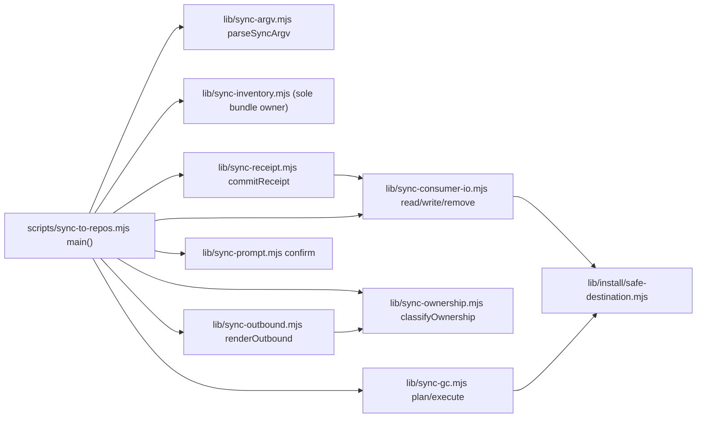

# Plan: sync-to-repos debt cluster (16 still-present defects)
- **Date**: 2026-11-17
- **Status**: Draft
- **Author**: Claude + Louis
- **Scope**: backend (Node ESM CLI + `scripts/lib/**`; stack `js-ts`)
- **Target domain(s)**: `install`, `shared-lib`
- ⚠ **Cross-domain work** — touches >1 domain; the crossing (CLI → its own `sync-*` libs) is the existing, intended direction.
- **Tier-3 seam**: the consumer sync / relocation contract (AGENTS.md §Testing doctrine). Every defect lands with its test in the SAME commit.

**Neighbourhood considered**: `get-neighbourhood` returned only `review` band records, all inside
`scripts/sync-to-repos.mjs` itself (`main`, `readSource`, `bundleForRepo`, `realMissingDeps`, …): nothing
outside the file occupies this space. Reuse decisions below are made on the code, not the band.
Incident neighbourhood: INC-002 only (DB DSN), unrelated to these paths.

## 1. Context Summary

The census (`.claude/tmp/census/sync-verdicts.json`, read at `8ce88fc2`) lists 16 STILL-PRESENT topics.
Each was re-read against the code at `8ce88fc2` for this plan. Verdict after re-verification:

| # | topicId | Sev | Re-verified verdict |
|---|---|---|---|
| D1 | 7798d3cef2ea | HIGH | **Real, and worse than stated.** `--target` with no value, `--target ""`, and `--target=wine` all resolve `targetFilter` to a falsy value, so the run syncs EVERY consumer. `--target=x` passes `assertKnownFlags` (it checks the name half) and then `indexOf('--target')` misses it. |
| D2 | 3b96a5ef7971 | HIGH | **Real.** 9 consumer write/unlink sites skip `assertContainedDestination`. |
| D3 | 489588c47264 | HIGH | **Half real.** The *override* half is not real; the *divergence* half is. Details in §8. |
| D4 | 8fca02c6915a | HIGH | **Real, destructive.** A `.gitignore`/`.gitattributes` read that fails (EACCES/EBUSY) becomes `null`. `updateManagedBlock(null, …)` then builds a fresh file holding only the managed block, and the write REPLACES the consumer's whole file. |
| D5 | d6003d6472e6 (+dup e6d20a3a2532) | HIGH | **Real.** The receipt is read before the copy loop and rewritten from that snapshot. Also found: an *unreadable or malformed* receipt reads as "no prior", so the late write replaces the append-only history with one entry. |
| D6 | ae70a5d51c16 | HIGH | **Real.** `dst === src` is taken as proof of ownership. `.claude/skills/` is a shared Claude Code discovery root, so a consumer's own same-named skill there gets overwritten. |
| D7 | 4e0763d54f00 | HIGH | **Real.** The manifest base is re-read from disk after the loop, so a concurrent edit in that window gets recorded as our base. |
| D8 | 8e5974a92c98 (+umbrella d13d16b568ce) | MED | **Half real.** `readSource` catch→null is real: an unreadable entry file drops its whole import subtree from the bundle, and GC then deletes that subtree from consumers. The `realMissingDeps` regex is **not a defect** (§8). Of the umbrella's other parts, the lease-spawn part is already fixed (`lib/fleet/lease-spawn.mjs:30` c729 note, `stopTree` returns `{ok:false}`). The relocation-scan part is outside this claim and is recorded as a Finding. |
| D9 | 3627c83a | MED | **Real.** `sync-to-repos.mjs` and `sync-inventory.mjs` each define `CORE_ASSETS`, `EDITOR_FILES`, `CLAUDE_CODE_FILES`, `CORE_NON_IMPORTABLE`, `buildFileUniverse`, `readSource`, `resolveBundle`, `bundleForRepo` and `syncMigrations`, with "keep in lock-step" comments. |
| D10 | 07a3dbdd565b | MED | **Real.** Every `.json` destination is `deepMerge`d. For an upstream-exclusive file (`scripts/.claude-skills/lib/oss-call-policy.json`, `bundle-deps.json`, `.audit-loop/expected-schema.json`), a key that upstream deletes is never deleted downstream. |
| D11 | 77c917615461 | MED | **Real.** The ownership comparand runs EOL→rewrite→banner, but the writer also runs JSON parse→merge→stringify. A byte-identical JSON orphan therefore reads as a collision. |
| D12 | f4d57e36c0e2 | MED | **Real, and worse than stated.** On Ctrl-D or a closed stdin the promise never settles. With no handles left, node exits **0** mid-run. |
| D13 | cc838c26f9e4 | MED | **Real.** The EOL-only rewrite runs before `matchOverride`, so it rewrites a path the consumer declared held. |
| D14 | ad2fd650d8bd | MED | **Real.** A receipt write failure only logs, yet `detectSourceRollback` reads the latest receipt entry. |
| D15 | 2e26f79ebd92 | MED | **Real.** The boolean flags use `process.argv.includes`, which ignores `--`. `assertKnownFlags` stops at `--`. |
| D16 | f307dfbf6320 | MED | **Real.** The parity test asserts that `scripts/<rel>` appears as TEXT in the sync source, so a mention in a comment satisfies it. |

### Code Trace (all at `8ce88fc2`)

- argv: `scripts/sync-to-repos.mjs:193-243` (8ce88fc2) module-scope constants →
  `KNOWN_FLAGS` `:858` → `assertKnownFlags` `:913` (`scripts/lib/cli-io.mjs:383-399`, stops at `--`, accepts `=`) →
  target gate `:935-965` (`targetFilter ? filter : REPOS`).
- bundle: `readSource` `:386-389` → `collectImportClosure` `scripts/lib/module-graph.mjs:240`
  (`content == null → continue`) → `bundleForRepo` `:495` → `repo.files` → GC `planGarbageCollection`
  `scripts/lib/sync-gc.mjs:81-93`. Duplicate pipeline in `scripts/lib/sync-inventory.mjs:39-236`.
- receipt: read `:1212-1221` → `detectSourceRollback` `:1229` → … → `appendReceiptEntry` + write `:2084-2096`
  (`scripts/lib/sync-receipt.mjs:199,384,410`).
- preflight: `.gitignore` read `:1279-1282` → `updateManagedBlock` → write `:1981`; `.gitattributes` `:1326-1329` → write `:1971`.
- ownership: `ownedByInventoryNonRelocating` `:1391-1394`; comparand `:1413-1420` (no JSON stage) vs writer `:1534-1594`.
- writes: journal `:1492`, payload `:1654,:1755` (contained), manifest `:1894`, sidecar `:1906`, watermark `:1918`,
  gitattributes `:1971`, gitignore `:1981`, journal unlink `:2027`, receipt `:2086`; plus
  `patchManifestWithExtraHashes` (`scripts/lib/sync-manifest.mjs`) and `scripts/lib/sync-legacy-copilot-block.mjs`
  write/unlink. The containment oracle is `assertContainedDestination` (`scripts/lib/install/safe-destination.mjs:169`).
- EOL vs override: `eolOnlyDiff` write `:1645-1663` precedes `matchOverride` `:1679`.
- manifest base: `consumerFileMap` loop `:1862-1875` re-hashes `fs.readFileSync(abs)`.
- prompt: `maybePromptSharedCloudUpdate` `:2253-2261`.
- parity test: `tests/cli-smoke-set-sync-parity.test.mjs:29-35,81`.

**Measured** (2026-11-17, reading each consumer's `scripts/.claude-skills/.sync-manifest.json` with node): wine-cellar-app,
ai-organiser and storyline are all `layout: isolated`, with 1142 entries each, 167 of them `.claude/skills/**`.
So tightening D6 only affects destinations that are absent from a consumer's manifest. Today that is no
`.claude/skills/` path, so the tightening cannot mass-abort a consumer.

**Size gate (measured)**: `scripts/sync-to-repos.mjs` is 2298 lines against a baseline of 2300. Every PR must
leave it ≤ baseline. The D9 unification (Cluster B) deletes about 200 duplicated lines and runs early to buy
headroom. A shrink fails `size:ratchet:gate` until the baseline is re-recorded DOWNWARD in
`.file-size-baseline.json`. Lowering the baseline is not raising a cap.

Patterns reused: `assertContainedDestination` (containment), `ArgvError` + exit 2 (`:2290`),
`createPriorUpstreamResolver().matches` (`scripts/lib/sync-divergence.mjs`) for prior-upstream provenance,
`classifyOwnership` (`scripts/lib/sync-ownership.mjs`), `mayStillExist` (`scripts/lib/sync-gc.mjs`, the tri-state
precedent), and `appendReceiptEntry` (append-only merge).

## 2. Proposed Architecture

### Key design decisions

**A. One argv parser (D1, D15): `scripts/lib/sync-argv.mjs`** (#5 SSOT, #12 validation, #15 error handling)
- `parseSyncArgv(argv) → { flags:{dryRun,noPrompt,adoptOrphans,overwriteDiverged,allowRollback,allowStaleBase,quietLegacyCheck}, target, targetPath, errors:string[] }`.
  It is pure, never throws, and scans only the region before `--`, matching `assertKnownFlags`.
- A value flag (`--target`, `--target-path`) accepts `--flag value` and `--flag=value`. A missing value, an
  empty value, or a value starting with `--` is an ERROR, never "absent". Repeating a value flag is an error,
  because which occurrence wins is ambiguous on a command that writes into other repos.
- The module-scope constants become reads of one `const ARGV = parseSyncArgv(process.argv)`. It still evaluates
  at import, but it cannot throw, so the test that imports this module still works. `main()` throws
  `ArgvError(ARGV.errors.join('; '))` straight after `assertKnownFlags`, before any target is resolved. The
  existing catch turns that into exit 2.
- Not reused as is: `requiredFlagValue` (`scripts/lib/cli-io.mjs:224`) misses the `=` form, `--` and the empty
  value; `argOption` falls back silently. Changing either would alter their other callers, and `cli-io.mjs` is
  outside this claim. A Finding proposes folding the shared shape into `cli-io` later.

**B. The bundle has one owner (D8, D9, D16)** (#1 DRY, #5 SSOT)
- `sync-to-repos.mjs` imports `bundleForRepo`/`getSyncClosure`, `readSource` and `realMissingDeps` from
  `scripts/lib/sync-inventory.mjs` and deletes its own copies. Lists that only one side has (e.g.
  `NON_CODE_FILES`) move into the library first. The entry lists stay in `scripts/lib/sync-entry-lists.mjs`.
- **Behaviour-preservation oracle**: at the base commit, a scratch script captures `bundleForRepo()` from
  BOTH modules (the CLI's copy via `_internals`, which already exports the entry arrays; the private function
  is exposed for the capture only). After the change, the single bundle must be byte-identical to the CLI's
  former list. Any difference is a pre-existing drift: report it, and decide per entry with evidence.
- `readSource`: ENOENT/ENOTDIR → `null` (absence). Any other error THROWS `SourceReadError` naming the path
  and code. The throw happens during bundle resolution, before any consumer is touched, and aborts the run
  (exit 1). A declared ENTRY point that is absent is also fatal (`MissingEntryPointError`), because its
  subtree would otherwise vanish from every consumer and be GC-deleted (AGENTS.md: a read-path catch must not
  render a failure as an empty result).
- `realMissingDeps` moves unchanged (§8 explains why its regex stays).
- The parity test (D16) asserts on the COMPUTED closure: `CLI_SMOKE_SET ⊆ getSyncClosure().files` (mapped to
  `scripts/<rel>`), and the source-only CLIs `∉ files`. `tests/sync-inventory-parity.test.mjs` becomes a pin
  that `sync-to-repos.mjs` declares no inventory array of its own. It parses `export`/`const` declarations
  rather than matching text; one AST-free regex over `^const (CORE_ASSETS|EDITOR_FILES|…) =` is enough
  because the pin's subject is a declaration.

**C. One consumer-IO seam (D2, D4): `scripts/lib/sync-consumer-io.mjs`** (#5, #15, #16)
- `readConsumerFile(root, rel) → {state:'absent'} | {state:'present', content} | {state:'unreadable', code, message}`.
  It contains the path first (`assertContainedDestination`); a containment refusal is `unreadable`.
  Absent means ENOENT/ENOTDIR only (the `mayStillExist` rule).
- `writeConsumerFile(root, rel, content)` = contain → `mkdirSync(dirname)` → `atomicWriteFileSync`.
  `removeConsumerFile(root, rel)` = contain → unlink, with ENOENT treated as success.
- Every consumer write/unlink in the CLI goes through these: journal, manifest, sidecar, watermark,
  gitattributes, gitignore, journal unlink, receipt. So does `patchManifestWithExtraHashes`, whose signature
  takes `(root, rel)` instead of an absolute path, and so do the legacy-copilot-block write and unlink.
  Payload writes keep calling `assertContainedDestination` directly, through `writeConsumerFile`, so there is
  ONE write primitive.
- `.gitignore`/`.gitattributes`: `unreadable` → `ABORT <file> preflight: could not read (<code>)` with
  `totalErrors++` and `continue`, the same shape as the existing preflight aborts. Nothing is written.

**D. Receipt integrity (D5, D14)**: in `scripts/lib/sync-receipt.mjs` (#14 transaction safety, #15)
- The prior receipt is read through `readConsumerFile`. If it is `unreadable` OR present but unparseable,
  the target ABORTS before any write: `receipt is unreadable/malformed — resolve it (a merge conflict in a
  tracked file is the common cause) or move it aside`. The rollback guard cannot answer, and the late write
  would destroy the history. This is fail-closed for a safety guard's input, and it matches the existing
  `unsupported` refusal.
- The write becomes `commitReceipt({root, startSnapshot, entry})`. It re-reads the receipt at commit time.
  If the bytes changed since the start snapshot, it appends `entry` onto the FRESH parsed receipt (the record
  is append-only, so merging is an append) and logs `receipt changed during sync — merged onto the current
  record`. If the fresh read is unreadable or malformed, it does not write. Returns
  `{written|merged|declined|failed, reason}`.
- `failed` or `declined` (other than "no change worth writing") counts as a TARGET ERROR (`repoErrors++`,
  `totalErrors++`), so the exit code carries it. The rollback guard depends on this record, the same
  reasoning that made the manifest write fatal.
- **Residual, stated rather than hidden**: re-read-then-rename leaves a sub-millisecond window. Two whole
  syncs into ONE consumer at once also race on every payload file and on the manifest, not only on the
  receipt. Serialising whole runs per consumer is a separate design (a lock with liveness and staleness),
  recorded as a Finding rather than built here.

**E. Outbound is rendered once (D10, D11): `scripts/lib/sync-outbound.mjs`** (#1, #5)
- `renderOutbound({srcRel, dstRel, srcContent, existingContent, rewriteConfig}) → {content, rewrite:{changed,hits}, pinsHeld, isJson}`
  runs, in this order, the EOL fold, then the JSON stage, then the pin guard with its post-condition, then
  the rewriter, then the banner. The writer loop calls it, and so does the ownership comparand. "What we
  would write" therefore has exactly one definition.
- The JSON merge policy is DERIVED from the layout, not hand-listed: `deepMerge` only when
  `sourceRelToDestRel(srcRel) === srcRel` (non-relocated, consumer-namespace files:
  `.claude/settings.json`, `.vscode/mcp.json`, `.windowed-views.json`). A RELOCATED destination is
  upstream-exclusive and is REPLACED, still through the canonical `JSON.stringify(v,null,2)+'\n'`. The
  predicate is exported as `isCoOwnedJsonDest(srcRel)` next to `sourceRelToDestRel` in
  `scripts/lib/sync-path-map.mjs`, the layout's single source of truth.
- A consumer edit to a relocated JSON file now reaches the divergence gate. Before this change, `deepMerge`
  masked it. Such files are gitignored, so they take the `diverged-untracked` route → WRITE_LOUD, recorded in
  the receipt. That is the existing policy for every other tooling file.
- The comparand passes `existingContent: destContent` for a co-owned JSON file, which is the merge the
  writer would perform, and `null` otherwise.

**F. Ownership requires evidence (D6)** (#15 fail closed)
- An inventory-owned destination (`dst === src`, absent from the manifest, not journalled) is owned only if
  one of these holds: (a) `classifyOwnership` with the unified comparand says provable; (b)
  `priorUpstream.matches(srcRel, sha256(dest)) === true` (a byte-identical earlier upstream version; the
  resolver already exists and is budgeted); or (c) the destination is co-owned JSON (merge preserves the
  consumer's keys). Anything else is a collision. `--adopt-orphans` still overrides, and the unknown
  (`null`) answer is a collision.
- The `inventoryOwned` note now names which evidence each path carried.

**G. EOL repair respects declarations (D13)**
- `override = matchOverride(...)` is computed BEFORE `eolOnlyDiff`. With an active override, the EOL repair
  is skipped and the path falls through to `decideAction`, which returns HOLD and records it in
  `overridesHeld`. That is three moved lines, no growth.

**H. The manifest records what we wrote (D7)**
- The loop records `writtenHash.set(dstRel, 'sha256:'+srcHash)` on each of its three paths: unchanged
  (`srcHash === dstHash`), EOL-repaired, and written. The manifest build uses `writtenHash` for those and
  carries the prior entry for not-written paths (unchanged logic). The post-loop `readFileSync` is gone.
  `sync-isolation-verify` gate 2B (manifest vs disk) is then a real transfer check instead of a tautology.

**I. GC asks the divergence question (D3)**
- `planGarbageCollection` gains a `diskHash(rel)` probe. A deletion candidate whose disk hash ≠ its prior
  manifest base is split into `divergedDeletions`. These are still deleted: tooling-dir files are gitignored,
  and the write path's policy for a diverged untracked file is WRITE_LOUD. Each one prints
  `deleted consumer-edited file (upstream retired it)` and is recorded in the receipt's
  `divergedOverwritten` with reason `diverged-retired-upstream`. A probe failure (`null`) counts as diverged,
  i.e. loud.

**J. The prompt always settles (D12): `scripts/lib/sync-prompt.mjs`**
- `createConfirmPrompt({input, output}) → (q) => Promise<boolean>`. On `close` with no answer it resolves to
  `false` (decline) and writes a newline plus `no input — declined`. The settle-once guard is a local flag.

## 6. Sustainability Notes
- Four new small modules each own one seam: argv, consumer IO, outbound render, prompt. The CLI shrinks.
  A future value flag is one entry in `sync-argv.mjs`'s table.
- The JSON co-ownership rule follows the layout map. A newly relocated JSON asset is upstream-exclusive by
  default, with no list to forget.
- The assumption that could change: "relocated ⇒ upstream-exclusive". An asset that must ever be co-owned
  AND relocated would need an explicit exception in `sync-path-map.mjs`. That is acceptable: none exists
  today, and the failure is loud (WRITE_LOUD), not silent.

**Right-sizing gate**
- *Band-aid*: guard `targetFilter === undefined`; wrap each write in its own `assertContainedDestination`;
  re-read the receipt only.
- *Over-engineered*: a general argv framework for all CLIs; a per-consumer distributed run lock; a pluggable
  JSON-merge-policy config file.
- *Chosen*: one parser for this CLI's flags, one IO seam, one render function, and receipt CAS. Each serves a
  defect present today; the run lock and the cross-CLI parser are deferred as Findings with stated residuals.

**Manual vs scripted**: manual. There are about 12 write-site edits, each with different context.

## 7. File-Level Plan

| File | Intent | Purpose |
|---|---|---|
| `scripts/lib/sync-argv.mjs` | create | `parseSyncArgv` (D1, D15) |
| `scripts/lib/sync-consumer-io.mjs` | create | `readConsumerFile`/`writeConsumerFile`/`removeConsumerFile` (D2, D4) |
| `scripts/lib/sync-outbound.mjs` | create | `renderOutbound` (D10, D11) |
| `scripts/lib/sync-prompt.mjs` | create | `createConfirmPrompt` (D12) |
| `scripts/lib/sync-path-map.mjs` | modify | export `isCoOwnedJsonDest` (D10) |
| `scripts/lib/sync-inventory.mjs` | modify | sole bundle owner; fail-closed `readSource`; `realMissingDeps` (D8, D9) |
| `scripts/lib/sync-receipt.mjs` | modify | `commitReceipt` CAS (D5, D14) |
| `scripts/lib/sync-gc.mjs` | modify | `divergedDeletions` (D3) |
| `scripts/lib/sync-manifest.mjs` | modify | `patchManifestWithExtraHashes(root, …)` contained (D2) |
| `scripts/lib/sync-legacy-copilot-block.mjs` | modify | writes and unlinks via the IO seam (D2) |
| `scripts/sync-to-repos.mjs` | modify | consume the above; net shrink |
| `.file-size-baseline.json` | modify | re-record `scripts/sync-to-repos.mjs` DOWNWARD only |
| `tests/sync-argv.test.mjs` | create | D1/D15 |
| `tests/sync-consumer-io.test.mjs` | create | D2/D4 units |
| `tests/sync-outbound.test.mjs` | create | D10/D11 |
| `tests/sync-prompt.test.mjs` | create | D12 |
| `tests/sync-debt-cluster-e2e.test.mjs` | create | the e2e red→green set (temp source + temp consumer, real CLI spawn) |
| `tests/sync-receipt.test.mjs` | modify | `commitReceipt` cases |
| `tests/sync-gc.test.mjs` | modify | diverged deletions |
| `tests/sync-inventory-parity.test.mjs` | modify | pin: the CLI declares no inventory arrays |
| `tests/cli-smoke-set-sync-parity.test.mjs` | modify | assert on the computed closure (D16) |
| `docs/plans/sync-to-repos-debt-cluster.md` | create | this plan |

The e2e harness reuses the existing spawn harness of `tests/sync-target-path.test.mjs` and
`tests/sync-consumer-divergence-e2e.test.mjs`: `--target-path <tmp consumer>`, with a temp `HOME` and a
scrubbed env. It does not add a new one.

### 7b. Implementation Phases

**Phase 1 — Argv**: parser plus wiring; the first commit. Files: `scripts/lib/sync-argv.mjs` (create), `scripts/sync-to-repos.mjs` (modify), `tests/sync-argv.test.mjs` (create).
**Phase 2 — Inventory owner**: unify the bundle, fail-closed `readSource`, parity on the computed closure. Files: `scripts/lib/sync-inventory.mjs` (modify), `scripts/sync-to-repos.mjs` (modify), `tests/sync-inventory-parity.test.mjs` (modify), `tests/cli-smoke-set-sync-parity.test.mjs` (modify), `.file-size-baseline.json` (modify).
**Phase 3 — Consumer IO seam**: contained writes everywhere, tri-state preflight reads. Files: `scripts/lib/sync-consumer-io.mjs` (create), `scripts/lib/sync-manifest.mjs` (modify), `scripts/lib/sync-legacy-copilot-block.mjs` (modify), `scripts/sync-to-repos.mjs` (modify), `tests/sync-consumer-io.test.mjs` (create), `tests/sync-debt-cluster-e2e.test.mjs` (create).
**Phase 4 — Receipt + prompt**: CAS commit, fail-closed prior read, write failure is an error, prompt settles. Files: `scripts/lib/sync-receipt.mjs` (modify), `scripts/lib/sync-prompt.mjs` (create), `scripts/sync-to-repos.mjs` (modify), `tests/sync-receipt.test.mjs` (modify), `tests/sync-prompt.test.mjs` (create), `tests/sync-debt-cluster-e2e.test.mjs` (modify).
**Phase 5 — Outbound + ownership**: `renderOutbound`, JSON co-ownership rule, evidence-based inventory ownership. Files: `scripts/lib/sync-outbound.mjs` (create), `scripts/lib/sync-path-map.mjs` (modify), `scripts/sync-to-repos.mjs` (modify), `tests/sync-outbound.test.mjs` (create), `tests/sync-debt-cluster-e2e.test.mjs` (modify).
**Phase 6 — Write-loop accounting**: EOL vs override, manifest from written hashes, GC divergence. Files: `scripts/lib/sync-gc.mjs` (modify), `scripts/sync-to-repos.mjs` (modify), `tests/sync-gc.test.mjs` (modify), `tests/sync-debt-cluster-e2e.test.mjs` (modify).

**Close-out (not a phase)**: `npm run guards:preflight`; `npm run size:ratchet:gate`; `npm run skills:check`; `node scripts/sync-to-repos.mjs --dry-run --target <each of wine, ai-organiser, storyline>` (read-only; zero new `collide`/`ABORT` lines vs a base-commit dry run, saved to scratch and diffed). The full suite runs in GitHub Actions (`full-suite.yml`).

## 8. Risk & Trade-off Register

**Concluded not real (no fix, evidence)**
- D3 *override half*: overrides may never claim the tooling dir (`scripts/lib/sync-overrides.mjs:70-72`,
  `CONSUMER_TOOLING_DIR` is in the never-claimable list). GC deletes only under the tooling dir
  (`sync-gc.mjs:89-90`), and held paths are in `intendedDests`, so GC skips them (`:88`). An override and a
  GC deletion cannot meet.
- D8 *`realMissingDeps` regex*: `parseImports` captures only quoted literals (`module-graph.mjs:174-179`,
  `[^'"\n]+`). A specifier containing whitespace, a backtick, `$`, `{` or `}` is a fragment of a template
  literal, which no static walker can resolve. Repo paths never contain those characters. Filtering them
  drops noise, never a resolvable path. Moved unchanged.
- Umbrella d13d16b568ce *lease-spawn part*: already fixed (`stopTree` returns `{ok:false, why}` for every
  non-gone failure, `scripts/lib/fleet/lease-spawn.mjs:30-56`).

**Behaviour changes a consumer will see** (each loud, none silent)
- A malformed or unreadable tracked receipt now ABORTS the target (previously its history was silently
  replaced).
- A relocated JSON file with consumer-added keys gets one `upd` + `overwrote consumer content` line, then
  stays stable.
- `--target` misuse is exit 2 instead of a sync of all consumers.
- Ctrl-D at the cloud-config prompt declines instead of exiting 0 mid-run.

**Risks**
- D6 could abort a consumer whose manifest lost `.claude/skills/**` entries and whose skills carry rewrites
  (so `priorUpstream` cannot rebuild them). Mitigations: measured, all three manifests record those 167
  paths today; the abort is loud and `--adopt-orphans` is the documented remedy; the close-out dry run
  against all three consumers must show no new collisions.
- The Phase 2 unification may reveal real drift between the two lists. The oracle makes it visible, and each
  difference is decided with evidence rather than assumed.
- Size: Phases 3–6 add call sites. Each phase must end ≤ baseline. Cluster B's shrink is the headroom, so
  Cluster B lands before C and D.

**Deferred (true scope boundaries, recorded as Findings)**
- Serialising whole concurrent syncs per consumer (a lock with liveness). It is independent of D5's stated
  lost update, which CAS fixes.
- Folding `parseSyncArgv`'s value-flag shape into `scripts/lib/cli-io.mjs` for every CLI (outside this claim).
- The relocation-scan part of umbrella d13d16b568ce (not in the sync paths; unverified).

## 9. Testing Strategy

Unit tests cover the four new modules and the changed `sync-receipt`/`sync-gc` functions, using injected fs and stream seams.
Integration tests in `tests/sync-debt-cluster-e2e.test.mjs` spawn the real CLI against a temp consumer, because the Tier-3
contract is the bytes a consumer receives.

**PROOF PLAN**: each defect gets a test that is RED on the parent commit and GREEN on its own commit (the
red is captured by running the new test against the parent's source in a pinned `git worktree`) / the final
report shows per defect the test name, the red failure line and the green pass, plus the base-vs-head
dry-run diff over the three consumers, the bundle-identity diff, and the CI run id.

| D | Oracle (red on parent → green) |
|---|---|
| D1 | **Unit only, by design.** `CONSUMER_REPOS` always merges the real `BASE_REPOS` (`scripts/lib/consumer-repos.mjs:316`), so a red-on-parent CLI spawn of a trailing `--target` would SYNC THE REAL CONSUMERS. No test may spawn the CLI with a `--target` form that, on the parent, means "all". The oracle is a pure `selectTargets(parsed, repos)` exported beside `parseSyncArgv`, given fixture repos: trailing `--target`, `--target ""`, `--target=`, `--target --dry-run` → errors; `--target=wine` → exactly `[wine]`. The red evidence replays the parent's two expressions (`:221-236`) verbatim inside the test as a named `parentSelect` fixture, which returns ALL repos for those inputs. A safe e2e (after the fix only) spawns `--target` (trailing) and asserts exit 2 before any target resolution, by checking that stdout carries no target header. |
| D15 | `-- --dry-run` does NOT set dry-run (the parent sets it); e2e on a temp consumer: the args after `--` are ignored by both the validator and the reader. |
| D2 | A temp consumer whose `scripts/.claude-skills` is a junction/symlink to an outside dir: after the run the outside dir has no manifest, journal, watermark or sidecar (on the parent, the manifest lands outside). Unit: each IO function refuses an escaping rel. |
| D4 | `.gitignore` made unreadable (an injected `readFile` seam in the unit; e2e on POSIX via `chmod 000`, skipped with a stated reason on win32 where chmod cannot deny reads; the unit covers it there): the target ABORTs and the `.gitignore` bytes are unchanged. Parent: the file is replaced by the managed block. |
| D5 | Unit `commitReceipt`: the snapshot is stale because another writer appended an entry; the result keeps BOTH entries. Parent equivalent (`appendReceiptEntry(prior)`) drops one. Malformed prior receipt: e2e target ABORT, receipt bytes unchanged. |
| D14 | `commitReceipt` write fails (injected) → result `failed`; e2e with a read-only receipt (POSIX) gives exit ≠ 0. Parent: exit 0. |
| D6 | e2e: the consumer has its own `.claude/skills/<shipped-name>/SKILL.md` (no banner, not an earlier upstream blob, not in the manifest). Result: `ABORT … collide` and the file is unchanged. Parent: overwritten. Positive control: a byte-identical prior upstream version is still adopted. |
| D7 | Unit-level seam: the manifest builder is given `writtenHash` while the disk differs → the manifest records `writtenHash`. e2e: hard to race, so the unit is the oracle; it is stated as such in the report. |
| D8 | `readSource` with an injected EACCES throws `SourceReadError`; a missing declared entry throws `MissingEntryPointError`; ENOENT for a non-entry file returns null. Parent: returns null. |
| D9 | The bundle-identity oracle (§2 B), plus the pin test: `sync-to-repos.mjs` declares none of the inventory consts. It is red on the parent because they exist there. |
| D10 | e2e: the consumer's relocated `oss-call-policy.json` has an extra key that upstream lacks → after the sync the key is gone, and a `divergedOverwritten` receipt entry exists. Parent: the key persists. Control: `.claude/settings.json` consumer keys are preserved. |
| D11 | Unit: for a JSON source whose raw bytes ≠ its canonical stringify, `renderOutbound` used by the comparand equals the writer's output. e2e: a byte-identical canonical JSON orphan is content-owned (not a collision). Parent: collision. |
| D12 | Unit: a PassThrough input ended with no data → the promise resolves `false` within 100 ms. Parent's logic: never resolves (asserted with a timeout race). |
| D13 | e2e: an overridden path whose content differs only in EOL → bytes unchanged and `hold` recorded. Parent: rewritten to LF. |
| D3 | Unit `planGarbageCollection` with `diskHash` ≠ base → the path is in `divergedDeletions`; e2e: a loud line and a receipt entry. Parent: a silent delete. |
| D16 | Negative control: a fixture `CLI_SMOKE_SET` entry that appears only in a COMMENT of the sync source. The old text predicate passes it and the new closure predicate fails it. Both predicates are exercised as functions with a fixture. |

**Test-safety invariant**: every e2e spawn passes `--target-path <tmp consumer>` (the single-target route),
and runs only after its fix has landed on the branch. Red-on-parent evidence for any argv-dependent behaviour
comes from units, never from spawning the parent CLI. A spawn whose parent behaviour could reach the
registry is forbidden (D1 row).

Edge cases: `--target=` (empty after `=`); a duplicated `--target`; a receipt changed to a NEWER version
mid-run (`commitReceipt` → `declined: unsupported`); a dangling symlink at the gitignore path (`absent`
follows links, as in `mayStillExist`).

Test log: targeted runs of `tests/sync-*.test.mjs` and the new files locally. The full suite runs in GitHub
Actions (CES: `full-suite.yml`). If `fleet next` reports `fullSuite: "train"`, it is deferred per that rule.

## 11. Execution Clustering

- **Cluster A** — Phases 1–1 — fix-gate: yes
  - Coupling: standalone; the most dangerous and smallest defect. Its own commit and its own PR, landing first.
- **Cluster B** — Phases 2–2 — fix-gate: yes
  - Coupling: the bundle seam (`readSource` → closure → `repo.files` → GC); creates the size headroom the later clusters spend.
- **Cluster C** — Phases 3–4 — fix-gate: yes
  - Coupling: the consumer-IO seam; the receipt's commit reads and writes through `sync-consumer-io.mjs`, so they are audited together.
- **Cluster D** — Phases 5–6 — fix-gate: final
  - Coupling: the per-file write loop — the comparand, the writer, the EOL/override order, the written-hash record and GC all read the same loop state.
- **Final gate**: consolidated Gemini final review over the union diff of each PR; one PR per cluster unless the coordinator merges them.
