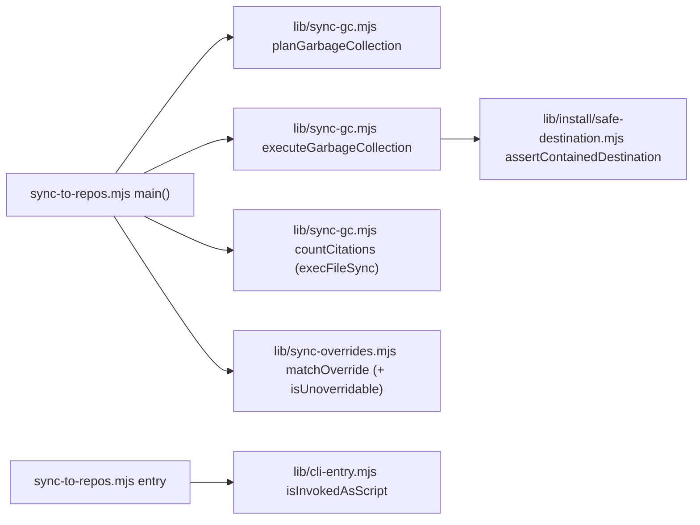

# Plan: sync-to-repos failure honesty (verified audit hypotheses from #231)
- **Date**: 2026-10-13
- **Status**: Complete — shipped in #233, #236 (H6 receipt/manifest lock stays recorded debt) (status reconciled against merged PRs 2026-10-25)
- **Author**: Claude + Louis
- **Scope**: backend (stack `js-ts`)
- **Target domain(s)**: `install`, `shared-lib`
- ⚠ **Cross-domain work**: touches more than one domain. This is intentional. The two new helpers sit in `scripts/lib/` and are called from the `install`-domain CLI.

> **Neighbourhood considered**: every candidate came back `review` (below the noise floor). The nearest was `main` in `scripts/sync-to-repos.mjs`, at 0.68. No precedent for a GC executor or a canonical-path entry guard. The repo has about 60 ad-hoc `import.meta.url === …argv[1]` guards and no shared helper (§8).
>
> **Past incident to verify against**: INC-001 (`manual-verification-required`). A lexical path check was trusted where a link resolved elsewhere. H2 below is the same class on the delete side.

## 1. Context Summary

**Origin.** PR Lbstrydom/claude-engineering-skills#231's cluster-B round-1 GPT audit (2026-10-13) raised nine hypotheses about pre-existing code in `scripts/sync-to-repos.mjs`. They were dismissed for independence, never verified. Each one below was checked against `origin/main` **be057735** and reproduced with a throwaway fixture consumer under `C:/tmp/ces-sync-findings/` driven through the real CLI (`tests/helpers/consumer-fixture.mjs` `runSyncCli`). No real consumer was synced.

| # | Verdict | Evidence (measured, be057735) |
|---|---|---|
| H1 | **real** (correctness). Not exploitable: the operator controls argv, and `"` is not a legal Windows filename character. | `unifiedDiff` `scripts/sync-to-repos.mjs:1120-1133 (be057735)` and the citation lookup `:2154`, both shell strings. Consumer at `C:/tmp/…/h1%OS%dir`: `--dry-run` printed `(diff unavailable: Command failed: git diff --no-index … "C:\tmp\ces-sync-findings\h1%OS%dir\…"`. cmd.exe expanded `%OS%`, so git was handed a path that does not exist. |
| H2 | **real** | GC loop `:2169-2177 (be057735)` unlinks `path.join(repo.path, dRel)` with no containment check. `scripts/.claude-skills` was replaced by a junction to `C:/tmp/…/h2-outside` and a retired manifest key added. The sync exited **0** with `gc: removed 1 stale file(s)`, and the file **outside the consumer** was gone. The write-side guard (`:2097`) never fired, because every file was `unchanged` and `assertContainedDestination` only runs on a write. |
| H3 | **real** | `notWrittenByUs` `:2221-2224 (be057735)` omits failed writes, so `:2245-2248` hashes the on-disk bytes as our base. Repro: consumer commits an edit to `.claude/skills/plan/SKILL.md`, file made read-only, then `sync --overwrite-diverged` (`EPERM … rename`, exit 1). The manifest base afterwards was the **consumer's bytes**. The next sync without consent printed `upd …SKILL.md`, exited **0**, and overwrote the committed consumer work. The one-time consent was laundered into a standing one. |
| H4 | **real** | `:2171-2176`: a non-ENOENT unlink failure only warns. Repro (failure injected by putting a directory at the path): exit **0**, `Errors: 0`, `gc warn … EPERM`. The receipt's `gcDeleted` listed the path, the manifest no longer tracked it, and the next run never retried. The file sits there indefinitely. |
| H5 | **false-positive as stated** | GC only deletes paths under `scripts/.claude-skills/` (`:2133`). `validateOverrides` refuses any override whose path or glob *starts with* that prefix (`scripts/lib/sync-overrides.mjs` `UNOVERRIDABLE_PREFIXES`), so GC cannot meet a legitimate override. **Adjacent real defect, H5′:** the ban is a prefix test on the declaration, not a test of what the glob can match. With `{"glob":"**/*.mjs"}` the sync printed `hold scripts/.claude-skills/cross-skill.mjs (held by .sync-overrides.json …)` and a consumer patch of an upstream-owned file survived. That breaks the governance rule the ban exists for. No real consumer uses a glob today (read-only check of wine-cellar-app, storyline, ai-organiser). |
| H6 | **real race, unreachable in the supported operating model.** Recorded as debt, not fixed. | The receipt is read at `:1562-1567` and written at `:2452-2454`. The manifest has the same read-modify-write (`:1522-1530` → `:2266`), and so do the payload files. A receipt-only fix would be a band-aid; the real fix is a per-target lock over the whole critical section. Two concurrent syncs into one consumer checkout need two simultaneous `npm run sync` runs (coordinator-serialised: "one heavy CES job at a time"). Alternatively, two local pushes of the default branch: since 2026-09-25 that branch moves only by PR squash-merge, and sessions are not authorised to push it. |
| H7 | **real** | `:2342-2355 (be057735)`: failures in the managed block write are logged, not counted. Repro: `.gitignore` made read-only, then a first sync gave exit **0**, `Errors: 0`, `.gitignore write failed: EPERM`, and `git status` showed `?? scripts/.claude-skills/`. All 931 tooling files were left unignored and committable. |
| H8 | **real** | `invokedAsScript` `:2697-2704` compares `pathToFileURL(path.resolve(argv[1]))` with `import.meta.url`, which Node realpaths for the main module. Running `node C:/tmp/…/h8/wt/scripts/sync-to-repos.mjs --bogus-flag` through a junction gave exit **0** with no output. `main()` never ran. Case variants of the canonical path (`c:/`, `C:/git/`) exit 2 correctly. |
| M2 | **real** (low reachability) | `syncMigrations` `:604-614` returns `[]` on *any* `readdirSync` error. A non-ENOENT failure (EACCES, ENOTDIR, EMFILE) silently drops all 138 migrations from the bundle. Their destinations are outside the tooling dir, so they degrade to an advisory orphan list, and the run exits 0. |

**Code Trace (be057735).** `main` `scripts/sync-to-repos.mjs:1259`. The per-target loop reads the prior manifest at `:1522-1530`, overrides at `:1540`, the prior receipt at `:1562-1567`, and preflights `.gitignore`/`.gitattributes` previews at `:1629`/`:1686`. The per-file loop runs `:1851-2112`, with error `continue`s at `:1869-1871`, `:1918-1920`, `:2004-2006` and `:2101-2103`. Each decision goes through `decideAction` (`lib/sync-divergence.mjs`) to the write at `:2097-2099` (`assertContainedDestination`, `lib/install/safe-destination.mjs`). GC planning is at `:2130-2138`, the orphan citation advisory at `:2152-2158`, and deletion at `:2165-2180`. After that: the manifest map at `:2221-2249`, the `buildConsumerManifest` write at `:2266`, the sidecar (built from the map's keys) at `:2277-2284`, the `findUndeliveredEntries` post-condition at `:2324-2338`, managed blocks at `:2340-2356`, the receipt `buildReceiptEntry({gcDeleted})` at `:2426-2454`, and summary counters at `:2477-2484`. The entry guard is at `:2697-2718`.

**Patterns reused:** `assertContainedDestination` (the existing single containment oracle, so no second guard is written); `notWrittenByUs` carry-forward semantics (already correct for refusals and holds, extended to failures); `repoErrors++; totalErrors++` accounting; `_internals` test seam.

## 2. Proposed Architecture

**Decisions (engineering principles cited):**

1. **GC becomes a plan/execute pair in `scripts/lib/sync-gc.mjs`** (#3 modularity, #11 testability). Both are pure or injectable, so every outcome can be tested without the 15-second CLI.
   - **`planGarbageCollection({priorFiles, intendedDests, toolingDir, exists})`** returns `{deletions, orphanedTracked, unsafeKeys}`. `exists` is consulted **only** for non-tooling orphans, to decide whether the advisory names them (today's `:2135` behaviour). Tooling-dir deletion candidates are **never** pre-filtered by existence, so a dangling link or an unreadable entry reaches the executor and is recorded as `failed` or `absent` there. A key starting with the tooling prefix is only a deletion candidate when `path.posix.normalize(key) === key` and it holds no `..` segment or backslash. Otherwise it goes to `unsafeKeys`: never deleted, reported as an error, and dropped from the manifest, because it never named a destination we write. Example: `scripts/.claude-skills/../../package.json` passes the prefix test and resolves inside the root, so containment alone would *allow* deleting the consumer's own `package.json`.
   - **`executeGarbageCollection({root, deletions, unlink, contain})`** returns `{deleted, absent, failed:[{path, reason}]}`. Every path passes through `contain` (`assertContainedDestination`) before `unlink` (H2: the same guard the writes use, #1 DRY / single oracle). ENOENT goes to `absent`. Any other error, or a `ContainmentError`, goes to `failed`.
2. **Honest GC outcomes** (#15 error handling, #10 single source of truth):
   - The receipt `gcDeleted` gets **only `deleted`**.
   - The summary count is `deleted.length`.
   - `failed` entries are **carried forward in the manifest** with their prior hash, so the next run retries them. A failed deletion's path is still on disk, so `findUndeliveredEntries` stays consistent.
   - Any `failed` or `unsafeKeys` entry costs one `repoErrors`/`totalErrors` and prints each path with its reason.
   - `absent` entries are dropped and not claimed as deleted.
   - **Dry-run boundary (unchanged, now stated).** Under `--dry-run`, main calls `planGarbageCollection` and prints the advisory plus `gc dry-run: N file(s) would be deleted`. It never calls `executeGarbageCollection`, and never reaches the manifest, sidecar, watermark or receipt writes (all of which already sit inside `if (!DRY_RUN)`). The executor is reachable only from the non-dry-run branch.
3. **H3: failed writes join `notWrittenByUs`.** A `failedWrites` Set is added at the four `ERR … continue` sites and spread into `notWrittenByUs`, which carries the prior base forward or omits the path when there was none. This is exactly the semantics the refusal and hold paths already use and document (`:2199-2220`). No new mechanism (#1, #14).
4. **H7: managed-block write failures are counted** like any other required write (#15). This is two increments inside the existing catch blocks.
5. **H8: `scripts/lib/cli-entry.mjs` `isInvokedAsScript(metaUrl, argv1)`.** It first converts `metaUrl` to a native path with `fileURLToPath` (both the canonical and the fallback comparison are path-to-path, never path-to-URL). It then compares `fs.realpathSync` of both sides, which is the same JS realpath Node's main loader applies. On win32 the comparison is case-insensitive. If canonicalisation fails (for example an argv path that does not exist) it falls back to the lexical `path.resolve` comparison, so it never regresses below today's behaviour.
6. **H1: `execFileSync('git', [...argv])`, no shell.** This covers `unifiedDiff` (in place, the same line count) and the citation lookup, which moves into `sync-gc.mjs` as `countCitations(repoRoot, rel, {run})` because it is part of the GC advisory. The outcome contracts are explicit:
   - `countCitations` returns `{count}` on success: the matching files, minus the orphan itself. It returns `{count: 0}` when git exits **1**, which is git grep's documented "no match". Any other failure (spawn error, exit ≥ 2, signal) returns `{count: null, reason}`. The caller prints `citation count unavailable (<reason>)` for `null`, never "no inbound citations". The count is advisory only and never changes deletion eligibility: a tracked orphan is never deleted either way.
   - `unifiedDiff` keeps today's contract. Exit 0 returns stdout. Exit **1** (`--no-index` "files differ", the normal case) returns `err.stdout`. Anything else returns `(diff unavailable: …)`.
   - Neither lets a path be read as an option. `unifiedDiff` passes `--` before its two paths. `countCitations` passes the orphan path as the pattern via `-e <rel>` (`git grep -l -F -e <rel>`), because after `--` git grep reads pathspecs, not a pattern.
7. **M2: `syncMigrations()` treats only ENOENT as empty and throws on anything else.** It uses the same error and message as its existing mirror in `scripts/lib/sync-inventory.mjs`, which already did this. Because `REPOS` is computed at import, an unreadable migrations dir becomes a fatal, non-zero sync naming the errno, never a silent empty bundle (AGENTS.md: "an unasked question must never render as an empty result"). The test seam is the existing `fs.readdirSync` patch in `tests/sync-inventory-parity.test.mjs`, now applied to both copies, plus an `_internals` export.
8. **H5′: `matchOverride` never matches an unoverridable path.** A shared `isUnoverridable(p)` is used by `validateOverrides` (unchanged behaviour) and by `matchOverride`. The governance rule then holds for what a glob *matches*, not just what it *says*. Writes and GC now share one override decision: the tooling tree is never overridable.

## 6. Sustainability Notes

- The assumption encoded is that the manifest keys under the tooling dir are written only by the sync. The unsafe-key filter makes that assumption checked rather than trusted.
- `isInvokedAsScript` is designed to be adopted by the other ~60 CLIs. That migration is deliberately **not** in this change (§8).

## 7. File-Level Plan

- `scripts/lib/sync-gc.mjs` (create): `planGarbageCollection`, `executeGarbageCollection`, `countCitations`. Imports `assertContainedDestination`, `LAYOUT_CONSTANTS`. Imported by `scripts/sync-to-repos.mjs`.
- `scripts/lib/cli-entry.mjs` (create): `isInvokedAsScript`. Imported by `scripts/sync-to-repos.mjs`.
- `scripts/lib/sync-overrides.mjs` (modify): add `isUnoverridable`; `matchOverride` consults it.
- `scripts/sync-to-repos.mjs` (modify, call sites only):
  - GC block replaced by the lib calls.
  - `failedWrites` set.
  - Managed-block error accounting.
  - `execFileSync` in `unifiedDiff`.
  - `syncMigrations` ENOENT-only (aligned with the `sync-inventory.mjs` mirror).
  - Entry guard → `isInvokedAsScript`.
  - `_internals` gains `syncMigrations`.
  - **Net line count must fall.** Re-baseline `.file-size-baseline.json` downward (the ratchet fails on an unrecorded shrink).
- `.file-size-baseline.json` (modify): new, lower count for `scripts/sync-to-repos.mjs`.
- `tests/sync-gc.test.mjs` (create): unit tests for plan/execute: junction or symlink containment refusal (a real link on both OSes); injected unlink failure; ENOENT → absent; unsafe keys; orphan advisory; `countCitations` on a path containing `%OS%`/`$HOME`.
- `tests/cli-entry.test.mjs` (create): direct path → true; through a junction or symlink → true; a different file → false; missing argv → false; nonexistent argv → lexical fallback.
- `tests/sync-overrides.test.mjs` (modify): a `**/*.mjs` glob does not match `scripts/.claude-skills/x.mjs` but still matches `tools/x.mjs`.
- `tests/sync-inventory-parity.test.mjs` (modify): its existing "syncMigrations distinguishes no-migrations from could-not-look" cases now run against BOTH copies. Implementation found that `lib/sync-inventory.mjs`'s mirror already had the ENOENT-only contract, so `sync-to-repos.mjs` was aligned to it; the planned new `tests/sync-migrations-listing.test.mjs` and its `dir` parameter were dropped as a second seam for one contract.
- `tests/sync-failure-accounting-e2e.test.mjs` (create): the real CLI against fixture consumers.
  - **H3:** a failed consented write, then an unconsented run → REFUSE, exit 1, consumer bytes intact.
  - **H4:** a failed GC → exit 1, manifest still tracks the path, `gcDeleted` excludes it, the next run retries and deletes it.
  - **H2:** junctioned tooling dir → the outside file is intact, exit 1.
  - **H7:** read-only `.gitignore` → exit 1.
  - **H1:** dry-run diff on a `%OS%`/`$HOME` consumer path shows a real hunk.
  - **H8:** CLI through a junction or symlink with `--bogus-flag` → exit 2.
  - **Dry-run:** a retired tooling file (on disk and in the manifest) plus a prior receipt. `--dry-run` leaves the file, `scripts/.sync-manifest.json`, `.sync-receipt.json` and `scripts/.sync-owned.json` byte-identical, and prints `would be deleted`, never `gc: removed`.
  - Failure injection is OS-specific: on win32 a read-only file blocks `rename`; on posix, `chmod 0o555` on the parent dir. Cases with no portable injection (H7 on posix, or anything run as root) `t.skip` **with the reason**, never pass silently.

## 8. Risk & Trade-off Register

- **Right-sizing.**
  - *Band-aid:* add `assertContainedDestination` inline in the GC loop and a counter at each catch. That fixes H2, H4 and H7 but leaves `gcDeleted` and the manifest lying about failures, and it grows a file that may not grow.
  - *Over-engineered:* a transactional per-target sync (journaled two-phase delete, plus a lock covering the receipt and manifest).
  - *Chosen:* plan/execute with per-path outcomes. The current requirement it serves: the manifest and receipt must describe what happened.
- **Behaviour change visible to consumers:**
  1. GC failures, managed-block write failures and unsafe manifest keys now exit 1. That is intended, since a partial sync must not read as success.
  2. A broad glob override no longer holds a tooling file. No current consumer uses one.
  3. An unreadable migrations dir is fatal.
- **Deferred: H6** (debt `a81c4d350fa3`). Concurrent same-consumer syncs are unsupported. The fix shape, if that changes, is a per-target `withFileLock` (`scripts/lib/file-lock.mjs`) over the read-prior-state → write-manifest/receipt window, **not** a receipt compare-and-swap.
- **Deferred: repo-wide entry-guard migration.** About 60 CLIs have the same `argv[1]` comparison, many even weaker (`file://${argv1}`). That is a separate, mechanical-but-verifiable change, suggested as its own task.

## 9. Testing Strategy

- **Two kinds of evidence, never conflated.**
  - **Baseline-compatible black-box regressions.** `tests/sync-failure-accounting-e2e.test.mjs` drives only the CLI and the fixture filesystem, with no new imports. It is run against be057735 by copying the test file into a detached `git worktree add <tmp> be057735` checkout, with no stash involved. There it must fail for the stated reason (exit status, file state, output), and then pass on the fix. The recorded red output goes in the PR.
  - **Post-extraction unit tests.** `tests/sync-gc.test.mjs`, `tests/cli-entry.test.mjs`, the parity `syncMigrations` cases and the `matchOverride` case verify the new contracts. They are **not** claimed as red-at-baseline, because an import failure proves nothing. For defects with no baseline seam (M2), the original evidence is the §1 reproduction plus the code reading.
- Unit tests cover the pure planners and executors, with injected `unlink`/`contain`/`run`.
- The e2e test proves the wiring through the real CLI (Tier 3, consumer sync contract).
- Existing sync suites must stay green: `sync-consumer-divergence-e2e`, `sync-target-path`, `sync-overrides`, `sync-isolation-*`, `sync-receipt`, `sync-delivery-postcondition`.
- **Close-out (not a phase):**
  - `node scripts/file-size-ratchet.mjs --update-baseline` (scoped review of the diff)
  - `npm run skills:check`
  - `npm run check` (pre-push sandbox)

## Out of Scope (Future)

- **`compileGlob` `**/` does not match the repo root** (Gemini plan-gate R2, LOW, non-blocking). `**/*.mjs` compiles to `^.*/[^/]*\.mjs$`, so it misses a root-level `file.mjs`. This is a pre-existing glob-semantics question in `scripts/lib/sync-overrides.mjs`. The H5′ fix does not depend on it, because `isUnoverridable` tests the path, not the glob. Independent, so deferred.

## Audit trail

- **GPT plan audit, R1 (2026-10-13):** H:1 M:2, all 3 accepted and fixed (100%). Covered: the citation subprocess outcome contract, the dry-run boundary plus its regression, and separating baseline-red e2e from post-extraction unit tests.
- **GPT plan audit, R2:** H:0 M:0 L:0, `READY_TO_IMPLEMENT`. Stopped (converged).
- **Gemini final gate, R1:** `blocked` on 2 items, both fixed:
  - convert `metaUrl` with `fileURLToPath`;
  - pass the `git grep` pattern via `-e`.
  
  Also clarified the `exists` scope.
- **Gemini final gate, R2:** `APPROVE` (blocking 0). One LOW debt item, recorded above.
