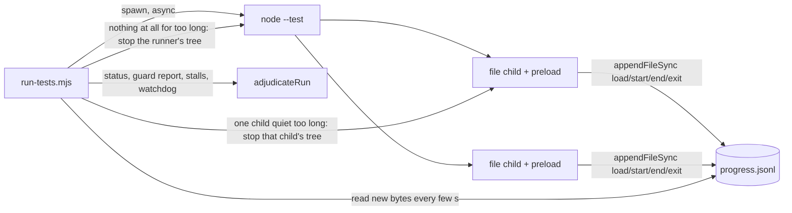

# Plan: make `npm test` hang-proof (a per-test stall limit and an idle watchdog)
- **Date**: 2026-11-26
- **Status**: In progress — implemented and audited on branch claude/wonderful-vaughan-7cdb0c; PR open, merge pending
- **Author**: Claude + Louis
- **Scope**: backend (test runner only; no UI) · stack `js-ts`
- **Target domain(s)**: `scripts`, `shared-lib`, `tests`
- **Depends on**: none.

Origin: a brief from another repo about a faster landing loop. CES already has the combined train, measured tiers, the CI full suite and
parallel `node --test`. The one gap is hang protection in `scripts/run-tests.mjs`: no timeout and no idle watchdog, so a hung test
blocks the run with no explanation. This plan closes only that gap.

**Revision 2.** Revision 1 (audited: 3 GPT rounds + a Gemini APPROVE) used node's `--test-timeout` as the per-test bound. Its own
local baseline run then measured the slowest FILE at 23.7 min under this machine's real load (section 1.1), so any per-file default
that is safe locally is useless in CI. Revision 2 enforces a true per-TEST limit in the runner instead, from the same progress file,
and keeps everything else revision 1 settled (the preload, the event schema, the lifecycle owner, the orphan sweep, the controls).

## 1. Context Summary

### 1.1 Measured facts

| Fact | Figure | Command / source |
|---|---|---|
| Slowest test FILE, last tier measurement | **131,671 ms** (`tests/fleet-ci-admission.test.mjs`) | `.test-tiers.json` `measuredMs`, `measuredAt: 2026-11-22` |
| Local full run on this machine, 2026-11-26, under its usual load | wall **1,612 s (26.9 min)**; Σ test-body **40,320 s** (5.5x the 7,344 s measured 2026-10-12, so the box was heavily contended); 27,737 tests, 1 failure (a 120-s spawn budget inside `help-readonly-gate`, which passes on a re-run) | `TEST_TIMING_KEEP=<file> npm test`, run in the background from this worktree; `# duration_ms` and the kept per-file report |
| Slowest FILE in that run | **1,419,664 ms (23.7 min)** (`tests/fleet-ci-admission.test.mjs`, 10.8x its tier figure) | the kept per-file report, sorted |
| Slowest single TEST in that run | **857.5 s** ("fires even when docs/plans does not exist …"); then 300.0 s, 264.8 s; p99 **30.8 s** | every `type: 'test'` `duration_ms` in the run's TAP, sorted |
| Slowest test FILE in CI | **161,870 ms** (`tests/fleet-ci-admission.test.mjs`) | run 45872119612 (2026-11-26): the base64 `test-timing-json#` blocks in `gh run view 45872119612 --log`, decoded |
| Slowest single TEST in CI, same run | **61.4 s**; then 37.5 s, 28.1 s; p99 **3.2 s** | every `type: 'test'` `duration_ms` in that run's TAP |
| CI `npm test` step | **22.4 min** | `gh run view 45872119612 --json jobs`, step times |
| CI job duration, last 15 green runs | median **23.5 min**, max **27.8 min** (since 2026-11-25); non-test steps about 0.5 min | `gh run list --workflow full-suite.yml --status success --limit 15 --json startedAt,updatedAt` |
| CI job cap | `timeout-minutes: 30`. Its comment ("3x the measured job, 9.6 min on 2026-10-14") is stale by 2.4x | `.github/workflows/full-suite.yml` |
| Local pre-push cap on the test step | **none** (`prepush-check.mjs` runs `npm run check` with no budget) | a timeout search in `scripts/prepush-check.mjs` (0 matches) and `scripts/lib/prepush-step.mjs` |

Two conclusions drive the design. Under real local load, durations stretch about 10x, so a wall-clock limit that is safe locally is
far too loose for CI. And the FILE is the wrong unit: node runs a file's tests in series, so a file's time is the sum of its tests'
times and load stretches the whole sum. A per-file bound has to cover the slowest SUM; a per-test bound only the slowest test.

### 1.2 What node actually does (probed on v22.23.2 with throwaway `ok`, `hang`, `busy` and `slowfile` files)

1. **`--test-timeout` bounds a FILE, not a test, under process isolation.** With `--test-timeout=2000`, `slowfile` (two 1.5-s tests)
   fails as `✖ slowfile.test.mjs … test timed out after 2000ms`. The runner's file subtest inherits the root timeout and its timer
   starts first, so it always beats the child's per-test copy. `--test-timeout` is refused in `NODE_OPTIONS`.
2. **Node names the FILE, never the test**, for a hang and for a busy loop alike.
3. **The runner sees in-file events only after the file ends**, and none from a busy-looping file (Windows pipe writes are async).
   A reporter can be neither a heartbeat nor a namer.
4. **A preload can be both.** `--import <preload>` runs in every file child and not in the runner. Root-level `beforeEach` /
   `afterEach` writing with `fs.appendFileSync` record `start busy loop` with no `end` (the write lands before the loop), and cover
   nested `describe`/`it` and `t.test` subtests, with `t.fullName`.
5. **Killing one file's child from outside fails that file and nothing else.** With three files running, killing the `hang` child
   at 2.5 s gives `✖ hang.test.mjs … 'test failed'`, the other two files pass, and the runner exits 1. So the runner can enforce a
   per-test limit itself, with the same effect node's file timeout has, but on the right unit.

## 2. Proposed Architecture

### 2.1 The limits, in order, in two measured profiles

| Limit | CI profile (`CI=true`) | Local profile | Enforced by | What it names |
|---|---|---|---|---|
| **per-test stall**: one test instance active for this long (see below), or a child outside any test for this long | **300 s** (4.9x the slowest CI test, 61.4 s) | **1,800 s** (2.1x the slowest local test, 857.5 s) | the shim | that child's unfinished test, or "outside any test (loading, or in a hook)", with the file and pid |
| **idle watchdog**: no progress event from any child for this long | **420 s** | **2,100 s** | the shim | everything in flight, or "no progress was recorded" |
| outer cap | CI job 30 min | none | GitHub Actions | nothing |

The per-test stall limit is an ABSOLUTE deadline per TEST INSTANCE, timed from that instance's own start, never reset. Each
instance has a unique id: the preload keeps a `WeakMap` from node's test context to a per-process counter, because node hands
`beforeEach` and `afterEach` the same context object (probed: two concurrent same-named tests ending out of start order pair
correctly by id). The measured maxima above are over EVERY test instance, parents with subtests included (a parent's
`duration_ms` covers its subtests), so the same deadline is safe for a parent and bounds a parent that creates subtests forever.
Every overdue instance is listed, deepest full name first (full names are display text, not a reliable ancestry, so no single
"innermost" is claimed), and the child process is stopped once. A child with no active
instance is timed from its last event (import, a hook, a leaked handle after its last test), and reported as "outside any test".
A long file of short tests is never at risk, which is why the limit can be tight in CI. The idle watchdog must sit above it: when a lone child stalls, the stall limit should fire first and
fail only that file, letting the run finish. The watchdog is for what the stall limit cannot reach: the runner itself stalling with no
child alive, a child the stall kill could not stop, or the shim's own view of the file going stale. The 2-minute (CI) and 5-minute
(local) gaps cover a stall kill plus node noticing the dead child.

**Why two profiles, not one constant.** A single value safe for the local slowest test (857.5 s, so at least ~30 min) is above the
CI job cap, so in CI it would never fire. A single value right for CI (5 min) fails healthy local tests under load (the local run
had 3 tests over 4 min). The profile is chosen by `process.env.CI === 'true'`, which GitHub Actions sets; nothing else reads it here.

**CI headroom, and what it does NOT guarantee.** The job's median is 23.5 min and max 27.8 min against 30. A hung test fails by name
300 s after its last event; the run then finishes. On a median run that is inside the cap if the hang starts in the first ~21 min.
A runner stall near the end (+420 s) may lose to the cap. When the cap wins the outcome is today's (an unnamed kill at 30 min),
never worse. Making a named failure certain in CI needs the cap raised or the suite shortened: the owner's decision (section 5).

**Node's own `--test-timeout` is no longer added by default**: its unit is the file, and under load a healthy file takes 23.7 min.
**A caller's `--test-timeout` still wins**: it is node's own FILE-level option, forwarded unchanged exactly as today and never
overridden, and it may fire before the stall limit (1.2 item 1). It is read from node's option region only (before any `--`; after
it, a token is a file). It is NOT the per-test stall limit, which stays the profile's (or `TEST_STALL_TIMEOUT_MS`). When node's file
timeout fires first, the progress file still names the test that was running, exactly as for a stall. A finite caller value raises
the idle watchdog to `max(profile default, N + profile gap)`, so the watchdog never preempts the caller's own bound; a non-finite one
(`Infinity`, a bare flag) keeps the profile default. `TEST_IDLE_WATCHDOG_MS` and `TEST_STALL_TIMEOUT_MS` override each limit for the
controls and for debugging: positive integers only, anything else is exit 2, and there is no "off". An explicit watchdog override
wins; if it ends up at or below the stall limit, the runner says so in its start line (the controls do this on purpose). Both join
`SCRUBBED_RUNNER_ENV`, so a nested runner started from a test never inherits them.

The runner prints the limits in force once at start: `run-tests: per-test stall 300s (ci), idle watchdog 420s (ci)`.

The limits test pins: profile stall ≥ 2x the slowest measured test of that profile (a constant in the test, with its date and
command); profile watchdog ≥ stall + 60 s; and the CI profile's watchdog < the `full-suite` job's `timeout-minutes` read from the
workflow, so the watchdog is never the larger of two nested budgets. It also asserts that each source it reads yields a real number.

### 2.2 Modules

- **`scripts/lib/test-hang-guard.mjs`** (new, shared-lib, pure, no IO): the two profiles; `callerTestTimeout(argv)`;
  `resolveLimits({env, argv})` → `{stallMs, watchdogMs, profile, sources}` (throws on a bad override); `createProgressTracker()`;
  `timedOutFiles(reportText)`; `childrenToSweep(...)`; `describeInFlight(...)`; and `createIdleWatchdog({idleMs, probe, onIdle,
  every, clock})`, which polls a probe and calls `onIdle` exactly once.
- **Progress event schema** (`test-progress/v1`), one JSON object per line: `{v: 1, ev, proc, file, at, ...}` where `ev` is `load`
  (also `pid`), `start` / `end` (also `id` and `name`) or `exit`. `proc` is a random per-process nonce, so a reused pid cannot merge two
  processes; `file` is the absolute path; `at` is `Date.now()` in the child. `exit` is written from `process.on('exit')`, which runs
  synchronously on every normal exit, so a child that finished is never a stall candidate. Starts and ends pair by `(proc, id)`, so
  same-named and concurrent tests cannot cancel each other. Every line also carries `seq`, a per-process counter, so a LOST line
  (a failed append followed by a successful one) shows as a gap. A proc with a gap is never stall-killed: its records cannot prove a
  stall. It is reported as a guard error, and the run fails through `adjudicateRun` (the instrument broke; never read as a pass, never
  blamed on a test). A child whose every later write fails is indistinguishable from a hang and would be stopped by name; that needs
  appends to a temp file the shim just created to start failing mid-run, and the run then fails loudly either way. Stated as a limit.
- **`createProgressTracker()`** is fed only the NEW bytes each tick (the shim keeps a read offset and carries a partial last line
  over), so the cost per tick is the growth since the last one, not the whole file (about 4.5 MB by the end of a full run). A line
  that does not parse is counted, never fatal. `snapshot(now)` returns, per live proc: file, pid, last event time, unfinished tests,
  exited or not; plus the run-wide last event time and the torn-line count.
- **`scripts/lib/test-progress-preload.mjs`** (new, shared-lib): registers its hooks and the `exit` handler only when
  `TEST_PROGRESS_FILE` is set, `NODE_TEST_CONTEXT` is set and the entry script matches node's own default test-file patterns
  (`*.test.{js,mjs,cjs}`, `*-test.*`, `*_test.*`, `test-*.*`, `test.*`, or any file under a `test/` directory), so a plain script a test
  spawns with `process.execArgv` records nothing. A caller may name a file that matches none of them; such a file gets no per-test
  limit, only the watchdog, so the runner prints one warning line at start naming each explicit file argument that matches no
  pattern. Every repo default-glob file is `*.test.mjs`. Every write is a try/catch: instrumentation never fails a test.
- **Progress file lifecycle**: created EMPTY by the shim before the spawn, inside the `mkdtemp` report directory it already makes,
  passed by absolute path, overridden by any nested runner for its own children, removed with the directory after `close`. If it
  cannot be created, the runner exits 2 before spawning: an unguarded run is not offered as a fallback.
- **The stall check** (run-tests.mjs, each tick): for every proc that has not exited and not already been stopped, with a timed
  instance (or, with none active, a last event) older than the stall limit: verify the process is the one that wrote the record,
  then `stopTree(pid, {force: true})` and record the stall `{file, name|null, pid, quietMs}`. **Identity** is checked with one
  process-table read at that moment (only then; a healthy run never pays it): the pid must be alive, its parent must be THIS runner,
  and its creation time must fall between the run's start and the record's `load` time (+1 s clock slack). A pid reused by a later
  process, even a later test child of the same runner, was created after that `load` and fails the check. Windows reads
  `Win32_Process` (`ParentProcessId`, `CreationDate`); POSIX reads `ps -o ppid=,etimes= -p <pid>`. If identity cannot be read,
  nothing is killed: the stall is recorded as "unverified, not stopped" and left to the watchdog (fail safe, never a blind kill).
  The check-then-signal gap is node's no-pidfd limit, the same one `reap.mjs` documents. The tree is still intact at that moment, so
  the test's own descendants go with it. Node then fails that file and the run continues. A failed or refused stop is recorded with
  its reason and left to the watchdog.
- **`scripts/run-tests.mjs`** has one lifecycle owner, `runSupervised`: spawn (POSIX `detached`, so the group can be signalled;
  Windows a plain child), a single ticking timer that runs the stall check and feeds the watchdog, and settlement exactly once on
  the first of `error`, `close`, or the watchdog (stop the runner's tree, then wait for `close`, bounded at 10 s). SIGINT and SIGTERM
  are forwarded to the tree (a detached POSIX group no longer gets the terminal's Ctrl-C); the shim then exits 130 or 143. Timers
  and handlers are removed on every path. `main` becomes async and ends with `finishAndExit`. The file stays under 1000 lines.
- **`adjudicateRun`** takes optional `watchdog` and `stalls` inputs, checked FIRST: a fired watchdog, or any stall kill, is exit 1
  with its message whatever status the runner left. That function is the only place that can say "pass", so neither can ever
  become exit 0.
- **A child that never writes `load`** (stuck in node's own startup before the preload runs, or unable to append) is not a
  stall candidate. It is still bounded: its file never completes, so once every other file is done no event arrives anywhere and the
  idle watchdog fires. Its bound is therefore the rest of the run plus the watchdog, not the stall limit; written in the runner's
  header as a limit.
- **Orphan sweep** (unchanged from revision 1, now a backstop): after `close`, sweep every child whose file node timed out (only
  possible when a caller passed `--test-timeout`) and every child the tracker shows unfinished and not stopped by the shim. POSIX
  signals the dead runner's process group, only when a sweep is needed (a group id is not reused while a member lives; the residual
  window is the pid-reuse limit `reap.mjs` documents). Windows runs fleet's one reaper, `REAP_WIN_ORPHANS_JS`, from each dead pid,
  60 s for the whole sweep, 10 s per child, in file order, listing every child it did not reach or fully reap. It never moves the
  verdict. A healthy run has nothing to sweep.

### 2.3 What is deliberately not built

- No default for node's own `--test-timeout` (its unit is the file; 1.1 and 1.2).
- No stack dumps: a dump needs an inspector attached per child; the test name and file are what debugging starts from.
- No per-test limit inside the child: a timer there cannot fire through a busy loop; the shim is a separate process.

### 2.4 Tests

- `tests/run-tests-hang-guard.test.mjs` (unit, pure): `callerTestTimeout` (both spellings; after `--` does not count; bare flag;
  `Infinity`); `resolveLimits` (each profile; a caller timeout leaves the stall limit unchanged and raises the watchdog only when N + gap is
  above the profile's, with cases below and above that threshold; env overrides win; bad overrides throw; no "off"); the tracker (fed in arbitrary chunks including mid-line splits; per-instance clocks paired by id, including
  same-named concurrent instances ending out of order; every overdue instance listed, deepest name first; a `seq` gap blocks the kill and is a guard error; a parent is timed from its
  own start however many subtests it finishes; a proc outside any test timed from its last event; `exit` removes a proc from candidacy; a reused pid with a different nonce; torn lines);
  the identity check through an injectable process-table reader (wrong parent, created after `load`, unreadable → no kill); the watchdog on a fake clock (fires once, growth resets, a throwing probe is no growth, `stop` means never);
  `adjudicateRun` with a fired watchdog or a stall and status 0 → exit 1; `childrenToSweep` and `sweepOrphans` selection and budget.
- **Limits**, as in 2.1.
- **Positive controls** (`tests/run-tests-hang-controls.test.mjs`), spawning the real runner against
  `tests/fixtures/run-tests-hang/*.test.mjs` (outside the default globs), each with its own deadline and a `finally` that stops
  everything the fixture recorded:
  1. hang + ok, `TEST_STALL_TIMEOUT_MS=3000`: exit 1; stderr names `hangs forever` in `hang.test.mjs` as a stall; the ok file
     passes; the hung child and the grandchild it spawned are gone.
  1b. concurrent: a file whose `describe({concurrency: true})` runs a hung test beside a same-named test that finishes first, then
     more short tests: the hung instance is named and stopped; no finished one is named.
  2. busy loop + ok, `TEST_STALL_TIMEOUT_MS=3000`: exit 1; stderr names `busy loop`; the ok file passes.
  3. a caller's `--test-timeout=4000` with a hang and a 600-s stall limit: node's file timeout fires first, untouched by the shim,
     and the progress file still names `hangs forever`; the start line shows node's file timeout as `4s (caller)` and the profile's
     watchdog unchanged (4 s plus the gap is below it). Raising the watchdog for a large caller value is a unit test of
     `resolveLimits`.
  4. the watchdog: hang, `TEST_STALL_TIMEOUT_MS=600000`, `TEST_IDLE_WATCHDOG_MS=3000`: exit 1 in under 30 s; the watchdog line names
     `hangs forever`; the hung child and its grandchild are gone.
  5. a bad override (`TEST_IDLE_WATCHDOG_MS=off`) is exit 2 before anything runs.
- **Red before green**, recorded in the PR body: the fixtures against `main`'s runner under an outer 60-s `timeout` (never ends,
  nothing named), and each control seen to fail with its mechanism disabled (no stall kill; no watchdog kill; no preload).

## 3. Risks

- **A false stall on a loaded machine.** 1,800 s locally is 2.1x the slowest test measured under heavy load; 300 s in CI is 4.9x.
  A false stall fails one file loudly, by name, and the limits test shows the margin whenever the constants are re-measured.
- **The preload is in every child**: two hooks and short appends per test, about 30,000 lines a run; the cost is checked against
  the baseline wall time before the PR opens.
- **Killing the wrong process.** A stall kill requires the pid to be alive, a child of this runner, and created before the record's
  `load`; an exited proc is never a candidate; an unreadable identity is never killed.

## 4. Acceptance

- `npm test` enforces a per-test stall limit and an idle watchdog from the profile in force, prints both, and no longer runs with
  no bound at all. A caller's `--test-timeout` wins.
- A stalled test fails its file by name while the other files run on; a run with no progress at all is killed as a tree. Either
  is exit 1 through `adjudicateRun`, never 0.
- Naming is best effort and says which kind it is: the unfinished test with its file; otherwise "outside any test"; otherwise
  "no progress was recorded".
- Every control fails as specified, and was seen red first with its mechanism disabled.
- `npm run check` stays green, including `help:readonly:gate`, `stdout:flush:gate` and `size:ratchet:gate`.

## 5. Follow-ups (not in this change)

- **CI cap headroom.** The `full-suite` job runs at 78-93% of its 30-min cap, and the workflow comment is stale. Raising the cap or
  shortening the suite is the owner's call.
- **Local load.** The same suite took 26.9 min locally against 9 min in the 2026-09-04 measurement in AGENTS.md; that figure is
  stale under current load.

## Audit trail

- Revision 1, GPT `audit-plan-1795725501531-17604`: R1 H:5 M:2, R2 H:2 M:1, R3 H:2 M:1, 13/13 accepted and fixed (argv region,
  lifecycle owner, event identity, progress-file lifecycle, bounded controls, best-effort naming, fresh figures, the watchdog
  following a caller timeout, orphan sweep, CI headroom qualified). Gemini final gate: APPROVE (one LOW: fill the local figures).
- Filling those figures measured the slowest local file at 23.7 min and the slowest local test at 857.5 s under load, which made
  revision 1's per-file default unsafe locally. Revision 2 (this text) moves the per-test bound into the shim, and is re-audited.
- Revision 2, GPT `audit-plan-1795727186637-84160` R1: H:3 M:1, 4/4 accepted: per-instance deadlines instead of per-child quiet; a
  caller's `--test-timeout` kept as node's own file option, not equated with the stall limit; a child that never writes `load` is
  bounded by the watchdog, stated; the kill's identity check adds the creation time against `load`, and fails safe.
- R2: H:3, 3/3 accepted: instances get unique ids from the preload (probed), the deadline is absolute from each instance's own
  start (the measured maxima include parents, so no reset rule is needed, and a parent that loops on subtests is bounded), and
  control 3 asserts the unchanged watchdog.
- R3 (the cap): H:3 M:1, 4/4 accepted: eligibility follows node's default test-file patterns, with a start warning for explicit
  files outside them; a per-process `seq` turns a lost line into a guard error that blocks the kill; the unit-test text now matches
  the caller-timeout contract; overdue instances are all listed, no single innermost claimed. GPT loop stopped at its 3-round cap.
- Code audit `audit-code-1795728511480-92916`: R1 H:9 M:9, R2 H:1 M:3, R3 H:1 M:1, R4 H:2 M:1, R5 PASS H:0 M:1 (fixed); 26/28 accepted.
  Final gate (Gemini) APPROVE, 0 blocking, 0 debt. Detail: [test-runner-hang-guard-audit-summary.md](test-runner-hang-guard-audit-summary.md).
  Added beyond the plan text by the audit: an end-of-run record check (a passing run must have a load and an exit line for
  every file that ran, and no lost line), a ppid owner filter, pid-reuse supersede, and a named-file manifest.
