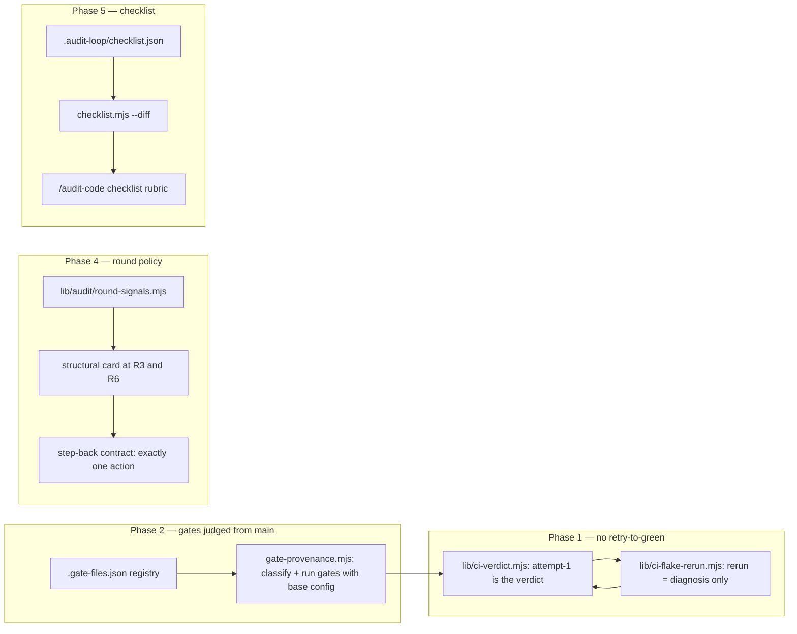

# Plan: Verification lessons — no retry-to-green, gates judged from main, step-back, diff-triggered checklist
- **Date**: 2026-11-21
- **Status**: Approved
- **Author**: Claude + Louis
- **Scope**: backend (stack `js-ts`; CLIs, CI workflow, audit pipeline, skill prose)
- **Target domain(s)**: `audit-orchestration`, `install`, `shared-lib`, `skills-content`, `tests`
- ⚠ **Cross-domain work** — six independent phases, each its own branch and PR; boundary crossings are deliberate.
- ⚠ **Untagged paths**: `.github/workflows/full-suite.yml`, `AGENTS.md` — neither matches a `domain-map.json` rule; they are repo-level config, not a domain.
- **Source**: Anthropic, "How the Claude Code team thinks about verification" (claude.dev, Nov 2026); /brainstorm GPT + Gemini (debate round, then synthesis) on 2026-11-21. **Every decision below is Louis's and approved; this plan implements, it does not relitigate.**

Neighbourhood considered (arch memory, 2026-11-21): every candidate banded `review` — `checkRatchet` /
`checkCandidateCoverage` (`scripts/check-gate-contracts.mjs`), `computeDriftFindings`
(`scripts/on-conflict-lint.mjs`), `deriveSignals` (`scripts/lib/learning/author-tier-observation.mjs`),
`shouldTriggerGpt` (`scripts/lib/audit/gpt-sentinel-trigger.mjs`). Nothing rose above the noise floor: greenfield for
the checklist and the gate-provenance classifier; the step-back EXTENDS the existing structural card (§2.4).

---

## 0. Investigation — which areas gain from the diff-triggered checklist pattern

**Question (Louis).** The checklist pattern takes pressure off AGENTS.md because a diff can *select* which rules apply,
so only the matching ones load. Which other areas have the same shape? **The test for each area is three measurements:
how big it is, how often it is loaded, and whether a diff can select its rules.** Where a diff cannot select the rules,
the answer is NO however big the area is.

All figures **measured 2026-11-21 at `6680c819`** (commands: `wc -c`, `ls | wc -l`, and the paragraph census below).

| Area | Size | How often loaded | Can a diff select its rules? | Verdict |
|---|---|---|---|---|
| **AGENTS.md** (the reference case) | 73,207 chars, 140 paragraphs | every session, every agent | **Partly.** 52 of 140 paragraphs (49,941 chars, 69%) name a path, module, test or migration (census: paragraphs matching `scripts/\|\.mjs\|\.json\|tests/\|migration\|\.githooks\|db/`). The rest is cross-cutting doctrine. | **INCLUDE** — the pilot (§5). The 69% is an upper bound: a paragraph that names a path is a candidate, not automatically an entry. |
| **Memory index + tripwires** (`~/.claude/projects/C--GIT-claude-engineering-skills/memory/`) | `MEMORY.md` 13,980 chars always loaded; 240 files, 670,393 chars total (165 feedback, 67 project) | index every Claude session; bodies on recall | **Partly.** 93 of 232 feedback+project files name a repo path. But memory is per-user, machine-local and **Claude-only** — Copilot/Cursor never see it, and it is not in the repo the checklist ships with. | **INCLUDE, as a promotion source only.** Repo-anchored tripwires (path in the body) become checklist entries via `/harness-retro promote` (§6); user/behaviour feedback stays in memory. The memory index is not itself converted. |
| **Large SKILL.md + `references/`** (skills:size ratchet) | Largest SKILL.md: ship 57,686, persona-test 44,404, cycle 42,329, audit-code 41,069; references up to 135K/skill | when the skill is invoked | **No.** A skill's steps apply because the skill was invoked, not because of which files changed. Progressive disclosure already exists (`references/` with "read when" triggers keyed on the *situation*). | **EXCLUDE.** The size ratchet is the right tool; a diff does not select a skill step. |
| **`docs/audit/shared-references/*`** synced into ten skills | 109,539 chars across 9 files (verification-discipline 29,443) | on demand, by a skill's "read when" row | **No.** Each is keyed on a skill situation (reporting a figure, building a gate transcript), not on a path. | **EXCLUDE.** Already lazily loaded; nothing a diff could prune. |
| **`/ship` Step 0.5 gate queries** (0.5a–0.5i) | ~390 lines of `skills/ship/SKILL.md` (lines 108–515) | every `/ship` | **One of seven.** 0.5g (migration realisation) is path-triggered (a `migrations/` file in the diff); 0.5a/b/e/h/i are store queries about the *repo*, not the diff. | **EXCLUDE**, except **note**: 0.5g's trigger already works this way; it becomes a checklist entry in the pilot only if it adds a check the binary does not already enforce (it does not — it is ENFORCED by the binary). |
| **`/audit-code` PASS_PROMPTS + R2+ rulings** (`scripts/lib/prompt-seeds.mjs`, 23,233 chars) | every audit round, every pass | **No for the prompts, yes for a new rubric slot.** The passes are selected by file class already (`frontend`/`backend`); their prose applies to every diff in the class. The rulings are keyed on the ledger, not the diff. | **EXCLUDE the prompts; the checklist enters the audit as a new `<checklist>` rubric block** (like `<requirements_rubric>`), not by rewriting the prompts. PASS_PROMPTS seed edits roll out globally (memory tripwire) — not touched. |
| **`/plan` principle tables** (`skills/plan/references/*-principles.md`, 3–4K each) | per plan, by scope | **No.** Selected by scope (backend/frontend), which `/plan` already does. | **EXCLUDE.** Already scope-selected and small. |
| **Reliability rules scattered across runbooks** (`docs/runbooks/*.md`, 384K total; consumer-adoption 104,602 with 100 `never/must/do not` lines, prepush-sandbox 37, postgres-parity 30, model-eval 33) | on demand, when an agent follows a link | **Yes, for the imperative lines.** A "never X when editing Y" line in a runbook is reachable only if the agent opens the runbook; the checklist makes it fire when Y is in the diff. | **INCLUDE, selectively.** Promote only imperatives with a path/symbol trigger AND an incident; the runbook keeps the prose. Candidate source for the pilot's second wave, not its first. |
| **Consumer-side AGENTS.md** | wine-cellar-app 84,973; ai-organiser 54,156; storyline 22,936 | every session in that repo | **Yes, same shape as CES's.** | **INCLUDE, after CES dogfood.** The checklist is a per-consumer file (`.audit-loop/checklist.json`), so each consumer migrates its own; CES ships the tool and the empty file, never a consumer's rules (upstream-owned vs consumer-owned split). Wine is the first candidate (above the CES cap already). |

**Summary.** Four INCLUDE (AGENTS.md now; runbook imperatives and memory tripwires as promotion sources; consumer
AGENTS.md after dogfood), four EXCLUDE (skills, shared references, PASS_PROMPTS, `/plan` tables — each is already
selected by *invocation* or *scope*, which a diff cannot improve on). `/ship` 0.5g is the one Step 0.5 query already
path-triggered and already enforced in code, so it gains nothing.

**Correction to the brief (measured).** "26 AGENTS.md sentences are quoted verbatim by gate contracts" — the census is
**25 contracts in `scripts/gate-contracts/*.json`** (22 files; `skills-check.json` holds four) **plus 1 in a skill's
`gate-contract.json`** (`grep -rhoE '"statedIn"\s*:\s*"AGENTS.md"'`), 26 in total. The figure stands; where they live
is two places, and §5's migration must read both.

**Correction to the brief (measured).** "No retry-to-green" is not only a coordinator habit: the repo **ships a
rerun-to-clear tool**, `node scripts/test-tier.mjs ci-verdict --pr <n> --rerun-unrelated-flake`
(`scripts/lib/ci-flake-rerun.mjs`, plan `docs/plans/fleet-chips-and-merge-friction.md` §2.3), and coordinator
playbook rule 8 points at it. Phase 1 changes what that tool's green *means*, not only the docs.

---

## 1. Context Summary

### What exists today (Code Trace, pinned to `6680c819`)

- **CI verdict + flake rerun.** `scripts/test-tier.mjs:16` exposes `ci-verdict … [--rerun-unrelated-flake]`;
  `scripts/lib/ci-flake-rerun.mjs:91` admits only `run_attempt === 1` and then re-runs it once;
  `scripts/lib/ci-verdict.mjs:65` sorts runs newest-first **by attempt**, so an attempt-2 green on the same head
  becomes the verdict. That is retry-to-green in code.
- **Round caps.** `scripts/lib/audit/round-cap.mjs:29-30` — `plan: {soft: 3, absolute: 5}`, `code: {soft: 6,
  absolute: 8}`. Unchanged by this plan.
- **Structural card.** `scripts/audit-structural-card.mjs:41` → `buildStructuralCard`
  (`scripts/lib/audit/structural-card.mjs:253` `assembleCard`), clusters findings across rounds
  (`clusterAuditRounds`, `:111`) and reads acceptance from the ledger via `scripts/lib/audit/cap-productivity.mjs:18`.
  It is built at the soft cap only, and it has no reopen-rate, drift or retired-defects signal.
- **Finding schema.** `scripts/lib/schemas.mjs:68` `severity: z.enum(['HIGH','MEDIUM','LOW'])`, `:74`
  `is_quick_fix` — no importance tag, no pre-existing field.
- **Recall.** `scripts/lib/model-eval/deterministic-scorer.mjs` scores recall on the known-defect corpus
  (`docs/experiments/audit-effectiveness/known-defects.json`, v3, 18 entries, KD-013 invalidated) — one stage only,
  the auditor's raw output.
- **Gate contracts.** `scripts/check-gate-contracts.mjs` (`checkRatchet`, `checkCandidateCoverage`) verifies each
  contract's `stated` sentence appears verbatim in its `statedIn` file.
- **CI.** `.github/workflows/full-suite.yml:58-65` — `npm ci` then `npm test`, on the PR's own tree. Every
  baseline, contract and prompt the gates read comes from the PR under review.
- **Context cap.** `scripts/check-context-drift.mjs` `DEFAULT_MAX_AGENTS_MD_CHARS` = 79,000; AGENTS.md is 73,207.
- **harness-retro.** `scripts/harness-retro.mjs` (260 lines) + `skills/harness-retro/references/{judging-candidates,effect-and-closure}.md`;
  propose-never-apply, with `promote` for memory tripwires (`tests/harness-retro-tripwires.test.mjs`).

### Evidence of the problem (night of 2026-11-20/21)

- PRs #410, #421, #424, #429 each used all 6 GPT rounds with findings growing more marginal; #424's R7 (past the soft
  cap) was still `SIGNIFICANT_ISSUES` on TOCTOU-shaped findings (side-session note `telemetry-p3-r7-findings-2026-11-21.md`).
- One wine PR hit the 8-round absolute cap.
- The coordinator reran a CI-flaky test 5 times (`tests/fleet-serial-golden.test.mjs`, case "crash before and after
  the merge submission", `candidate.oid` `<tested>` vs `<oid>`) instead of fixing it.

### Patterns reused vs new

Reused: the structural card and its ledger readers; the gate-contract checker; `fixture:create` for the pinned replay;
`requirements_rubric` injection as the model for a `<checklist>` block; harness-retro's proposal schema; the
`::notice title=audit-loop-no-measurement::` marker for observe mode. New: a gate-file registry + classifier
(`scripts/gate-provenance.mjs`), a checklist file + matcher (`scripts/checklist.mjs`), the step-back agent contract.

---

## 2. Proposed Architecture

### 2.1 Phase 1 — a rerun may diagnose, never clear (#11 Testability, #16 Graceful Degradation inverted: fail closed)

- **A head that ever failed stays failed (R1 H1).** The verdict's identity is the **exact head sha**, and its evidence
  is **every attempt of every run of each required workflow for that sha** (`gatherCiEvidence` already lists runs by
  `head_sha`; it now also lists each run's attempts via `/actions/runs/{id}/attempts/{n}`). Aggregation, in
  `classifyCiVerdict` (#5 single source of truth: one function decides):
  1. any attempt of any run for the sha concluded `failure` / `timed_out` / `startup_failure` → **`failed`**, and if a
     later attempt or a later run for the same sha is green the reason is `failed-then-rerun` — still exit 4, never
     `passed`. A *new run* for the same sha (a re-dispatch, a workflow_dispatch) is a rerun by another name and
     counts the same.
  2. otherwise any attempt `cancelled`: cancelled by supersession (a newer sha on the lane) is ignored for THIS sha's
     verdict only if this sha has another complete, green run; else `unverified`.
  3. a required workflow with no run, a run with a missing attempt 1, or any in-progress attempt → `pending` /
     `unverified`, never `passed`.
  4. all attempts of all runs complete and green → `passed`.
  The only ways to clear a `failed` sha: a new commit (the fix), or a test deletion with a written reason (below) —
  both are a new sha.
- **`--rerun-unrelated-flake` stays as a diagnostic.** It still reruns once, records the result, and files the
  proposal — but its record now says `outcome: diagnosed` and the verdict ignores it. The attempt-2 result is
  *information* ("reproduces" vs "did not reproduce"), printed beside the red verdict.
- **Docs**: coordinator playbook gains a rule ("A rerun may diagnose, never clear"); `/ship` CI-wait and
  `skills/cycle/references/ci-wait.md` say the same; AGENTS.md gets one tripwire sentence (it is cross-cutting — kernel
  material).
- **Root-cause the three flaky tests**, each fixed at its cause, with a deterministic reproduction that fails before
  the fix. Where no cause can be shown, the test is **deleted with a written reason naming the coverage lost** — the
  only deletion this plan makes on its own authority (Louis granted it for this case). No sleeps, retries or skips.
  Root causes are in §2.1a; Cluster A does not start implementation until §2.1a names each cause with evidence
  (R1 M3).

### 2.1a Root causes of the three CI-only flakes (investigated 2026-11-21, CI logs of every failed run 11-18..21)

None is deleted: each has a cause with evidence, and each fix lands at the cause.

| Test | Failure (measured, CI) | Cause | Fix at the cause | Red-first proof |
|---|---|---|---|---|
| `tests/fleet-serial-golden.test.mjs` | 7 failures in 6 runs (44710942194, 44809057324, 44836421707, 44839342616, 44840460597, 44901035185 a1), several subtests; always `oid: '<tested>'` vs golden `'<oid>'` | `scripts/lib/fleet/train.mjs:393 (6680c819)` builds the candidate with `merge --squash` + `commit -C <tested>`: same parent, tree, author, author date, message, committer identity — only the committer date (1 s resolution) differs. When `land` commits in the same second as `tested` (`tests/helpers/fleet-serial-fx.mjs:20-38`), `candidate.oid === tested` and the normaliser (`tests/fleet-serial-golden.test.mjs:32-46`) labels it `<tested>`. **Measured**: squash with `-C T` and T's committer date reproduces T's oid exactly. No product bug. | `trainFx` commits `tested` with a fixed past `GIT_COMMITTER_DATE` (`2026-01-01T00:00:00Z`, as `tests/helpers/git-fixture-env.mjs:21`) so the candidate can never collide. Not a normaliser label (a value-keyed map would relabel every equal oid). | `tested` committed at "now rounded to the second" → fails every run; pinned date → passes every run. |
| `tests/git-env-fixture-isolation.test.mjs` | 44901035185 a2: `ENOENT '/tmp/tpl-a-*/.git/objects'` in `cpSync` ← `instantiate` (`tests/helpers/fixtures.mjs:143`) | Node's `cpSync` fast path reports the parent dir of a vanished file (measured, Node v22 `src/node_file.cc`), so a regular file directly in `.git/objects/` vanished mid-copy — `objects/maintenance.lock` from the detached `git maintenance run --auto` that git 2.56 (CI) starts after `commit`. **Inferred** (Windows cannot detach; 0/15 local probes saw a lock). | Disable auto-maintenance at the shared seam: `gitFixtureEnv()` adds `GIT_CONFIG_COUNT/KEY/VALUE` for `maintenance.auto=false` (covers `tests/helpers/fixtures.mjs` and the `fleet-tpl-` templates in `tests/helpers/fleet-repo.mjs:84`). | A test asserts `git config maintenance.auto` reads `false` in every fixture env (deterministic), plus a Linux-only probe that polls `.git/objects` after `commit` with and without the env. |
| `tests/sync-rewriter.test.mjs` | 44830850360 a1: `ENOENT scandir '…/.claude/tmp/ces-ctl-src-*/tests/check-context-drift'` ← `walk` (`scripts/lib/sync-inventory.mjs:180`) ← `buildFileUniverse` (`:190`) ← `bundleForRepo` (`:320`) | **Production bug**: `buildFileUniverse` (`scripts/lib/sync-inventory.mjs:175-192`) walks the raw disk under `.claude/`, skipping only `node_modules/.git/.audit/.audit-loop`, so it descends into gitignored `.claude/tmp/` (and `.claude/worktrees/` in the main checkout) while `tests/sync-prior-upstream-rewritten.test.mjs:265-267` creates and deletes a repo copy there in a parallel process. Violates "the corpus is the repo, not the disk". | Build the universe from the ownership oracle (`scripts/lib/disowned-paths.mjs`: drop ignored-and-untracked candidates), never catch ENOENT. Tier 3 (sync contract): test in the same commit. | Plant `.claude/tmp/probe/sub/x.mjs` and stub `readdirSync` to delete `sub` when `probe` is listed: today ENOENT and the universe contains `.claude/tmp/probe/…`; after, neither. |

Files added to Phase 1: `tests/helpers/fleet-serial-fx.mjs` (modify), `tests/helpers/git-fixture-env.mjs` (modify),
`scripts/lib/sync-inventory.mjs` (modify), `tests/sync-inventory-universe.test.mjs` (create). The earlier CI failure
of 44390039181 (`'<path>'` vs `'<msgfile>'`, 11-18) is a different symptom, not analysed; it is listed, not claimed.

### 2.2 Phase 2 — gates judged from main, observe mode (#5, #15 Error Handling, #19 Observability)

- **`.gate-files.json`** (committed, Category B): the registry of gate-defining paths — every `.*-baseline.json` the
  ratchets read, `scripts/gate-contracts/**`, `skills/*/gate-contract.json`, `scripts/lib/prompt-seeds.mjs`,
  `scripts/check-gate-contracts.mjs` and each gate evaluator entry point, the policy loaders
  (`scripts/lib/audit/round-cap.mjs`), `.test-tiers.json`, `.windowed-views.json`, `.own-model-coverage.json`, and the
  registry itself. Each entry names a **classifier** (`numeric-cap`, `set-of-allowances`, `contract-set`, `opaque`).
- **Classifier** (`scripts/lib/gate-provenance/classify.mjs`, pure): per changed registered file, base vs head →
  `tightening` | `loosening` | `unknown`. `numeric-cap`: every cap ≤ base and no entry added → tightening; any cap
  raised or entry removed → loosening. `set-of-allowances` (baselines that list tolerated files): removal → tightening,
  addition → loosening. `contract-set`: gates only added → tightening; removed or weakened (`expectExit` changed,
  `tests` dropped) → loosening. `opaque` (prompts, evaluator code, loaders) → **unknown, treated as loosening**.
- **Classifier precedence (R1 H3), versioned as `GATE_DIFF_CONTRACT_VERSION = 1`.** Per file the comparison yields a
  set of per-entry verdicts; the file's verdict is the **worst** of them in the order
  `loosening > unknown > tightening > unchanged`, and the PR's verdict is the worst over files. Fixed rows, before any
  kind-specific rule: file **added** to the registry or to a registered glob → `tightening` only for `contract-set`
  (a new contract), else `unknown`; file **deleted** → `loosening`; base or head **fails to parse** → `unknown`;
  **unknown top-level fields** → `unknown`; a change to **`.gate-files.json` itself** → each removed entry or changed
  classifier is `loosening`, each added entry `tightening`. Kind rules then apply per entry: `numeric-cap` — cap
  lowered → tightening, raised → loosening, entry removed → **loosening** (an uncapped value is a raised cap) —
  **except** a per-site exception under the entry's declared `allowanceKeys` (`files`, `ids`), whose removal restores the
  default cap and reads **tightening** (corrected during Cluster B: a fixed site leaving the baseline is a tightening);
  entry added → **loosening** (a new allowance); `contract-set` — gate added → tightening; gate removed, or for an existing
  gate any of `expectExit`, `oracle`, `implementation`, `poisonPill`, `stated` changed or a `tests` entry dropped →
  loosening; a `tests` entry added → tightening; any other field → unknown; `opaque` → unknown.
- **Base ref (R1 H3)**: on `pull_request` the immutable `github.event.pull_request.base.sha`, never the moving
  `base.ref`; on `push` to `main` the event's `before` sha; any other event, or a base sha not fetchable → the step
  reports `unmeasured` (observe) / fails (enforce). Never `HEAD~1`, never `@{u}` (AGENTS.md: one range, one resolver —
  `scripts/lib/push-range.mjs` resolves it).
- **Trusted execution boundary (R1 H2).** Overlaying base config onto the PR tree is not enough: the gate's own code
  and its imports would still be the PR's. So the verdict run uses an exact PR snapshot with the protected set swapped
  for the base's (R2 H3): `git worktree add --detach <tmp> <head-sha>` (HEAD, index and `git ls-files` are the PR's,
  so additions, deletions and renames are seen as git sees them), then `git -C <tmp> checkout <base-sha> --
  <protected>` where `<protected>` = every registered file plus the import closure of each registered gate entry point
  (derived from the **base** with `scripts/lib/bundle-deps.mjs`'s walker, never a hand list) — `checkout` writes AND
  stages them, so a protected file the PR deleted is restored and tracked. **A protected path absent at the base**
  (the PR added a registered baseline or contract — R3 H1) is removed from the snapshot's worktree and index
  (`git -C <tmp> rm --cached --quiet` + unlink), so the verdict run sees exactly the base's protected set; the shadow run
  sees the PR's. Both inventories (`git ls-tree -r --name-only` at base and head, filtered to the registry) are
  computed explicitly and printed. **Install inputs (R3 H3)**: `package.json`, `package-lock.json` and `.npmrc` are in
  the protected set; dependencies are installed by `npm ci --ignore-scripts` in a **separate detached worktree of the
  base sha**, and the snapshot's `node_modules` is a junction/symlink to it, so no PR-controlled manifest, lockfile or
  npm config reaches the install. Tests cover: PR adds a registered file, PR deletes one, PR edits `package.json`.
  The registry test asserts
  every gate entry point's closure resolves. **Residual, named**: a gate whose verdict depends on running PR code by
  design (the test-suite gates) cannot be judged by base code; those are out of the registry, and the plan says so
  rather than pretending to cover them.
- **`scripts/gate-provenance.mjs --base <sha> [--mode observe|enforce]`**: (1) classify; (2) **run each registered
  ratchet gate twice — the verdict run from the base worktree above, and the shadow run from the PR tree as it is** —
  and report both; (3) if any change is loosening,
  require that the PR touch only registered files and carry label `gate-loosening` with an approving review from
  `Lbstrydom`. **Observe mode** prints the full report and `::notice title=audit-loop-gate-provenance::…`, exit 0.
  Enforce mode is a later, separate PR — itself a tightening.
- **The runner itself runs from base (final gate G1).** The CI step first creates the detached base worktree, then runs `node <base-wt>/scripts/gate-provenance.mjs --repo-root "$GITHUB_WORKSPACE" --base <base-sha>`, so the provenance runner, registry loader and classifier are always the base's; a PR editing them is classified (they are registered, `opaque` → loosening) but cannot change how it is judged. On the bootstrap PR, where base has no runner, the step reports `unmeasured` (observe) — the one PR that cannot be judged by base code, named.
- **CI**: one step in `full-suite.yml` after `npm ci`, `fetch-depth: 0` for the base. No new workflow (the Actions
  budget test `tests/workflow-runner-labels.test.mjs` stays green).
- **Right-sizing**: *band-aid* — a CODEOWNERS line on baselines (catches nothing a self-approving agent misses, and
  says nothing about direction). *Over-built* — re-executing the whole `check` from base. *Chosen*: the registry +
  per-kind classifier + re-run of the ratchet gates only, because the current requirement is "a PR cannot loosen the
  gate that judges it", which is exactly the ratchets and contracts.

### 2.3 Phase 3 — Important / Nit / Pre-existing, and per-stage recall (#13 Validation, #19)

- **Schema**: `importance: z.enum(['important','nit'])` and `pre_existing: z.boolean()` plus
  `newly_reachable: z.boolean()` (meaningful only when `pre_existing`), added to the finding schema in
  `scripts/lib/schemas.mjs`. Required in the LLM response schema; **every non-LLM constructor fills them** (memory
  tripwire: a required field breaks legacy re-writes) — legacy rows read as `importance: null` (`unmeasured`, never
  `nit`). Severity is untouched and independent.
- **Rule**: `pre_existing && !newly_reachable` is reportable but does not gate; `pre_existing && newly_reachable` gates
  like a new defect (impact, not authorship — AGENTS.md). `nit` never gates; convergence counts only `important`.
- **Conservative reads (R1 H4)**: one accessor, `findingGateClass(f)` in `scripts/lib/finding-tags.mjs`, is the only
  reader. `importance` null/absent (legacy) → **gates** (treated as `important`); `pre_existing` absent → **gates**;
  contradictory pairs (`newly_reachable: true` with `pre_existing: false`; `importance: 'nit'` with
  `severity: 'HIGH'`) → **gates** and the finding is marked `tag-contradiction` in the report. Unknown never relaxes.
- **Lifecycle trace (R1 H4)**: the cluster's first step is a census — `git grep -n "is_quick_fix"` over
  `scripts/**` lists every site that reads or writes a finding's flags (provider schema, `populateFindingMetadata` in
  `scripts/lib/ledger.mjs`, ledger writers, suppression, `countFindings`, the convergence test, the final-gate
  transcript builder, debt capture). Each site either passes the two fields through or calls `findingGateClass`; a
  test asserts the census has no site that drops them (the same derive-from-the-filesystem shape as the store-writer
  registry). Provider validation (`.strict()`, required) is separate from persisted-record parsing (lenient,
  null-defaulting).
- **How the auditor decides `pre_existing`**: from the diff it is shown — a cited line outside every changed hunk and
  not in a new file is pre-existing; the model must state, for `newly_reachable: true`, which changed line makes it
  reachable. Unstated → `newly_reachable` is read as true (conservative).
- **Per-stage recall** on the sashiko corpus: stages `raw` (auditor output), `post-verification` (after
  dedup/suppression/triage), `final-gate` (after the final reviewer). `scripts/lib/model-eval/stage-recall.mjs` computes
  recall per stage from stage-tagged outputs; the deterministic scorer gains a `stage` dimension. Any stage the recorded
  data cannot reach reports `unmeasured`. A paid run, if one is needed, is a separate spend request to the coordinator.
- **Stage artifact (R1 M1)**: `stage-findings/v1` JSON per audit run — `{version, runId, corpusRev, entryId, stage,
  findings: [{topicId, file, line, severity, importance}]}`; the three stages of one run share `runId` + `entryId`, so
  the join is exact. Eligibility = corpus entries not `invalidated`, read at `corpusRev` via `git show` (as the miner
  does). Matching reuses `deterministic-scorer.mjs`'s existing defect-match contract unchanged. Report per stage:
  `{numerator, denominator, recall, unmeasuredReason|null}`. The writer is added at the three points in
  `scripts/openai-audit.mjs` / `scripts/gemini-review.mjs` where those stages' findings already exist in memory, behind
  `AUDIT_STAGE_CAPTURE_DIR` (unset = no write, byte-identical).

### 2.4 Phase 4 — round policy, step-back at rounds 3 and 6 (#1 DRY: extends the card, #12)

- **Deterministic signals** (`scripts/lib/audit/round-signals.mjs`, pure, read from the ledger and the round diffs):
  - **reopen rate** = findings in round N whose cited lines fall in hunks that round N-1's fix commit touched, ÷
    findings in round N;
  - **severity drift** = per file, the change in the max severity of `important` findings between rounds (falling
    severity on the same file = drift toward the marginal);
  - **unique defects retired** = accepted findings of round N-1 closed by round N's fix, counted by topic id.
  Thresholds are declared constants in that module (not tuned in prose), and each signal reports `unmeasured` when its
  input is missing.
- **Exact semantics (R1 H7).** Inputs: the ledger (`.audit/$SID-ledger.json`, entries carry `resolvedRound`,
  `topicId`, `severity`, file, line) and, per round N, the **fix range** `fixBase(N-1)..fixHead(N-1)` — the commits made
  between round N-1's result file and round N's start, taken from each round result's recorded `audited_sha`. Lines are
  mapped on the **post-image** side of that range's hunks (`git diff -U0 --find-renames`), so a renamed file maps to its
  new path. Formulas and initial thresholds (constants, `ROUND_SIGNALS_VERSION = 1`):
  - `reopenRate(N) = |{f ∈ findings(N) : f.file:f.line ∈ postImageHunks(fix(N-1))}| / |findings(N)|`; denominator 0 →
    `0` with `measured: true`; fires at **≥ 0.5**.
  - `severityDrift(N)`: for each file with findings in both N-1 and N, `maxSev(N) - maxSev(N-1)` on HIGH=3, MEDIUM=2,
    LOW=1; fires when **the median over those files ≤ -1** and at least 2 files qualify (fewer → `measured: false`).
  - `retired(N) = |{topicId accepted in N-1 : no finding with that topicId in N}|`; *closure is uncertain* (not
    "proven") when the topicId's file is absent from the fix range — counted separately as `retiredUnverified`. Fires
    when **`retired(N) ≤ 1` for two consecutive rounds**.
  - Missing `audited_sha` for a round, an unreachable commit, or a rewritten range (sha not an ancestor) → that signal
    is `measured: false` with the reason; **an unmeasured signal never fires and never reads as quiet**: the card
    prints it, and the operator is told the step-back trigger is unmeasured.
  - Historical ledgers have no `importance`: signals use all findings of severity ≥ MEDIUM there, and say so
    (`importanceSource: 'severity-proxy'`).
- **At rounds 3 and 6** (`code`; plan audits keep their own soft cap of 3), the card computes the signals. **When any
  fires**, the operator runs the step-back: a **fresh-context agent** given the plan, the ledger and **read access to
  the whole repo** (not just the diff), whose output is validated by a Zod schema with exactly one of
  `{action: 'structural', files: [...]}`, `{action: 'stop', items: [{topicId, premise}]}`,
  `{action: 'defect', topicId, evidenceNeeded}` — no `continue` variant exists, so a bare continue is unrepresentable.
- **After round 6**: the card's default is **stop-to-debt or a human**; the card names it, and rounds 7–8 need the
  existing `--past-cap "<reason>"` override. The 6/8 caps are unchanged. The post-round-6 call is Louis's.
- **State machine (R1 H8)** — states recorded in the card file (`stepBack` block), never inferred:
  `signals-quiet` → next round as today · `signals-fired` → **the operator (the /audit-code session, or the coordinator
  for a chip) invokes** `node scripts/audit-structural-card.mjs --step-back …`, which spawns the fresh-context reviewer
  → `step-back-valid` | `step-back-invalid` (schema reject, kept with the raw output) | `step-back-unavailable` (no
  provider route / timeout). Transitions from `step-back-valid`: `structural` → the round is not run; the named files
  go to `/plan` or a fleet proposal; `stop` → each item is written as debt via `debt-auto-capture.mjs` **only after the
  human approves the stop** (Louis, or the coordinator inside a chip's launch authority) — the agent proposes, never
  writes debt; `defect` → round N+1 runs with the named topicId and `evidenceNeeded` passed as a focus note.
  `step-back-invalid` / `-unavailable` → **no round is admitted on the strength of it**: the card says the step-back
  did not happen and the human decides; it is never treated as `continue`.
- **What the reviewer reads, and egress (R2 H5).** "Reads the repo beyond the diff" is implemented as a deterministic
  **context pack**, `buildStepBackPack()` in `scripts/lib/audit/step-back.mjs`: the plan, the ledger up to the
  checkpoint, the round results up to the checkpoint, every file cited by a finding, those files' importers and imports
  one hop out (from the observed dependency graph), and the top arch-memory neighbours of the cited symbols — not an
  open-ended tool loop. Every file goes through `resolveAndClassify` (`scripts/lib/sensitive-paths.mjs`): sensitive →
  excluded and counted (`formatSkipLog`), classification error → excluded (fail closed), and every body through
  `redactSecrets` before it leaves the machine. Tier 3 (sensitive-path egress): the test lands in the same commit —
  a planted `.env`, a symlink into `~/.ssh` named innocently, and a secret-shaped string in a cited file, each asserted
  absent from the pack. Used interactively by a Claude Code session, the step-back may instead be a fresh subagent;
  that path uses the session's own egress, and the model-API path always uses the pack.
- **No look-ahead in the replay (R2 H4).** Each checkpoint (R3, R6) gets an immutable snapshot built **only** from what
  existed then: the repo at that round's `audited_sha` (a detached worktree, so the pack's file reads and dependency
  graph are of that revision), the **per-round ledger snapshot written at that round** (`.audit/$SID-r<N>-ledger.json`,
  which the audit already writes each round — never a filter over the final, mutable ledger, which does not keep
  earlier field values: R3 H2), and round results `≤ checkpoint`. Provenance check: the snapshot's round and the
  result file's `audited_sha` must agree; a checkpoint whose per-round snapshot is missing or disagrees makes that
  PR-checkpoint `unrecoverable` (excluded, listed), never reconstructed. Ground truth (the final ledger's
  accepted-HIGH rounds) lives in a separate `scoring/` file the pack builder never opens; a test asserts no pack
  contains a topicId first raised after the checkpoint.
- **Replay baseline (R1 H8).** The dataset is frozen before any paid call: `docs/research/step-back-replay-2026-11.json`
  lists each PR's SID, ledger path, round result paths and `audited_sha`s (from the worktrees' `.audit/` dirs and the
  store's `audit_runs`, cross-checked). Ground truth per PR = the set of round numbers with **≥1 finding later
  adjudicated `accepted` at HIGH** (from the final ledger, not from the step-back). A PR whose ledgers cannot be
  recovered is listed as `unrecoverable` and excluded, never imputed. Arm (a) is computed, not called (it is the
  recorded run). Each paid arm is scored on: `earlyStops` (bad PRs stopped at R3/R6 with no later accepted HIGH),
  `falseStops` (any PR stopped before a later accepted HIGH), and `invalidOutputs`. The verdict rule is fixed in
  advance: an arm is **adopted** only with `falseStops = 0` and `earlyStops ≥ 2` of 4; otherwise the verdict is
  `not adopted` and the step-back ships as on-demand only.
- **Q1 test — synchronous replay**, not a passive collector (AGENTS.md: do not add a sixth collector). Arms:
  (a) no step-back (the recorded run), (b) same-model fresh step-back (`latest-gpt`, the auditor's model),
  (c) different-model fresh step-back (`latest-pro`). Inputs: recorded ledgers + round diffs of #410, #421, #424, #429
  (bad) and #412, #425, #426 (converged), at the revision pinned with `npm run fixture:create`. **Score**: an arm *wins*
  on a bad run if it says stop/structural at R3 or R6 and no later round of that run had an accepted `HIGH`; it *fails*
  if it stops a run before a later accepted `HIGH` (a real finding). Spend: 7 PRs × 2 checkpoints × 2 paid arms = 28
  calls, **estimate ~$14** (measured per-call cost after the first 2 calls replaces it), **hard stop at $20** metered
  from provider usage. The planned spend goes to the coordinator before the first paid call. Verdict →
  `docs/research/step-back-replay-2026-11.md`.

### 2.5 Phase 5 — diff-triggered checklist and the AGENTS.md kernel (#5, #11, #20)

- **`.audit-loop/checklist.json`** (committed, per consumer; CES ships the tool and an empty file to consumers, and
  its own file here): entries `{id, trigger: {paths?: [glob], symbols?: [name], patterns?: [regex]}, check,
  incident, control: {path, text}, gateContract?: '<file>#<id>'}`. Zod-validated. `control` is the **positive control**:
  a synthetic diff line + path that must match the trigger; `tests/checklist-controls.test.mjs` iterates every entry and
  fails if its control does not fire (and asserts a declared negative path does not).
- **`scripts/checklist.mjs --diff <base> | --files <csv>`** prints matching entries (human or `--json`). Matching is
  pure (`scripts/lib/checklist/match.mjs`). `/audit-code` injects matched entries as a `<checklist>` block, as it
  does `<requirements_rubric>`; absent file → unaffected.
- **Kernel**: AGENTS.md keeps a 10–15K always-loaded kernel of what no diff can select: scope discipline, stage by
  name, secrets, upstream-owned files, impact-not-authorship, Tier-3 same-commit tests, and the two-step rule (R2 H1):
  **"Before editing, run `node scripts/checklist.mjs --files <the paths you will touch>`; before calling the change
  done, run `node scripts/checklist.mjs --diff origin/main` and follow what both print"** (Copilot and Cursor have no
  hooks). A test runs both commands against a clean worktree (pre-edit: path and symbol entries fire, pattern entries
  cannot) and after a planted change (post-edit: the pattern entry fires).
- **Two acquisition modes (R1 H5).** *Pre-edit*: `--files <csv>` with the paths the agent intends to touch — matches
  `paths` and `symbols` (symbols are matched against the **current content** of those files, read from disk; a file
  that does not exist yet matches paths only), never `patterns` (there is no diff yet). The kernel sentence uses this
  mode. *Post-edit*: `--diff <base>` — the diff is `git diff <base>` (staged + unstaged) **plus untracked files**
  (`git ls-files --others --exclude-standard`, read whole), with `--find-renames` so **both** rename endpoints match
  `paths`, and deleted files match `paths` and their **removed** lines match `patterns`. `patterns` run over added
  AND removed lines. `<base>` resolves through `scripts/lib/push-range.mjs`; unresolvable → exit 2, never "no matches".
  The audit pipeline calls `matchChecklist({files, diffPath})` in-process with the same `--files` / `--diff` it
  already receives, so the audit and the CLI share one matcher and one input.
- **Gate contracts move with their sentence — but not all of them (R1 H6).** The phase's first artefact is an
  **inventory** (`docs/research/checklist-pilot-2026-11.md` §Inventory): each of the 26 `statedIn: AGENTS.md`
  sentences is classed `selectable` (a path/symbol trigger exists and the rule only matters when it fires) or `kernel`
  (applies to every change). `kernel` sentences stay in AGENTS.md with their contract untouched. Each `selectable` one
  moves into a checklist entry's `check` text **in the same PR**, its contract's `statedIn` becomes
  `.audit-loop/checklist.json#<id>`, and `check-gate-contracts.mjs` learns to read a `stated` sentence from a
  checklist entry (the 26 contracts' other consumers — `gates:check`, `skills:check`, the requirements ledger — are
  listed in the inventory and checked). During the pilot the sentence exists in both places; AGENTS.md is not edited.
- **Pilot pass thresholds (R1 H6), fixed before the replay**: over the last 30 merged PR diffs, (i) **every** incident
  entry whose incident PR is in the window fires on that PR (recall 100% of the in-window incidents); (ii) every entry's
  positive control fires and declared negative fires nothing; (iii) **median entries fired per PR ≤ 5** and no PR > 12
  (noise). Each control set includes a *representative* scenario taken from the incident's real diff, not only a
  synthetic line. Fail any → Cluster F does not run; the report says which.
- **Full AGENTS.md inventory before the shrink (R2 H2).** The 26 contract sentences are a subset. Cluster F's first
  artefact is a disposition for **every one of AGENTS.md's paragraphs** (140 at `6680c819`), each exactly one of:
  `kernel` (stays), `checklist:<id>` (migrated, with trigger and control, and it must have passed E's pilot),
  `enforced:<gate or test>` (a gate already fails on the mistake — the line shortens to a pointer, the gate named),
  `relocated:<docs path>` (description, not tripwire — AGENTS.md's own rule: "a line that *describes* a subsystem
  moves"). A test parses the inventory and fails if any paragraph of the pre-shrink AGENTS.md has no disposition, if a
  `checklist:` id does not exist **or has no `pass` row in the pilot's per-entry evidence file**
  (`docs/research/checklist-pilot-2026-11.json`, written by E), if an `enforced:` disposition does not name a gate
  contract with a poison pill or a test file that exists and contains a negative control for that mistake (R3 M2), or
  if a `relocated:` target lacks the moved text. Cross-cutting rules that no diff
  can select are `kernel` by definition; if the kernel then exceeds 15K the shrink stops and reports, rather than
  forcing selectable-looking triggers onto them.
- **Pilot first**: 5a adds the checklist alongside the full AGENTS.md; a comparison replays the last 30 merged PR
  diffs through the matcher and checks (i) each known incident's PR fires its entry, (ii) stable controls fire, (iii)
  the noise — entries fired per PR. Only if the comparison passes does 5b shrink AGENTS.md to the kernel.

### 2.6 Phase 6 — routine pruning via /harness-retro

- **`harness-retro prune`**: proposes retiring checklist entries, AGENTS.md lines and memory tripwires that never fired
  in N weeks (fire log: `scripts/checklist.mjs` appends to gitignored `.audit/checklist-fires.jsonl`), and entries
  whose incident's code no longer exists. **Proposals only**; a human approves; each retirement is its own PR. Promotes
  repo-anchored memory tripwires into checklist entries (the §0 promotion source).
- **Observation scope (R1 M2, R2 M1)**: only checklist entries are observable. Fires are recorded at ONE boundary,
  `recordFires()` in `scripts/lib/checklist/match.mjs`, called by `matchChecklist` itself — so the CLI and the
  in-process audit caller both log, and no caller can match without logging (`{entryId, sha, caller, ts}`,
  append-only, one `appendFileSync` line per fire). **Every evaluation is logged, including zero-match ones** (R3 M1)
  — `{runId, sha, purpose, entriesEvaluated, fired: []}` — so "evaluated and did not fire" is distinguishable from
  "not evaluated". `purpose ∈ {operational, control, replay, test}`, set by the caller (the CLI and the audit pass
  `operational`; the control test, the 30-PR replay and unit tests pass their own, and tests write to a tmpdir log);
  only `operational` counts as pruning evidence. A test asserts a zero-match evaluation writes a record. An entry's observation window is
  `[max(log start, the entry's first commit date via git log), log end]`; a never-fired proposal needs ≥ 4 weeks AND
  ≥ 20 logged runs inside that entry's own window. AGENTS.md
  lines and memory tripwires have **no fire telemetry** and are never proposed for retirement on "never fired"; for
  them prune proposes only on *dead reference* (the path or symbol they cite no longer exists — measured with
  `git ls-files` / the symbol index). The log's coverage is printed (first and last ts, machines = this one only);
  a missing or < 4-week log → `unmeasured`, no proposal. Every proposal names its evidence; a human approves.

---

## 6. Sustainability Notes

- **Assumption: GitHub attempt counting is stable.** If GitHub changes `run_attempt`, Phase 1's verdict reads
  `unknown`, which is red, never green.
- **Assumption: the gate-file registry is complete.** A gate config not in the registry is judged from the PR. A test
  derives candidates from the filesystem (`*-baseline.json`, `gate-contracts/**`) and fails on an unregistered one — the
  side that can see a file no list mentions.
- **Extension points**: classifier kinds are a table (a new kind = a new function); checklist trigger kinds are a
  table; step-back actions are a closed enum, extended only by a schema change.

## 7. File-Level Plan

##### 7b. Implementation Phases

**Phase 1 — No retry-to-green**: attempt-1 verdict, rerun as diagnosis, docs, three flaky-test root causes. Files:
`scripts/lib/ci-verdict.mjs` (modify), `scripts/lib/ci-flake-rerun.mjs` (modify), `scripts/test-tier.mjs` (modify),
`tests/ci-verdict.test.mjs` (modify), `tests/ci-flake-rerun.test.mjs` (modify), `skills/fleet/references/coordinator-playbook.md`
(modify), `skills/cycle/references/ci-wait.md` (modify), `tests/fleet-serial-golden.test.mjs` (modify),
`tests/git-env-fixture-isolation.test.mjs` (modify), `tests/sync-rewriter.test.mjs` (modify), `AGENTS.md` (modify).
Production files the root cause lands in are added to this list when §2.1a is written.

**Phase 2 — Gates judged from main (observe)**: Files: `.gate-files.json` (create), `scripts/gate-provenance.mjs`
(create), `scripts/lib/gate-provenance/classify.mjs` (create), `scripts/lib/gate-provenance/registry.mjs` (create),
`tests/gate-provenance-classify.test.mjs` (create), `tests/gate-provenance-registry.test.mjs` (create),
`.github/workflows/full-suite.yml` (modify), `package.json` (modify), `scripts/.cli-catalog.json` (modify),
`docs/reference/gate-honesty.md` (modify).

**Phase 3 — Finding tags + per-stage recall**: Files: `scripts/lib/schemas.mjs` (modify), `scripts/lib/prompt-seeds.mjs`
(modify — output-contract lines only), `scripts/lib/model-eval/stage-recall.mjs` (create),
`scripts/lib/model-eval/deterministic-scorer.mjs` (modify), `tests/finding-tags.test.mjs` (create),
`tests/stage-recall.test.mjs` (create), `skills/audit-code/SKILL.md` (modify).

**Phase 4 — Round signals + step-back + replay**: Files: `scripts/lib/audit/round-signals.mjs` (create),
`scripts/lib/audit/step-back.mjs` (create), `scripts/lib/audit/structural-card.mjs` (modify),
`scripts/audit-structural-card.mjs` (modify), `scripts/step-back-replay.mjs` (create), `tests/round-signals.test.mjs`
(create), `tests/step-back-contract.test.mjs` (create), `docs/audit/shared-references/round-cap-and-structural-card.md`
(modify), `docs/research/step-back-replay-2026-11.md` (create).

**Phase 5 — Checklist pilot** (item 5, first half): Files: `.audit-loop/checklist.json` (create), `scripts/checklist.mjs` (create),
`scripts/lib/checklist/match.mjs` (create), `scripts/lib/checklist/schema.mjs` (create),
`tests/checklist-controls.test.mjs` (create), `tests/checklist-match.test.mjs` (create), `scripts/check-gate-contracts.mjs`
(modify), `scripts/lib/gate-honesty/schema.mjs` (modify — `statedIn` closed policy admits `.audit-loop/checklist.json#<id>` and verifies the id exists; final gate G2), `scripts/lib/gate-honesty/loader.mjs` (modify), `docs/reference/gate-honesty.md` (modify), `scripts/gate-contracts/*.json` (modify), `skills/audit-code/SKILL.md` (modify), `docs/research/checklist-pilot-2026-11.md` (create).

**Phase 6 — Shrink AGENTS.md to the kernel** (item 5, second half): Files: `AGENTS.md` (modify), `scripts/check-context-drift.mjs` (modify —
the cap LOWERS to the kernel's size + headroom; lowering is a tightening).

**Phase 7 — Pruning via /harness-retro** (Louis's item 6): Files: `scripts/harness-retro.mjs` (modify), `scripts/lib/harness-retro/prune.mjs`
(create), `tests/harness-retro-prune.test.mjs` (create), `skills/harness-retro/SKILL.md` (modify).

**Close-out (not a phase)**: `npm run skills:regenerate && npm run skills:check`; `npm run bundle:deps`;
`npm run guards:preflight` before each handover.

## 8. Risk & Trade-off Register

- **Phase 1 makes merging slower** when a flake is real and unrelated: the fix is mandatory. Accepted — that is the
  point. The rerun still tells the operator whether it reproduces.
- **Phase 2 observe mode can be ignored.** Accepted for the first PR; enforce is the follow-up, and observe output is
  a notice the coordinator reads.
- **Classifier false "unknown"** on harmless prompt edits forces a separate PR. Accepted: unknown = loosening is
  Louis's rule.
- **Phase 4 replay is n=7.** It decides whether the step-back is worth wiring as a default, not its thresholds'
  final values; the verdict doc says so (measure variance before effect).
- **Phase 5b depends on 5a's comparison.** If the comparison fails, 5b does not run and the plan stops there with the
  evidence.
- **Deferred**: enforce mode for Phase 2; consumer checklist migration (wine first) — each is its own later PR.

## 9. Testing Strategy (proof plan)

| Change | Oracle | Pass condition |
|---|---|---|
| Phase 1 verdict | red test: attempt 1 failed + attempt 2 passed → `failed-then-rerun`, exit 4 | fails on `6680c819`, passes after |
| Each flaky test | deterministic reproduction forcing the race/order | fails before the fix, passes after; 50 consecutive local runs green |
| Classifier | table tests per kind incl. unknown→loosening | every row; negative control: a raised cap reads loosening |
| Registry completeness | filesystem census vs registry | an unregistered `*-baseline.json` fixture fails the test |
| Finding tags | schema round-trip + every non-LLM constructor fills the fields | `z.toJSONSchema` lists them as required; legacy row reads `null` |
| Round signals | fixture ledgers with known reopen/drift/retired values | exact figures |
| Step-back contract | schema rejects `{action:'continue'}` and empty `files` | rejection |
| Checklist controls | each entry's control fires; negative path does not | every entry |
| Gate contracts after move | `npm run gates:check` | green with `statedIn` pointing at the checklist |

## 11. Execution Clustering

- **Cluster A** — Phases 1 — fix-gate: yes
  - Coupling: the verdict change and the flaky-test fixes are both "a red result is cleared only by a fix"; the tests
    must be fixed before the verdict stops tolerating them.
- **Cluster B** — Phases 2 — fix-gate: yes
  - Coupling: registry, classifier and CI step are one feature.
- **Cluster C** — Phases 3 — fix-gate: yes
  - Coupling: schema fields and the stage recall that reads them.
- **Cluster D** — Phases 4 — fix-gate: yes
  - Coupling: the signals feed the card that triggers the step-back that the replay measures.
- **Cluster E** — Phases 5 — fix-gate: yes
  - Coupling: the checklist file, matcher, controls and the gate-contract move must land together (MIGRATION TRAP).
- **Cluster F** — Phases 6 — fix-gate: yes
  - Coupling: depends on E's comparison verdict.
- **Cluster G** — Phases 7 — fix-gate: final
  - Coupling: reads E's fire log.
- **Final gate**: Gemini final review with FULL coverage on each cluster's exact head (each cluster is its own PR, so
  the consolidated gate runs per PR, not once over a union).

Each cluster is its own branch, committed only, never pushed; the audited head sha goes to the CES coordinator, which
pushes, opens the PR and merges on green CI.

**Dependency graph and merge order (R1 M3)** — `A`, `B`, `C` are independent (branch off `origin/main`). `D` uses
`importance` when present but has an explicit compatibility boundary (`importanceSource: 'severity-proxy'`, §2.4), so
it does not need `C` merged; it branches off `origin/main` too. `E` is independent of `A`–`D`. `F` stacks on `E` (needs
the pilot verdict and the checklist). `G` stacks on `E` (reads the fire log). Merge order: A → B → C → D → E → F → G;
any later branch is rebased onto `main` after its predecessors merge. Stacked PRs are retargeted before a base branch
is deleted (coordinator playbook §2).

## Audit trail

- **/audit-plan** SID `audit-plan-1795277773022-9524` (GPT, `--mode plan`): R1 H8 M3 (11/11 accepted, fixed), R2 H5 M1
  (6/6 accepted, fixed), R3 H3 M2 (5/5 accepted, fixed). HIGH 8→5→3. Acceptance 100% each round — productive, so the
  stop below is the cap's, not convergence's.
- **Structural card at R3**: 1 STRUCTURAL cluster — *Incomplete Migration Verification / AGENTS.md*, matched to debt
  f7aa386c ("Documentation monolith / context-budget") and 5f614048 ("Documentation capacity debt"). That debt IS this
  plan's Phase 5–6 subject, so the structural primitive is already the plan. 3 LOCAL? (unmeasured: arch), 2 POLISH.
- **Call: STOP at the soft cap (3), no R4.** R3's findings were narrowing (snapshot edge cases, telemetry purpose
  field), each fixed in place; further detail is implementation-completeness, which each cluster's `/audit-code`
  verifies against real code.
- **Final gate** (Gemini `gemini-4-argon`, round 1): `approve_with_debt`, 0 blocking, 2 debt — G1 MEDIUM (runner must execute from base) and G2 LOW (`statedIn` closed policy lives in `scripts/lib/gate-honesty/schema.mjs`). Both folded into §2.2 and Phase 5's file list rather than carried as debt.
