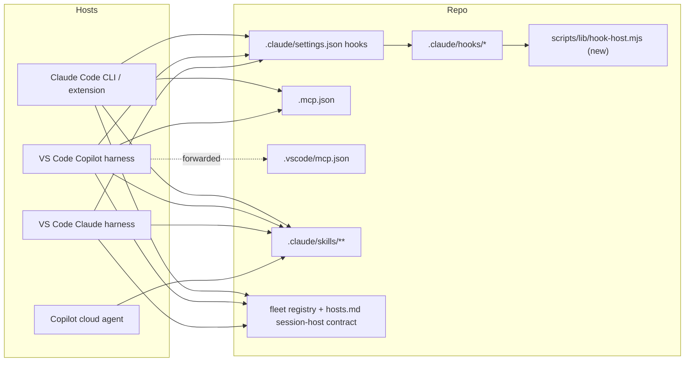

# Plan: VS Code compatibility — host facts, MCP, hook portability, fleet on VS Code
- **Date**: 2026-11-22
- **Status**: Draft
- **Author**: Claude + Louis
- **Scope**: backend (skills prose, hooks, sync and fleet CLI strings; no UI)
- **Target domain(s)**: `claude-hooks`, `fleet`, `shared-lib`, `skills-content`
- ⚠ **Cross-domain work**: the plan touches 4 domains. Each crossing is one cluster (§11), so no single change spans two
  of them, apart from the hook lib, which sits in `shared-lib` and is consumed by `claude-hooks`.
- ⚠ **Untagged paths**: `AGENTS.md`. This is expected: it is a root instruction file, not code.
- **Evidence**: [`docs/research/vscode-compatibility-review-2026-11.md`](../research/vscode-compatibility-review-2026-11.md)
  (the review). Every vendor fact below is cited there with its URL. This plan restates only the facts that change a
  design decision.

**Approval markers.** ⚑ marks a change Louis must approve before a chip implements it. There are two of them: Cluster C
(a new file written into consumers) and the smoke runbook's own instruction to run it. No change in this plan loosens a
gate.

## 1. Context Summary

**Stack:** js-ts (Node ESM), per `detect-stack`. Scope: backend.

**What exists today.** The repo is already host-neutral by design, in three places:

- `.claude/skills/**` is the single skill surface, which Copilot also reads.
- Hooks are documented as accelerators, with the rule in code.
- `/fleet` coordinates through a git-common-dir registry, not through host messages.

**What is stale.** VS Code 1.147 (2026-11-18) moved every session onto an *agent harness*, and the old "Local" harness is
removed in February 2027. Four facts the repo relies on have changed:

1. The default Copilot harness reads the root `.mcp.json` and only *forwards* `.vscode/mcp.json`.
2. The Copilot harness **runs the repo's `.claude/settings.json` hooks**, with Claude matchers and a snake_case payload.
   Its output contract differs: a top-level `permissionDecision` or `additionalContext`, and output from
   `userPromptSubmitted` is dropped.
3. Copilot and Claude harness agents **can create sessions (with a new worktree), inspect them and message them**.
4. Claude Code's `ListAgents`/`SendMessage` and `claude --bg` give the CLI and the extension the same primitives.

**Code Trace** (all pinned to `4b778e70`):

- **MCP.** The instruction is `AGENTS.md:236-237` ("VS Code reads `.vscode/mcp.json`, **NOT** `.mcp.json`"). It is quoted
  verbatim by `scripts/gate-contracts/mcp-parity-gate.json:10` and paraphrased in `scripts/lib/checklist/gen.mjs:117`. It
  is enforced by `scripts/check-mcp-parity.mjs` → `scripts/lib/mcp-parity.mjs:40` (`HOSTS ['claude','vscode']`).
  - The sync ships only `.vscode/mcp.json`: `scripts/lib/sync-inventory.mjs:330` (`EDITOR_FILES`), with
    `scripts/check-mcp-parity.mjs:13` saying ".vscode/mcp.json is in the sync bundle, .mcp.json is not".
  - Co-owned JSON merge: `scripts/lib/sync-divergence.mjs:234` and `scripts/lib/sync-path-map.mjs` (its
    `STAYS_AT_CANONICAL_PATH_PREFIXES` list includes `.vscode/mcp.json`).
- **Hooks.** They are wired in `.claude/settings.json:40-101`.
  - `quickfix-scan.mjs:115-125` and `syntax-check.mjs:108-112` read `tool_name` (`Edit`/`Write`) and
    `tool_input.file_path|filePath`, then emit `{systemMessage}` (`quickfix-scan.mjs:231`, `syntax-check.mjs:184`).
  - `bash-grep-nudge.mjs:42-43` reads `tool_name === 'Bash'` and `tool_input.command`, and emits a nested
    `hookSpecificOutput.permissionDecision` (`:60-62`).
  - `arch-memory-check.sh:66` reads `prompt`, writes a plain-text callout to stdout, and pays for an embed and an RPC.
  - Hook-to-library resolution goes through `LIB_CANDIDATES` (`quickfix-scan.mjs:49`), whose closure is synced, pinned by
    `tests/hook-lib-closure-synced.test.mjs`.
- **Accelerator docs.** `docs/reference/enforcement-mechanisms.md:108` ("Copilot, Cursor and every other host get no
  hook") and `docs/reference/skill-surface-ownership.md:62-67,217`.
- **Gate substitute.** `docs/audit/shared-references/gemini-gate.md:32` ("spawn a fresh agent (Task/Agent)") is synced into
  `skills/*/references/gemini-gate.md` by `scripts/sync-shared-audit-refs.mjs`.
- **Fleet.** The desktop-tool touchpoints are:
  - `skills/fleet/SKILL.md:115-116` (the "desktop session list" check before removal);
  - `skills/fleet/references/chip-preamble.md:14` (TITLE via `set_session_title`);
  - `skills/fleet/references/participant-rules.md:68` (rule 8);
  - `skills/fleet/references/coordination.md:89,96,97,99` (rules 2, 6, 7, 9);
  - `scripts/lib/fleet/archive.mjs:49` and `scripts/lib/fleet/prune.mjs:67` (`SESSION_LIST_CHECK`, printed at `:349` and
    `:415`), asserted by `tests/fleet-archive.test.mjs` and `tests/fleet-prune.test.mjs`.
  - Rules 15 and 16 (`coordination.md:105-106`) are already worded "a host may" and "where the host lets", so they stay.
  - `scripts/lib/fleet/handover-render.mjs:35,262` (`spawn_task`, `list_sessions`) belongs to the Claude-account handover
    and stays Claude-only by nature.
- **The existing host matrix** is `skills/fleet/references/hosts.md:5-75` ("as of 2026-10-19, VS Code 1.142").

**Patterns reused.**

- The `host-contract` marker family: `input-acquisition`, `no-dispatch`, `hook-rule`, and `browser-driver`
  (`skills/click-test/references/browser-tool-detection.md:17`). Its role-not-tool-name contract is the template for the
  new `session-host` contract.
- The co-owned JSON sync merge, already used for `.vscode/mcp.json`.
- `LIB_CANDIDATES` hook-to-library resolution.
- The parity gate's two-schema comparison.

**Neighbourhood considered** (`get-neighbourhood`, `k:8`, coverage `verified`). All 8 results are band `review`, which
means no near-duplicate exists:

- `classifyListing`, `renderPlan` and `capture` (`scripts/lib/fleet/archive.mjs`, domain `fleet`);
- `bundleForRepo`, `buildSkillFiles`, `buildFileUniverse`, `realMissingDeps` and `getAllConsumerInventories`
  (`scripts/lib/sync-inventory.mjs`, domain `shared-lib`).

No hook payload normaliser exists. `scripts/lib/**/*hook*` holds only `claudemd/step65-hook.mjs`,
`fleet/hooks-path-guard.mjs`, `fleet/ledger-hook.mjs` and `prepush-hook-version.mjs`, none of them about tool-event
payloads. So the new module is greenfield.

**Security incident neighbourhood.** INC-001 (sensitive-path classification of a symlink) applies to Cluster D. The
quick-fix and syntax hooks short-circuit on sensitive paths, and a second payload shape must not create a path that
reaches `matchPatterns` or `node --check` without that classification (§Security Considerations).

## 2. Proposed Architecture

**Key decisions.**

1. **One host oracle for hooks, `detectHookHost(payload)`** (#5 Single Source of Truth, #15 Graceful Degradation). It
   returns `claude-code`, `copilot` or `unknown`. `copilot` means the payload carries Copilot's documented shape: a
   string `timestamp` and `hook_event_name`, and no `transcript_path`. `unknown` behaves exactly as today (the Claude
   shape), so a misdetection fails toward current behaviour, never toward silence.
   - Every hook asks this one function; none re-derives the host.
   - `normaliseToolEvent(payload)` returns `{tool, filePath, text}` or `null`. `formatHookOutput(host, kind, message)`
     returns the stdout JSON for that host.
   - Field names for Copilot tool inputs are taken **only from recorded payloads (Cluster A) or the published reference**,
     never guessed. A field the normaliser does not know yields `null`, which means exit 0, the same as today.
2. **Arch-memory skips its paid query only on a positive `copilot` detection** (#15). The host documents that it drops
   the output, so paying for it is pure waste. `unknown` still runs.
3. **Ship `.mcp.json` beside `.vscode/mcp.json`** ⚑ (#5, #18 Backward Compat). It reuses the existing co-owned JSON merge
   and the existing parity gate, now checked in consumers too. It is not a new generator. `.vscode/mcp.json` stays
   because the Local harness exists until February 2027.
4. **Fleet's `session-host` contract is prose**, a role table in `hosts.md` like `browser-driver` (#4 No Hardcoding of
   tool names, #10 Long-Term Flexibility).
   - The roles are spawn, list, message, title, archive and session-list check.
   - Each touchpoint cites the role. Code strings drop "desktop".
   - The registry stays the single authority, so mixed-host fleets work with no code change.
5. **No new skill surface.** No `.github/hooks/`, `.github/agents/`, `.github/skills/` or `copilot-instructions.md`.
   Reasons:
   - Copilot hooks from several sources *all* run, so a second copy would double-fire.
   - Skills are already read from `.claude/skills`.

**Right-sizing gate.**

- **Band-aid extreme:** fix the sentences, add a VS Code paragraph to `hosts.md`, and leave every hook emitting Claude-only
  output. The hooks then keep spending money and nudging nothing on the default VS Code harness, and every chip prompt
  keeps telling a VS Code session to call a tool it does not have.
- **Over-engineered extreme:** a Copilot-native mirror of every surface (`.github/hooks`, `.github/agents`,
  `copilot-setup-steps.yml` with audit keys), a fleet host-adapter module that spawns sessions itself, or adopting a
  third-party orchestrator. The review §7 shows none covers claims, the lease or landing.
- **Chosen:**
  - one host-detection function for the hooks that already run there;
  - shipping the one MCP file the default harness reads;
  - a prose role contract for fleet;
  - a smoke runbook that turns each "doc" cell into "obs".

  The current requirement it serves: Louis runs these skills and `/fleet` from VS Code (Copilot and the Claude extension)
  on both machines.

**Manual vs scripted.** Manual edits. The touchpoints are about 12 distinct prose sites, each with different wording, so
no codemod is warranted.

## 6. Sustainability Notes

- **Assumption:** vendor hook payload shapes stay as documented (hooks are Preview). Detection is one function, so a shape
  change is a one-file fix plus a fixture.
- **Assumption:** VS Code session tool names stay unpublished. The contract names roles, so a rename costs nothing.
- **Event:** the Local harness is removed in February 2027. `.vscode/mcp.json` can then be retired by a follow-up that
  deletes one `EDITOR_FILES` entry and one parity host. That retirement is deliberately not done now, while Local still
  exists.
- **Extension point:** `detectHookHost` can admit a third host, such as Codex, as a new branch plus a fixture.

## 7. File-Level Plan

| File | Purpose | Key change | Principle |
|---|---|---|---|
| `docs/runbooks/vscode-host-smoke.md` (planned) (create) | The per-harness smoke test Louis runs | Steps, capture recipe, the fixture destination, and recording into `hosts.md` | #12 Testability |
| `AGENTS.md` (modify) | The MCP line | Copilot harness reads `.mcp.json`; Local reads `.vscode/mcp.json`; keep both mirrored | #5 |
| `scripts/gate-contracts/mcp-parity-gate.json` (modify) | The verbatim `stated` quote | Re-quote the new sentence | gate honesty |
| `scripts/lib/checklist/gen.mjs` (modify) | Its checklist context string | Match the new line | #5 |
| `docs/reference/enforcement-mechanisms.md` (modify) | Fix the "no hook" fact | Copilot runs `.claude/settings.json` hooks with different outputs; the rule is unchanged | accuracy |
| `docs/reference/skill-surface-ownership.md` (modify) | Per-harness discovery | The harness table, the Local deprecation, precedence still undocumented | accuracy |
| `docs/audit/shared-references/gemini-gate.md` (modify) | Name the role | "an independent subagent (Claude `Agent`/`Task`, Copilot `task`)", size-neutral | #4 |
| `scripts/lib/sync-inventory.mjs` (modify) ⚑ | Ship `.mcp.json` | Add it to `EDITOR_FILES` | #18 |
| `scripts/lib/sync-path-map.mjs`, `scripts/lib/sync-divergence.mjs`, `scripts/lib/sync-eol-pins.mjs` (modify) ⚑ | Co-owned merge and EOL for `.mcp.json` | Same treatment as `.vscode/mcp.json` | #1 DRY |
| `scripts/check-mcp-parity.mjs` (modify) ⚑ | Its header comment and consumer note | Both files now ship | accuracy |
| `scripts/lib/hook-host.mjs` (create) | The host oracle | `detectHookHost`, `normaliseToolEvent`, `formatHookOutput` | #5, #15 |
| `.claude/hooks/quickfix-scan.mjs`, `.claude/hooks/syntax-check.mjs`, `.claude/hooks/bash-grep-nudge.mjs`, `.claude/hooks/arch-memory-check.sh` (modify) | Use the oracle | Normalised input, host-shaped output, arch skip on `copilot` | #5 |
| `skills/fleet/references/hosts.md` (modify) | Matrix refresh plus the `session-host` contract | Roles × hosts, the routes (VS Code session tools, `claude --bg`, cloud PR via `fleet add`), the existing-tools verdict | #4 |
| `skills/fleet/references/chip-preamble.md`, `skills/fleet/references/participant-rules.md`, `skills/fleet/references/coordination.md`, `skills/fleet/SKILL.md` (modify) | Touchpoints cite roles | TITLE and rule 8 conditional on a title role; rules 2, 6, 7, 9; the removal check | #4 |
| `scripts/lib/fleet/archive.mjs`, `scripts/lib/fleet/prune.mjs` (modify) | `SESSION_LIST_CHECK` | "the host's session list (desktop, Agents window or `claude agents`)…" | #4 |

## 7b. Implementation Phases

**Phase 1 — VS Code smoke runbook.** Write the per-harness smoke test, covering Copilot, Claude harness, the Claude
extension, and the cloud agent where it applies.

- *Discovery and arguments:* skills listed from `.claude/skills`; `/name args` delivery; `disable-model-invocation`
  honoured.
- *Configuration:* `.mcp.json` versus `.vscode/mcp.json` servers visible; `allowed-tools: Bash(...)` behaviour.
- *Hook payloads:* captured with an **uncommitted** local diagnostic hook, `.github/hooks/payload-capture.json`. The
  capture must stay private and must leave nothing behind:
  - **Before the run.** Launch VS Code from a shell with `$env:ARCH_MEMORY_HOOK_DISABLE = '1'`. The repo's
    `.claude/settings.json` hooks also fire under the Copilot harness, so without this every captured prompt would pay
    for an embed before Phase 5's skip exists. Record that the variable was set.
  - **Preflight (refuse, never overwrite).** The runbook first checks that `.github/hooks/payload-capture.json` and its
    script path do not exist. If either does, it stops: those are the operator's files, and the runbook never replaces
    or deletes a file it did not create.
  - **Where raw captures go.** The hook script writes raw payloads OUTSIDE the repo, to a **unique per-run** directory,
    `$env:LOCALAPPDATA\ces-hook-capture\<run-id>\<host>\`, where `<run-id>` is a timestamp plus a random suffix. It
    never writes into the working tree.
  - **Access control: restrict, then verify against an allowlist.** The runbook creates the run directory and
    immediately removes inheritance and grants an explicit set:
    `icacls <dir> /inheritance:r /grant:r "${env:USERNAME}:(OI)(CI)F" "SYSTEM:(OI)(CI)F" "Administrators:(OI)(CI)F"`.
    It then verifies with `Get-Acl`:
    - `AreAccessRulesProtected` is `True`, so nothing is inherited;
    - every access rule's identity, resolved to a SID, is in the allowlist: the operator's own SID, `S-1-5-18`
      (SYSTEM) and `S-1-5-32-544` (Administrators). A rule for any other principal, a group or an individual account,
      fails the check.

    If the check fails, or cannot run, the runbook stops before any capture. A negative control runs first: grant
    `Users:(R)` to the directory, confirm the check refuses, then remove the grant and confirm it passes.
  - **Run record.** The runbook writes each artifact it creates (the hook config, its script, the run directory) to a
    run record, `$env:LOCALAPPDATA\ces-hook-capture\<run-id>.created.txt`.
  - **Cleanup.** The runbook's last step removes **only the artifacts in the run record**, then the record itself. It
    runs even if an earlier step failed. Other files under `.github/hooks/` or `ces-hook-capture\` are left alone. The
    step then checks each removal explicitly:
    - `Test-Path` must be `False` for every path in the run record and for the record itself;
    - `git status --porcelain --ignored -- .github/hooks/payload-capture.json <script path>` must print nothing.

    A `True` or any output means cleanup failed. The runbook says so in bold and stops until it is fixed.
  - **Fixtures.** A fixture is made only by a **fail-closed schema projection** script that the runbook gives inline.
    - **It is recursive and allowlist-based.** It walks the payload. For each supported event it reads a **versioned
      allowlist**, `tests/fixtures/hook-payloads/allowlist.json` (`{"version": N, "events": {<event>: {<key path>:
      <synthetic value>}}}`), created with the first fixture commit. Each permitted key path has its synthetic value.
    - **Unknown key paths REFUSE; they are never dropped.** If the payload holds any key path not on the allowlist, the
      script exits 2 and writes no fixture. It prints the unknown key **paths** to stderr, never their values. So an
      unpublished field, which is exactly the evidence Tier 2 needs, cannot be lost silently.
    - **Approving a field is a two-step process.** Louis reviews the printed paths privately. He adds each one he
      approves to the allowlist with a synthetic value and bumps `version`. Then he re-runs the projection on the same
      raw capture. A path he does not approve means no fixture for that event; the raw capture is then deleted at
      cleanup.
    - **What it keeps.** No original string value survives anywhere except the closed-list identifiers below. Every
      other string, number or nested value is replaced by the synthetic value its key path has in the allowlist.
    - **When else it refuses.** It refuses (exit 2, no output) on an unsupported event.

    Its tests:
    - a payload with a nested secret, a private non-path string and a home path, all on approved paths: none of them
      appear in the output;
    - a payload with an unexpected field: exit 2, no output, and stderr names the path but not its value;
    - the same payload after that path is added to the allowlist: the output carries the path with its synthetic value.

    Because unknown paths refuse, a fixture's key set always equals the recording's key set. Beyond that, it **keeps**
    the fields that identify the event:
    - `hook_event_name` and `tool_name` verbatim, validated against a closed list (the documented event names, and the
      Claude tool names from the reference's mapping table);
    - `timestamp`, replaced by the fixed value `2026-01-01T00:00:00.000Z`, and `session_id`, replaced by
      `"fixture-session"`.

    It **replaces** values with synthetic ones:
    - a path becomes `src/fixture.mjs`;
    - a prompt becomes `fix the fixture bug`;
    - a command becomes `rg fixturePattern src`;
    - edited text becomes a known quick-fix trigger, `try { x() } catch {}`.

    No raw prompt, path or command survives. The projection script has its own test, which feeds it a payload with a
    home path and asserts the output holds none of it. Output lands under `tests/fixtures/hook-payloads/<host>/`.
  - **Checks before commit.** Louis reviews the fixture diff. A scan of the fixtures for a home-directory or drive-letter
    pattern must find nothing. Raw captures are never committed, and they cannot be, because they live outside the repo.
- *Agent sessions:* create with a worktree, list, and message.
- *Fleet:* the two-session test from `hosts.md:73-75`.
- *Results:* the result table and where it is recorded (the `hosts.md` matrix, with harness version and date).

Files: `docs/runbooks/vscode-host-smoke.md` (planned) (create).

**Phase 2 — Host-facts refresh.** Rewrite each stale fact with its citation.

- AGENTS.md's MCP line, and its verbatim quote in the gate contract.
- The checklist context string.
- The "no hook" sentence in `enforcement-mechanisms.md`. Also its AGENTS.md echo in §Architectural Memory ("Copilot,
  Cursor and every other host get no hook"), *if* that sentence is not a `statedIn` quote. If it is, re-quote it in the
  same commit.
- The discovery table in `skill-surface-ownership.md`.
- The role-named subagent substitute in the canonical gemini-gate reference, regenerated into its copies.

Files: `AGENTS.md` (modify), `scripts/gate-contracts/mcp-parity-gate.json` (modify), `scripts/lib/checklist/gen.mjs`
(modify), `docs/reference/enforcement-mechanisms.md` (modify), `docs/reference/skill-surface-ownership.md` (modify),
`docs/audit/shared-references/gemini-gate.md` (modify).

**Phase 3 — Ship `.mcp.json` to consumers ⚑.** Add `.mcp.json` to the sync's editor files with the same co-owned JSON
merge, canonical-path and EOL treatment as `.vscode/mcp.json`. Keep the parity gate and update its consumer note.

**Merge semantics are the existing ones, unchanged and restated here so the tests pin them.**

- `deepMerge` (`scripts/lib/json-merge.mjs`, `4b778e70`) gives *leaf-path authority*:
  - a source leaf (a scalar or an array) wins at its path;
  - a source object merges recursively;
  - a consumer-only path at any depth survives.
- **Same-name server.** A consumer server under the same name as ours (`playwright`, `mermaid`) gets our leaves (`type`,
  `command`, `args`). Its extra keys survive. A consumer that must keep different values declares that divergence in its
  committed `.sync-overrides.json` (the existing mechanism, AGENTS.md §Consumer divergence). A pin downgrade is refused
  by `sync-pin-guard.mjs`.
- **Upstream removal.** It is NOT propagated: a server we stop shipping stays in the consumer. This is today's
  `.vscode/mcp.json` behaviour and is accepted. The plan does not change it.
- **Malformed consumer JSON.** It is a `collision` (`decideUnmanifested`, `scripts/lib/sync-outbound.mjs:97-102`), so the
  sync refuses to claim that file. It is never overwritten.

**Tests** run on a temporary consumer. They cover:

- the first sync, where the file is absent;
- a repeated sync, which must change no bytes;
- a consumer-only server, which survives;
- a same-name server with an extra key, where our leaves win and the extra key survives;
- malformed JSON, which is a collision and leaves the file untouched;
- managed-server parity on the merged consumer pair.

**Parity is defined over MANAGED servers only.** Managed servers are the names the source repo ships (`playwright`,
`mermaid`).

- The existing `check-mcp-parity` stays a source-repo gate, comparing our two files in full.
- In a consumer, a server present in only one of the two files is the consumer's own. It is independently owned and
  never a parity failure.
- A managed server whose merged values differ between the two files fails parity, unless the consumer declared that
  divergence in `.sync-overrides.json`.

**Where consumer parity runs.** It runs in the existing consumer-side verifier, `scripts/lib/sync-isolation-verify.mjs`
(`runGates`, `:916` at `4b778e70`), as a new **gate 10, managed MCP parity**. That verifier already runs from the
consumer side after a sync and reads the consumer's manifest as its source of truth. So consumer parity needs no new
CLI, and it runs after the merge and the writes, against the files as they landed.

- **Managed names.** The manifest's `files` map is path → hash and has no per-entry metadata, so the names go in a new
  **top-level** field, `mcpManagedServers: string[]` (sorted, each non-empty), taken from the source `.mcp.json` the
  sync merged in. The gate reads it from the consumer's validated manifest, never from the source repo. The field
  touches one persistence path, changed together:
  - `SyncManifestSchema` (`scripts/lib/sync-manifest.mjs:62`) gains `mcpManagedServers:
    z.array(z.string().min(1)).optional()`. Without this the non-strict schema strips the key on parse, and gate 10
    never sees it;
  - `buildConsumerManifest` (`:341`) takes and writes it, and `sync-to-repos.mjs` passes it;
  - the verifier already validates through `SyncManifestSchema.safeParse` (`sync-isolation-verify.mjs:226`), so it
    needs no second parse.

  **Backward compatibility:** the field is optional. An older manifest without it still validates. A malformed value
  (not an array of non-empty strings) fails schema validation, which the verifier already reports as a failure.
- **Overrides.** An override is per FILE, not per server: `.sync-overrides.json` freezes a whole path. The gate loads
  it with the existing `loadOverrides` and checks each of the two files with `matchOverride`
  (`scripts/lib/sync-overrides.mjs:254`, `:285`). If either file is overridden, the consumer has declared that pair
  divergent. Gate 10 then compares nothing and reports `declared`, naming the overridden file. That is a recorded
  decision, never `pass`.
- **Comparison.** It calls the existing oracle, `compareMcpSurfaces` (`scripts/lib/mcp-parity.mjs:268`), on the two
  consumer files, restricted to the managed names by a new `managedNames` option. Without that option the function
  behaves as today, so the source-repo gate is unchanged.
- **Reporting and exit status.** Gate 10 has four results. Only two let the verifier exit 0:
  - `pass`: every managed server matches;
  - `declared`: the pair is overridden (above);
  - `fail` (`MCP_PARITY_MISMATCH`): a managed server differs, reported with its name and the differing leaf path;
  - `unmeasured` (`MCP_PARITY_UNMEASURED`): the manifest lists the root `.mcp.json` but has no `mcpManagedServers`.

  `fail` and `unmeasured` are gate failures: the verifier exits non-zero, as for any other failed gate. `unmeasured`
  prints its own diagnostic, distinct from a mismatch: "manifest predates managed-server recording — re-sync with
  `npm run sync -- --target <name>` from claude-engineering-skills". A manifest that does not list `.mcp.json` at all
  was written before Cluster C. There is nothing to compare, so gate 10 reports `not-applicable` and exits 0.

The temporary-consumer tests run a real sync into the temporary consumer. They reload the manifest through
`SyncManifestSchema` and assert the exact `mcpManagedServers` value. Then they call `runGates` with gate 10, the same
production path an operator runs, and assert both the gate result and the verifier's overall exit status:

1. an extra server on one side only: `pass`, exit 0;
2. an overridden pair with a divergent managed value: `declared`, exit 0;
3. an undeclared managed mismatch: `fail`, non-zero;
4. `mcpManagedServers` removed from a manifest that lists `.mcp.json`: `unmeasured`, non-zero, with the re-sync
   diagnostic;
5. `mcpManagedServers` set to a malformed value: schema failure, non-zero;
6. a manifest with no `.mcp.json` entry: `not-applicable`, exit 0.

Files: `scripts/lib/sync-inventory.mjs` (modify), `scripts/lib/sync-path-map.mjs` (modify),
`scripts/lib/sync-divergence.mjs` (modify), `scripts/lib/sync-eol-pins.mjs` (modify), `scripts/check-mcp-parity.mjs`
(modify), `scripts/lib/mcp-parity.mjs` (modify), `scripts/lib/sync-isolation-verify.mjs` (modify),
`scripts/lib/sync-manifest.mjs` (modify: schema field and `buildConsumerManifest`), `scripts/sync-to-repos.mjs`
(modify: pass `mcpManagedServers`), `tests/mcp-parity.test.mjs` (modify).

**Phase 4 — Hook host oracle.** Create `scripts/lib/hook-host.mjs` with three exports:

- `detectHookHost(payload)`: `claude-code` | `copilot` | `unknown`;
- `normaliseToolEvent(payload)` returns a discriminated union, or `null`:
  - `{kind:'file', op:'edit'|'write', filePath, text?}`: `filePath` required, `text` optional (absent when the payload
    carries no text field). Used by syntax-check, which needs only `filePath`, and by quick-fix, which needs both.
  - `{kind:'shell', command}`: `command` required; there is no path. Used by grep-nudge.

  A variant missing a **required** field is `null`; a missing optional `text` is not. Each hook checks the fields it
  needs: quick-fix exits 0 with no output when `text` is absent, while syntax-check still runs on a path-only event.
  So no hook that reads only the path today loses an event it handles now.
  - **Multi-file tools** (Copilot `apply_patch`) are **explicitly deferred**: `normaliseToolEvent` returns `null` for
    them. No hook sees a partial or unparsed patch, so no path skips the sensitive check.
  - Only single-file `edit`/`str_replace_editor`/`create` are mapped, and only in Tier 2.
- `formatHookOutput(host, event, kind, reason)` is the ONE signature. `event` is `PreToolUse` or `PostToolUse`, and
  `kind` is `deny` or `context`.
  - For `claude-code` and `unknown` it reproduces today's envelope byte for byte.
  - For `copilot` it emits the top-level `permissionDecision`/`permissionDecisionReason` or `additionalContext`.
  - Unit and caller tests are derived from these two schemas, including a shell event and a path-only syntax event.

**Two tiers of support, decided by what the evidence can show.**

- **Tier 1 — documented, shipped unconditionally.** The envelope fields are published in the Copilot hooks reference for
  the PascalCase events:
  - `hook_event_name`, `session_id`, `timestamp` (an ISO string), `cwd`;
  - `prompt` for `UserPromptSubmit`;
  - `tool_name` with Claude names for `PreToolUse`.

  Host detection, the arch-memory skip and the output shapes depend on these fields only.
- **Tier 2 — tool-input fields, shipped only with recorded fixtures.** The keys inside `tool_input` for Copilot's
  `bash`/`powershell`, `edit`/`str_replace_editor` and `create` tools (`apply_patch` is deferred, above) are **not published**. Mapping them
  requires Phase 1's recorded fixtures to be committed.
  - If they are absent when Cluster D starts, `normaliseToolEvent` maps the Claude shape only and returns `null` for
    Copilot.
  - The quick-fix, syntax and grep hooks then stay exactly as silent on Copilot as today.
  - The cluster report states "Tier 2 deferred: no recorded fixtures", and `hosts.md` records it. It is never counted as
    implemented.

**Mapping contract** (tests are derived from this table; ✱ = Tier 2):

| Hook | Event | Host | Input read | Output emitted |
|---|---|---|---|---|
| `bash-grep-nudge.mjs` | PreToolUse | claude-code / unknown | `tool_name=='Bash'`, `tool_input.command` | unchanged: `{hookSpecificOutput:{hookEventName:'PreToolUse',permissionDecision:'deny',permissionDecisionReason}}` |
| `bash-grep-nudge.mjs` | PreToolUse | copilot | `tool_name=='Bash'`, `tool_input.<recorded key>` ✱ | `{permissionDecision:'deny',permissionDecisionReason}` |
| `quickfix-scan.mjs` | PostToolUse | claude-code / unknown | `Edit`→`new_string`, `Write`→`content`, path `file_path\|filePath` | unchanged `{systemMessage}` |
| `quickfix-scan.mjs` | PostToolUse | copilot | `Edit`/`Write` → recorded text and path keys ✱ | `{additionalContext}` |
| `syntax-check.mjs` | PostToolUse | claude-code / unknown | path as above | unchanged `{systemMessage}` |
| `syntax-check.mjs` | PostToolUse | copilot | recorded path key ✱ | `{additionalContext}` |
| `arch-memory-check.sh` | UserPromptSubmit | claude-code / unknown | `prompt` (`:66`) | unchanged plain-text callout |
| `arch-memory-check.sh` | UserPromptSubmit | copilot | `prompt` | none. Exit 0 before the embed and the RPC, plus one stderr line |

**Missing fields.** Any required input field absent from the payload makes `normaliseToolEvent` return `null`, and the
hook exits 0 with no output. That is today's behaviour.

**Output wording.** The signature is the one above; snapshot tests taken before the change pin the Claude envelopes.

**Fixtures** come from three sources:

- the published reference (envelopes);
- Phase 1's recordings (Tier 2);
- the Claude shapes the existing hook tests use.

**Module resolution** is one contract for all four hooks. The node hooks use the existing `LIB_CANDIDATES` probe
(`scripts/lib/X`, then `scripts/.claude-skills/lib/X`, both resolved from the hook file's own directory, never from the
cwd).

- `arch-memory-check.sh` passes the module path it already derives (the same two-candidate loop at `:157` that finds
  `cross-skill.mjs`) into its `node -e` call as an argument.
- **Load-failure contract.** Each hook keeps its current inline Claude-shape parsing and output code as the legacy path.
  It is not deleted. If `hook-host.mjs` cannot be loaded, the hook:
  - writes one stderr line, `[<hook>] hook-host unavailable — legacy Claude path`;
  - runs that legacy path, which reads the input, emits output and exits exactly as at `4b778e70`.

  So the failure is observable (stderr) and never changes the exit status. On Copilot, arch-memory then runs its query as
  it does today. A test deletes the module from a relocated consumer-layout copy and asserts:
  - the stderr line;
  - byte-identical legacy stdout for the Claude fixture;
  - exit 0.

**Registration.** Add the module to the hook-library closure so the sync ships it.

Tests:

- `tests/hook-lib-closure-synced.test.mjs` is updated;
- a consumer-layout test runs each hook from a non-repo cwd against a `scripts/.claude-skills/lib/` copy;
- the Tier 3 sync and relocation tests (AGENTS.md §Testing doctrine) go in the same commit.

Files: `scripts/lib/hook-host.mjs` (create), `tests/hook-host.test.mjs` (create),
`tests/hook-lib-closure-synced.test.mjs` (modify), `scripts/lib/sync-entry-lists.mjs` (modify).

**Phase 5 — Wire the hooks to the oracle.**

- `quickfix-scan.mjs` and `syntax-check.mjs` take input from `normaliseToolEvent`, and output comes from
  `formatHookOutput`.
  - The existing symlink-aware boundary is kept unchanged and runs first on the normalised `filePath`:
    - `quickfix-scan.mjs:139` canonicalises before its sensitive check;
    - `syntax-check.mjs:125-135` resolves an absolute path, then calls `sensitive-paths.mjs`, whose `resolveAndClassify`
      re-checks the realpath and classifies a resolution failure or a repo-escaping link as `sensitive`.
  - No new path-handling code is written.
  - Tests for BOTH payload shapes: a direct sensitive path, a symlink into a sensitive location, and a dangling link.
    Each must short-circuit with no scan and no `node --check`, for INC-001.
  - A spawned-hook regression test feeds `syntax-check.mjs` a path-only Claude `Edit` event (no `new_string`) and
    asserts that `node --check` still runs, as it does at `4b778e70`. It feeds `quickfix-scan.mjs` the same event and
    asserts exit 0 with no output. Once Tier 2 fixtures exist, the same pair runs on the recorded Copilot event.
- `bash-grep-nudge.mjs` emits a host-shaped deny. Its message names the host's search tool ("the Grep tool", or "the grep
  tool" on Copilot).
- `arch-memory-check.sh` asks the oracle (through its existing `node -e` parse) and exits 0 **before** the embed and the
  RPC when the host is `copilot`, with one stderr line saying why.
- `legacy-surface-advisory.mjs` is left as is: it is cheap, and `npm run check` covers it.

Files: `.claude/hooks/quickfix-scan.mjs` (modify), `.claude/hooks/syntax-check.mjs` (modify),
`.claude/hooks/bash-grep-nudge.mjs` (modify), `.claude/hooks/arch-memory-check.sh` (modify),
`tests/learning-quickfix-hook.test.mjs` (modify), `tests/hook-syntax-check.test.mjs` (modify),
`tests/hook-arch-memory-check.test.mjs` (modify).

**Phase 6 — Fleet `session-host` contract (prose).**

- Rewrite the `hosts.md` matrix from the review:
  - add a `<!-- host-contract: session-host; roles=spawn,list,message,title,archive,session-list -->` block with roles ×
    hosts (desktop app, VS Code Copilot/Claude harness, Claude Code CLI/extension, manual);
  - add three routes: VS Code agent-created sessions with a new worktree, `claude --bg` workers, and cloud-agent PRs
    adopted with `fleet add #PR`;
  - add the existing-tools verdict (none adopted; CCManager named as an optional user-side launcher).
- Make the touchpoints cite roles:
  - chip-preamble TITLE becomes "with the host's title tool where it has one (desktop: `set_session_title`); otherwise lead
    your first message with the title";
  - participant rule 8 uses the same wording;
  - coordination rules 2, 6, 7 and 9 become "the host's session list" and "the host's archive", with the desktop tool
    given as the example;
  - `SKILL.md`'s removal check becomes "the host's session list".
- **Mixed-host removal procedure.** It goes in `hosts.md`; the touchpoints point to it. The registry records intent, not
  liveness, so no single host can see every session. Before removing or archiving a worktree, the coordinator checks four
  things in order:
  1. **The registry record for that worktree.** If it has a `--host-session` id from another host, or no host at all, the
     coordinator cannot see that session from here.
  2. **Its own host's session list,** through the session-host `list` role. A live session found there stops the removal.
  3. **Any session it cannot see from its own host.** Removal needs Louis's explicit confirmation in chat that no session
     on the other host uses the path. Examples: a VS Code Agents-window session seen from the desktop app, or a
     `claude --bg` worker seen from VS Code.
  4. **No confirmation means no removal.** The existing `archive-check` refusal and "removing a worktree is the user's
     decision" (`skills/fleet/SKILL.md:112`) are unchanged.

  This is a tightening, not a loosening: today's text assumes one host's list is complete.
- Respect the size gates:
  - `skills/fleet/SKILL.md` and `gemini-gate.md` are over the 12,000-char cap and **must not grow**;
  - `coordination.md` is at about 12,000 chars and must not cross it;
  - net-neutral edits only. A shrink is re-baselined, which lowers the baseline and is not a cap raise.
- Update `skills/fleet/gate-contract.json` `ignoredCandidates` where a quoted line's text changes.

Files: `skills/fleet/references/hosts.md` (modify), `skills/fleet/references/chip-preamble.md` (modify),
`skills/fleet/references/participant-rules.md` (modify), `skills/fleet/references/coordination.md` (modify),
`skills/fleet/SKILL.md` (modify), `skills/fleet/gate-contract.json` (modify).

**Phase 7 — Fleet code strings.** Two string changes:

- `SESSION_LIST_CHECK` in `archive.mjs` and `prune.mjs` names "the host's session list". It adds "and, for any session
  on another host or with no recorded host, the user's confirmation". This is the Phase 6 procedure in one line.
- Update the tests that assert the string. The red test asserts the old wording is gone and the cross-host clause is
  present.

Files: `scripts/lib/fleet/archive.mjs` (modify), `scripts/lib/fleet/prune.mjs` (modify), `tests/fleet-archive.test.mjs`
(modify), `tests/fleet-prune.test.mjs` (modify).

**Close-out (not a phase):**

- `node scripts/sync-shared-audit-refs.mjs` (first: it rewrites `skills/*/references/` copies from the canonical, and
  those copies are committed in the same commit as the canonical edit);
- `npm run skills:regenerate` (second: it copies `skills/**` into `.claude/skills/**`);
- `npm run checklist:gen` then `npm run checklist:gen:check` (Cluster B: `mcp-parity-gate.json` and
  `scripts/lib/checklist/gen.mjs` feed the Category B `.audit-loop/checklist.json`);
- `npm run bundle:deps` then `npm run bundle:deps:check` (Cluster D: the `sync-entry-lists.mjs` change and the new
  synced import feed `scripts/lib/bundle-deps.json`);
- `npm run skills:check`;
- `npm run skills:size:gate` (re-baseline only on a shrink);
- `npm run gates:check`;
- `npm run context:check`;
- `node scripts/check-mcp-parity.mjs`;
- `npm run plans:index`;
- targeted tests: `node --test tests/hook-host.test.mjs tests/mcp-parity.test.mjs tests/fleet-archive.test.mjs tests/fleet-prune.test.mjs`
  and the hook tests.

## 8. Risk & Trade-off Register

- **Hooks are Preview on Copilot.** Shapes may change. Mitigations: one oracle plus fixtures, and `unknown` falls back to
  today's behaviour.
- **Misdetection.** A Claude payload misread as `copilot` would skip arch-memory for Claude users, which would be a silent
  regression. Mitigations:
  - the predicate requires the *absence* of `transcript_path`, which every Claude Code hook payload carries;
  - a positive-control test asserts that the Claude fixture is never `copilot`;
  - a negative-control test asserts that the Copilot fixture is.
- **The Copilot tool-input field names are not in the reference.** This is the Tier 2 split in Phase 4.
  - Without recorded fixtures, the grep, quick-fix and syntax hooks are explicitly deferred on Copilot. They are reported
    as "Tier 2 deferred", not as shipped.
  - Tier 1 (detection, the arch-memory skip, output envelopes) ships either way.
  - Cluster D's acceptance names which tier landed.
- **`.mcp.json` in consumers ⚑.** It is a new file in every consumer's tree. Mitigations: the co-owned merge keeps their
  servers, and the sync receipt records the write. Louis approves before Cluster C starts.
- **Fleet prose edits near the size caps.** The size gate fails on growth, which forces condensing. The risk is a chip
  that chooses to raise a baseline instead. That would be a cap raise, which stays Louis's, and the chip must stop.
- **Deferred, with reasons** (review §8):
  - `/harness-retro` on Copilot sessions, which needs a new data source and a privacy review;
  - `copilot-setup-steps.yml` with keys, which is a secrets and deploy-environment write;
  - `.github/agents`, for which no requirement exists.

  None of the shipped clusters depends on them.

## 9. Testing Strategy

- **Unit.** `detectHookHost` gets one fixture per shape plus a malformed one. `normaliseToolEvent` and `formatHookOutput`
  get one test per host and kind.
- **Integration.**
  - Each modified hook is spawned with a Copilot fixture on stdin, and its stdout is asserted against the Copilot output
    contract.
  - With a Claude fixture, its stdout must be byte-identical to today's (regression).
  - The sync test: a consumer `.mcp.json` merge preserves their servers.
- **Edge cases:**
  - an empty stdin;
  - a payload with neither shape;
  - a sensitive path in a Copilot payload, which must still short-circuit (INC-001);
  - an `arch-memory` prompt with no intent verb (unchanged).

**Hook test matrix** (what each Copilot-fixture run must assert, by tier):

| Hook | Copilot, Tier 1 only (no recorded fixtures) | Copilot, Tier 2 (recorded fixtures) | Claude fixture |
|---|---|---|---|
| `arch-memory-check.sh` | **empty stdout**, **zero** stub calls, one stderr line | same | callout as today, one stub call |
| `bash-grep-nudge.mjs` | **empty stdout**, exit 0 (deferred) | leading `rg` gives top-level `permissionDecision:"deny"`; a non-grep command gives empty stdout | byte-identical deny |
| `quickfix-scan.mjs` | **empty stdout**, exit 0 (deferred) | a trigger edit gives top-level `additionalContext`; a clean edit gives empty stdout | byte-identical `systemMessage` |
| `syntax-check.mjs` | **empty stdout**, exit 0 (deferred) | a broken `.mjs` gives top-level `additionalContext`; a valid one gives empty stdout | byte-identical |

**Proof plan** (`references/proof-oracle.md`):

| Behaviour change | Oracle | Pass condition | Evidence in the report |
|---|---|---|---|
| Host detection | Red test: the Copilot fixture is classified `copilot`, which fails before the module exists. Control: the Claude fixture is classified `claude-code` | Both assertions green; the malformed fixture is `unknown` | The test names and the counts |
| Arch-memory skip | Spawn the hook with the Copilot fixture and a stubbed `cross-skill` that records calls | Zero recorded calls for the Copilot fixture, one for the Claude fixture | The stub's call log |
| Hook behaviour per hook × host × tier | Spawn each hook with each fixture and a stubbed `cross-skill` | See the matrix below; Claude stdout is byte-identical to the pre-change snapshot in every row | The test names, plus the diff of the snapshots |
| `.mcp.json` sync ⚑ | A sync test on a temporary consumer that has its own server | The merged file holds both theirs and ours; the parity gate passes in the consumer | The test output |
| Fleet strings | Existing `fleet-archive` and `fleet-prune` tests updated, red first against the old string | Green | The test names |
| Stated quotes | `npm run gates:check` | Exit 0 | The command output |
| Host facts | Source check: every rewritten sentence cites the review row and its vendor URL | A reviewer finds no uncited fact | The review link |
| Smoke runbook | Louis runs it once per harness | The `hosts.md` matrix cells move from `doc` to `obs` with a date | The `hosts.md` diff |

## Security Considerations

INC-001 applies to the hook-payload work:

- `normaliseToolEvent` returns a raw `filePath`. The existing sensitive-path short-circuit in `quickfix-scan.mjs` and
  `syntax-check.mjs` must run on it **before** any read or scan.
- `syntax-check` already resolves an absolute path before classifying, and that order must be kept.
- **Egress is unchanged from today, or reduced, and never increased.**
  - Today `arch-memory-check.sh` derives an intent from the prompt and sends it for an embedding and a store RPC, on every
    host where it runs. Claude Code is covered by `ARCH_MEMORY_HOOK_DISABLE=1`.
  - After this plan, a positively detected `copilot` host sends nothing. An `unknown` host or a module-load failure
    behaves exactly as today. That is a documented, existing egress, not a new one.
  - No new remote call is added anywhere.
  - The quick-fix and syntax hooks make no remote calls. They write only to `.audit/quickfix-hits.jsonl`, redacted as
    today.
  - Tests stub the remote calls and assert zero calls for `copilot`, and the same count as today for `unknown` and for
    a load failure.
- The smoke runbook's capture hook writes payloads containing prompts and paths. The runbook requires scrubbing before
  anything is committed as a fixture. It writes raw captures outside the repository and verifies their deletion
  explicitly (Phase 1).

## 11. Execution Clustering

- **Cluster A** — Phase 1 — fix-gate: none
  - Coupling: the runbook alone. Docs only; the later clusters read its fixture destination. Running it is Louis's step
    between clusters, not a chip's.
  - author-tier: economy
- **Cluster B** — Phase 2 — fix-gate: none
  - Coupling: every sentence that states a host fact, plus the verbatim gate quotes that pin them. They must change in one
    commit or `gates:check` fails.
  - author-tier: standard
- **Cluster C** — Phase 3 — fix-gate: none ⚑ (Louis approves before it starts)
  - Coupling: one sync surface: the inventory, path map, divergence merge, EOL pin and parity gate for `.mcp.json`,
    plus the `mcpManagedServers` manifest field (schema, writer and sync call site) and the consumer-side gate 10 in
    `sync-isolation-verify.mjs` that reads it. They move together or the sync and its verifier disagree.
  - author-tier: standard
- **Cluster D** — Phases 4-5 — fix-gate: yes
  - Coupling: the oracle and its four callers share one contract (the normalised event and the output shape). The
    cross-cutting pass must see both sides of that seam.
  - author-tier: standard
- **Cluster E** — Phases 6-7 — fix-gate: final
  - Coupling: the `session-host` role vocabulary is defined in `hosts.md` and used by the prose touchpoints and the two
    code strings. They must agree word for word on "the host's session list".
  - author-tier: standard
- **Final gate**: the consolidated final review over the union diff of all landed clusters. Each cluster is also
  independently shippable: B, C, D and E share no files, and A is docs only.

## Audit trail

`/audit-plan`, SID `audit-plan-1795383114685-66924`. GPT plan audit at round cap 3:

| Round | Findings | Accepted (fix-now) |
|---|---|---|
| R1 | H5 M3 | 8/8 |
| R2 | H2 M2 | 4/4 |
| R3 | H4 M1 | 5/5 |
| R4 (past cap) | H3 M1 | 4/4 |
| R5 (past cap, absolute) | H3 | 3/3 |

**Rounds 4 and 5** ran past the soft cap with Louis's approval of 2026-11-23 (`--past-cap`, relayed by the coordinator
and confirmed by Louis in this session). They fixed:

- R4: the path-only syntax event (one `file` variant, `text` optional), consumer parity as gate 10 of the
  consumer-side verifier, unknown fixture keys refusing rather than dropping, and per-run runbook cleanup;
- R5: the `mcpManagedServers` persistence path through `SyncManifestSchema`, gate 10's exit semantics, and a
  restrict-then-verify ACL allowlist for the capture directory.

Round 5 is the absolute cap; no further GPT round is possible.

**Every round was productive.** The findings narrowed from design gaps to contract detail:

- fixture schema and sanitisation;
- the per-tier test matrix;
- the module-load fallback;
- multi-file patches;
- managed-server parity;
- the egress wording.

**The structural-or-stop card at the cap** reported "AT THE CAP WHILE PRODUCTIVE". It found one STRUCTURAL cluster,
capture-cleanup verification, which points at `scripts/lib/disowned-paths.mjs` (`ignoredUntrackedPaths`) as precedent
for "ask git what is ignored and untracked". That precedent is folded into the Phase 1 cleanup check as an option for
the implementer.

**Call: STOP.** This was taken by the planning chip, because no operator was present mid-turn. It is reported to the
coordinator for confirmation. **The cap stopped this audit, not convergence.** The remaining risk is implementation
detail, and `/audit-code` on each cluster verifies it against real code. Final independent review: see below.

**Final gate** (Gemini, `gemini-4-argon`, round 1/2): verdict CONCERNS, disposition `approve_with_debt`, with 0 blocking
items. Three non-blocking items were folded into the plan rather than carried as debt:

- **G1 (MEDIUM):** regenerate the checklist after the Cluster B edits. Added to close-out.
- **G2 (MEDIUM):** regenerate `bundle-deps.json` after the Cluster D sync entry. Added to close-out.
- **G3 (LOW):** the hooks fire twice during the Phase 1 capture. The smoke run now sets `ARCH_MEMORY_HOOK_DISABLE=1`.

No second gate round was run, because nothing was blocking.

**Final gate after rounds 4-5** (Gemini, `gemini-4-argon`, round 1/2, run `fce79324`): verdict APPROVE, disposition
`approve`, 0 blocking, 0 debt.
